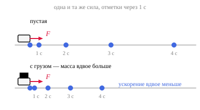

Толкни одинаково пустую тележку и тележку с покупками. Пустая разгонится быстрее. А теперь толкни пустую тележку вдвое сильнее — она разгонится ещё быстрее. В уроке 5.3 силы были уравновешены и скорость не менялась. Теперь равнодействующая не ноль. Насколько быстро тогда меняется скорость?

## Одна сила, разные массы

Приложим одну и ту же силу $2\ \text{Н}$ к пустой тележке массой $1\ \text{кг}$ и к тележке с грузом массой $2\ \text{кг}$. Обе стоят, трения нет. Отметим, где они через каждую секунду.

Обе тележки разгоняются: расстояния между отметками растут, как в уроке 2.1. Но у нагруженной всё идёт вдвое медленнее. По отметкам можно найти ускорения: у пустой $2\ \text{м/с}^2$, у нагруженной $1\ \text{м/с}^2$. Масса вдвое больше — ускорение вдвое меньше.

А если ту же тележку тянуть вдвое сильнее, ускорение будет вдвое больше. Опыты показывают: ускорение пропорционально силе и обратно пропорционально массе.

## Закон

**Второй закон Ньютона:** ускорение тела равно равнодействующей всех сил, делённой на массу тела:

$$
a = \frac{F}{m}, \qquad F = m a.
$$

- $F$ — равнодействующая **всех** сил, Н;
- $m$ — масса тела, кг;
- $a$ — ускорение, $\text{м/с}^2$.

Ускорение направлено туда же, куда равнодействующая.

Отсюда определение ньютона: $1\ \text{Н}$ — сила, которая телу массой $1\ \text{кг}$ сообщает ускорение $1\ \text{м/с}^2$. То есть $1\ \text{Н} = 1\ \text{кг} \cdot \text{м/с}^2$. Поэтому $\text{Н/кг}$ и $\text{м/с}^2$ из урока 5.2 — одно и то же: $g$ — это ускорение, которое сила тяжести $mg$ сообщает любому телу. Вот почему в уроке 3.1 все тела падали одинаково: чем больше масса, тем сильнее тянет Земля, но тем труднее разогнать тело.

Первый закон — частный случай второго. Если $F = 0$, то $a = 0$: скорость не меняется.

Поиграй с моделью. Меняй силу и массу и сравнивай отметки с прошлым запуском — они остаются бледными.

<pp-cart f="2" m="2" v0="0">Модель: тележка на гладких рельсах, на неё действует постоянная сила. Ускорение равно силе, делённой на массу: вдвое большая масса — вдвое меньшее ускорение. Если сила направлена против скорости, тележка тормозит, останавливается и едет назад.</pp-cart>

Задай силу против движения (отрицательную) и начальную скорость. Тележка тормозит, останавливается и едет назад: ускорение всё время смотрит по силе, а скорость сначала смотрела в другую сторону. Ускорение направлено по силе, а не по скорости.

## Сначала сложи силы

В формулу $a = F/m$ идёт **равнодействующая**, а не одна какая-то сила. Сначала сложи все силы, как в уроке 5.2, и только потом дели на массу.

**Пример.** Ящик массой $4\ \text{кг}$ тянут по полу с силой $14\ \text{Н}$, а трение тормозит его с силой $6\ \text{Н}$. Равнодействующая $14 - 6 = 8\ \text{Н}$ вперёд. Ускорение:

$$
a = \frac{8}{4} = 2\ \text{м/с}^2.
$$

Если бы ты взял только силу тяги, получил бы $3{,}5\ \text{м/с}^2$ — неверно.

<pp-task id="ks-newton-04"></pp-task>

Проверь себя: на тело действует постоянная сила. Массу тела уменьшили вдвое, а силу не меняли. Как изменилось ускорение?

Увеличилось вдвое: $a = F/m$, масса в знаменателе. Лёгкое тело та же сила разгоняет быстрее.

<pp-task id="ks-newton-13"></pp-task>

## От сил к движению

Второй закон даёт ускорение. А с ускорением ты уже умеешь всё: из урока 2.1 скорость $v = v_0 + at$, из уроков 2.3–2.5 путь $s = v_0 t + \dfrac{at^2}{2}$ и формулу $v^2 - v_0^2 = 2as$.

Так устроена почти любая задача динамики:

1. по силам найти ускорение: $a = F/m$;
2. по ускорению найти то, что спрашивают, формулами кинематики.

**Пример.** Велосипедист массой $80\ \text{кг}$ трогается с места. Равнодействующая всех сил $160\ \text{Н}$ вперёд. Какую скорость он наберёт за $4\ \text{с}$?

$$
a = \frac{160}{80} = 2\ \text{м/с}^2, \qquad v = a t = 2 \cdot 4 = 8\ \text{м/с}.
$$

<pp-task id="ks-newton-05"></pp-task>

## От движения к силам

Бывает и наоборот: известно, как тело движется, а спрашивают силу. Тогда идём в обратную сторону: по кинематике находим ускорение, а по нему — силу $F = ma$.

**Пример.** Лыжник массой $60\ \text{кг}$ съехал на ровный снег со скоростью $10\ \text{м/с}$ и остановился за $5\ \text{с}$. Какая сила его тормозила?

Ускорение по модулю $a = \dfrac{10 - 0}{5} = 2\ \text{м/с}^2$. Сила $F = ma = 60 \cdot 2 = 120\ \text{Н}$, направлена назад — против скорости.

<pp-task id="ks-newton-12"></pp-task>

## Частые ловушки

- **Взяли одну силу вместо равнодействующей.** Сначала сложи все силы.
- **«Ускорение направлено по скорости».** Ускорение направлено по равнодействующей. Тормозящее тело летит вперёд, а ускорение у него — назад.
- **Остановились на ускорении.** Если спрашивают скорость или путь, после $a = F/m$ нужен ещё шаг кинематики.
- **Умножили массу на скорость** вместо ускорения. $F = ma$, а не $mv$.

## Коротко

- Второй закон: $a = \dfrac{F}{m}$, где $F$ — равнодействующая всех сил. Ускорение направлено по равнодействующей.
- $1\ \text{Н} = 1\ \text{кг} \cdot \text{м/с}^2$; поэтому $g$ можно писать и в $\text{Н/кг}$, и в $\text{м/с}^2$.
- При $F = 0$ ускорение ноль — это первый закон.
- Схема задачи: силы → ускорение → движение. Или наоборот: движение → ускорение → сила.

Дальше — урок 5.5: если тело A действует на тело B, то и B действует на A. С какой силой?
