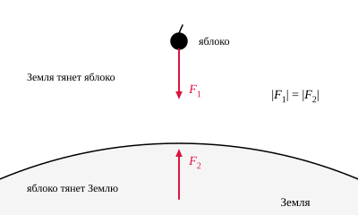
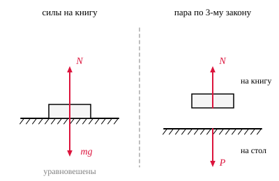

Ты в бассейне, упираешься ногами в стенку и толкаешь её. Стенка не сдвинулась, а ты уплыл. Тебя толкнуло — но кто? Ты толкал стенку, а не себя. Значит, стенка тоже толкнула тебя. В этом уроке разберёмся, с какой силой.

## Действие всегда взаимно

Вспомни папу и сына на льду из урока 5.1. Сын толкнул папу — и сам поехал назад. Папа ничего специально не делал, а всё равно поехал. Одно тело не может подействовать на другое «в одну сторону». Если A действует на B, то и B действует на A. Это и есть взаимодействие.

Опыты с динамометрами показывают: эти две силы всегда **равны по модулю** и **противоположны по направлению**.

**Третий закон Ньютона:** тела действуют друг на друга с силами, равными по модулю и противоположными по направлению:

$$
\vec F_1 = -\vec F_2.
$$

Здесь $\vec F_1$ — сила, с которой второе тело действует на первое, а $\vec F_2$ — сила, с которой первое тело действует на второе.

У этих сил есть ещё два свойства:

- они **одной природы**: если одна — притяжение, то и другая притяжение; если одна — сила упругости, то и другая;
- они приложены **к разным телам**: одна к первому, другая ко второму.

## Яблоко притягивает Землю

Земля притягивает яблоко. По третьему закону яблоко притягивает Землю — с такой же силой.

Почему же падает яблоко, а не Земля? Силы равны, а массы — нет. По второму закону ускорение равно силе, делённой на массу.

**Пример.** Земля притягивает тебя с силой $600\ \text{Н}$. Значит, и ты притягиваешь Землю с силой $600\ \text{Н}$. Твоё ускорение $600 / 60 = 10\ \text{м/с}^2$ — это $g$. А масса Земли около $6 \cdot 10^{24}\ \text{кг}$, и её ускорение

$$
a = \frac{600}{6 \cdot 10^{24}} = 10^{-22}\ \text{м/с}^2.
$$

Это так мало, что заметить невозможно. Сила та же — ускорение ничтожно. Так же и со стенкой в бассейне: стенка «приделана» ко всей Земле.

Это ещё одно объяснение опыта с конькобежцами из урока 5.1. Силы у папы и сына были равны, а скорости разные — из-за разных масс.

Проверь себя: боксёр бьёт по груше с силой 300 Н. С какой силой груша действует на кулак?

С той же силой, $300\ \text{Н}$, направленной навстречу кулаку. Поэтому боксёры бинтуют руки: удар достаётся и кулаку.

<pp-task id="ks-newton-06"></pp-task>

<pp-task id="ks-newton-14"></pp-task>

## Почему силы не уравновешивают друг друга

Если силы равны и противоположны, почему они не дают в сумме ноль? Тогда бы ничего никогда не двигалось.

Ответ — в словах «к разным телам». Складывать можно только силы, приложенные **к одному телу**. Сила $\vec F_1$ действует на яблоко и разгоняет яблоко. Сила $\vec F_2$ действует на Землю и «разгоняет» Землю. Друг другу они не мешают.

Вот классическая ловушка. Книга лежит на столе.

- Сила тяжести $mg$ и сила реакции опоры $N$ действуют **на книгу**. Они равны, потому что книга покоится, — это **первый** закон (урок 5.3). Это **не** пара из третьего закона: силы разной природы (притяжение и упругость), а действуют на одно тело.
- Пара по третьему закону для $N$ — это сила $P$, с которой книга давит **на стол**. Обе силы упругие, одна на книгу, другая на стол.
- А пара для силы тяжести $mg$ — это сила, с которой книга притягивает **Землю**.

Чтобы найти пару по третьему закону, поменяй местами слова: «стол давит на книгу» → «книга давит на стол».

## Лошадь и телега

Старый вопрос. Лошадь тянет телегу, телега тянет лошадь назад с такой же силой. Как же они едут?

Посмотри, какие силы действуют **на телегу**: лошадь тянет вперёд, дорога тормозит назад. Если лошадь тянет сильнее, телега разгоняется. Сила, с которой телега тянет лошадь, приложена к лошади — на телегу она не действует. Лошадь же отталкивается копытами от дороги, и дорога толкает её вперёд (третий закон!). Разгоняется ли система, решают силы на каждое тело в отдельности.

## Частые ловушки

- **«Маленькое тело действует слабее».** Нет: силы взаимодействия всегда равны. Разные только ускорения.
- **Сложили силы из третьего закона.** Они приложены к разным телам, складывать их нельзя.
- **Назвали парой $mg$ и $N$.** Это силы на одно тело и разной природы. Они равны только тогда, когда тело покоится на горизонтальной опоре.
- **«Сначала действует A, потом отвечает B».** Обе силы появляются и исчезают одновременно.

## Коротко

- Третий закон: $\vec F_1 = -\vec F_2$. Силы взаимодействия равны по модулю, противоположны по направлению.
- Они одной природы и приложены к разным телам, поэтому не уравновешивают друг друга.
- Силы равны, ускорения — нет: $a = F/m$, массивное тело почти не разгоняется.
- Пара по третьему закону: поменяй местами «кто на кого действует».

Дальше — урок 5.6: силы не обязаны лежать на одной прямой. Как тогда записать второй закон и как решать задачи с несколькими телами.
