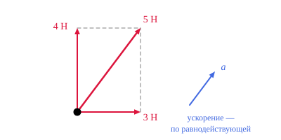
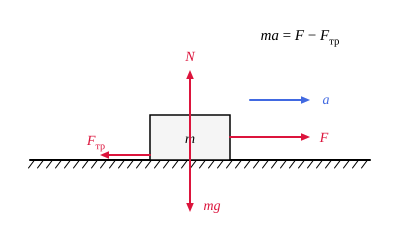
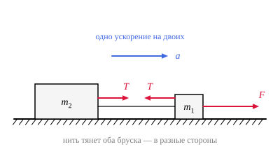

До сих пор все силы лежали на одной прямой: вперёд-назад или вверх-вниз. Но лодку можно тянуть двумя верёвками с разных берегов, а санки — за верёвку под углом. Куда тогда поедет тело? И как решать задачи, где тел два или три? В этом уроке соберём всё, что знаем, в один метод — им решают задачи ЕГЭ по динамике.

## Силы под углом

Силы — векторы (урок 5.2). Значит, складывать их надо **как векторы**, по правилу из урока 1.4. Самый частый случай — две перпендикулярные силы.

Достроим стрелки до прямоугольника. Равнодействующая — его диагональ. Её длину находим по теореме Пифагора:

$$
F = \sqrt{F_1^2 + F_2^2} = \sqrt{3^2 + 4^2} = 5\ \text{Н}.
$$

Если масса тела $0{,}5\ \text{кг}$, его ускорение $a = 5 / 0{,}5 = 10\ \text{м/с}^2$. И направлено оно **по диагонали**, а не по одной из сил.

Модули сил под углом **не складываются**: $3 + 4 = 7$ — неверно. Так же, как в уроке 4.6 не складывались скорости точки колеса.

<pp-task id="ks-newton-07"></pp-task>

## Второй закон в векторах

В общем виде второй закон Ньютона записывают так:

$$
m\vec a = \sum_i \vec F_i = \vec F_1 + \vec F_2 + \ldots
$$

Он верен в инерциальной системе отсчёта (урок 5.3) и для скоростей, много меньших скорости света.

Главное в этой записи — стрелки. Ускорение всегда направлено **по равнодействующей**, а не по скорости. Ты уже встречал это:

- брошенный вверх мяч летит вверх, а ускорение $g$ — вниз (урок 3.3): на мяч действует только сила тяжести;
- тело на окружности движется по касательной, а ускорение — к центру (урок 4.3).

Считать векторы неудобно. Поэтому, как в уроке 2.5, выбирают оси и пишут закон **для каждой оси отдельно**:

$$
m a_x = F_{1x} + F_{2x} + \ldots, \qquad m a_y = F_{1y} + F_{2y} + \ldots
$$

Проекция силы — со знаком: плюс, если сила смотрит по оси, минус — если против. Знаки решают всё.

## План решения

Почти любая задача на законы Ньютона решается по одному плану.

1. **Нарисуй тело и все силы**, которые на него действуют. Для каждой силы назови тело, которое её создаёт (урок 5.2). Не забудь силу тяжести.
2. **Выбери оси.** Удобно одну ось направить по ускорению, а другую — перпендикулярно.
3. **Запиши второй закон в проекциях** на каждую ось. Если по оси тело не ускоряется, сумма проекций на неё равна нулю (урок 5.3).
4. **Реши систему.**

На рисунке брусок тянут по столу. По вертикали он не ускоряется: $N - mg = 0$. По горизонтали: $ma = F - F_{\text{тр}}$. Как считать силу трения, разберём в следующей теме.

## Груз на тросе

Посмотрим на план в деле. Груз массой $2\ \text{кг}$ опускают на верёвке, и он движется вниз с ускорением $3\ \text{м/с}^2$. Найдём силу натяжения верёвки $T$.

1. Силы: верёвка тянет вверх с силой $T$, Земля — вниз с силой $mg$.
2. Ось $Oy$ — **вниз**, по ускорению.
3. Второй закон в проекции: $ma = mg - T$.
4. $T = m(g - a) = 2 \cdot (10 - 3) = 14\ \text{Н}$.

Сила натяжения меньше силы тяжести $20\ \text{Н}$ — так и должно быть: груз разгоняется вниз, значит, Земля тянет сильнее верёвки. Если бы груз разгонялся **вверх**, всё было бы наоборот: верёвка тянула бы сильнее Земли.

Проверь себя: тот же груз 2 кг опускают с постоянной скоростью. Чему равна сила натяжения?

Скорость постоянна, ускорение ноль: $T = mg = 20\ \text{Н}$. Это урок 5.3 — от направления движения сила не зависит.

<pp-task id="ks-newton-15"></pp-task>

## Связанные тела

Два бруска на гладком столе связаны лёгкой нерастяжимой нитью. Передний тянут силой $F$, и он тянет за собой задний.

Что тут важно:

- **нить нерастяжима** — бруски движутся вместе, ускорение у них **одно**;
- **нить лёгкая** — она тянет оба бруска с одинаковой силой $T$: задний вперёд, передний назад.

Второй закон пишем для **каждого** тела отдельно. Для заднего: $m_2 a = T$. Для переднего: $m_1 a = F - T$. Сложим уравнения — $T$ сократится:

$$
(m_1 + m_2)\, a = F, \qquad a = \frac{F}{m_1 + m_2}.
$$

Это удобный приём: сначала найти общее ускорение, рассматривая оба бруска как одно тело. Нить внутри этого «тела» не нужна. А силу натяжения найти потом — из уравнения для одного бруска, лучше того, на который действует меньше сил.

**Пример (как на ЕГЭ).** Бруски массами $m_1 = 1\ \text{кг}$ и $m_2 = 4\ \text{кг}$ лежат на гладком столе и связаны нитью. Передний брусок $m_1$ тянут горизонтальной силой $10\ \text{Н}$. Найди силу натяжения нити.

$$
a = \frac{10}{1 + 4} = 2\ \text{м/с}^2, \qquad T = m_2 a = 4 \cdot 2 = 8\ \text{Н}.
$$

Проверка по переднему бруску: $m_1 a = F - T$, то есть $1 \cdot 2 = 10 - 8$. Сходится.

Заметь: $T$ меньше $F$. Сила $F$ разгоняет оба бруска, а нить — только задний.

<pp-task id="ks-newton-08"></pp-task>

## Что заворачивает тело на окружности

В уроке 4.3 мы оставили вопрос: тело на окружности «хочет» лететь по касательной — что заворачивает его к центру? Теперь ответ ясен. Ускорение направлено к центру, $a = v^2/R$. По второму закону туда же направлена равнодействующая:

$$
F = m\frac{v^2}{R}.
$$

Камень на нити заворачивает нить, машину на повороте — трение шин о дорогу, Луну — притяжение Земли. Никакой особой «центробежной силы» в инерциальной системе нет: тело тянут **к** центру, а не от него.

**Пример.** Шайба массой $0{,}2\ \text{кг}$ на нити скользит по гладкому льду по окружности радиусом $0{,}5\ \text{м}$ со скоростью $2\ \text{м/с}$. Нить тянет её с силой $F = 0{,}2 \cdot \dfrac{2^2}{0{,}5} = 1{,}6\ \text{Н}$ — к центру.

## Частые ловушки

- **Сложили модули сил под углом.** Перпендикулярные силы — по Пифагору.
- **Подставили числа в векторную формулу без проекций.** Сначала оси, потом знаки, потом числа.
- **Натяжение равно внешней силе.** Нить тянет задний брусок, а $F$ разгоняет оба: $T < F$.
- **Натяжение троса равно $mg$, когда груз ускоряется.** $T = mg$ только при постоянной скорости.
- **Добавили «центробежную силу» или «силу инерции».** В инерциальной системе таких сил нет.

## Коротко

- $m\vec a = \sum \vec F$; ускорение направлено по равнодействующей, а не по скорости.
- Перпендикулярные силы: $F = \sqrt{F_1^2 + F_2^2}$.
- В проекциях: $m a_x = \sum F_x$, $m a_y = \sum F_y$.
- План: все силы → оси (одна по ускорению) → проекции → система уравнений.
- Связанные тела: ускорение общее, $a = F / (m_1 + m_2)$; натяжение — из уравнения для одного тела.
- На окружности равнодействующая направлена к центру: $F = mv^2/R$.

Это последний урок темы. Теперь ты умеешь по силам находить движение. Но откуда берутся сами силы и как их считать — сила упругости, сила трения, вес? Это следующая тема, «Силы в механике — упругость, трение, вес».
