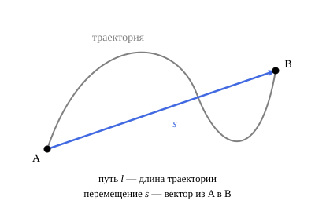

Кинематика отвечает на вопрос «как тело движется», не спрашивая «почему». Это фундамент всей механики: без неё не решить ни задачу 1 на ЕГЭ, ни половину задач второй части.

Начнём с самого простого — с того, что проходят в 7 классе, — и дойдём до векторов и проекций, на которых держится ЕГЭ. У каждого шага отмечен класс, в котором его проходят в школе. После шага есть задача. Она решается только тем, что уже прочитано выше, так что смело пробуй.

## Шаг 1. Путь, время и единицы (7 класс)

Машина едет, улитка ползёт, Земля летит вокруг Солнца. Во всех случаях тело со временем меняет положение относительно других тел. Это и есть **механическое движение**.

Линия, по которой движется тело, — **траектория**. След самолёта в небе, лыжня на снегу — это траектории. Длина траектории — **путь** $l$. Путь — просто число метров, он не бывает отрицательным.

В физике всё считают в единицах **СИ**: путь — в метрах, время — в секундах. Переводить приходится постоянно:

- $1\ \text{км} = 1000\ \text{м}$, $1\ \text{см} = 0{,}01\ \text{м}$;
- $1\ \text{мин} = 60\ \text{с}$, $1\ \text{ч} = 3600\ \text{с}$.

Скорость в задачах часто дают в километрах в час. Переведём $1\ \text{км/ч}$:

$$
1\ \frac{\text{км}}{\text{ч}} = \frac{1000\ \text{м}}{3600\ \text{с}} = \frac{1}{3{,}6}\ \frac{\text{м}}{\text{с}}.
$$

Правило: **из км/ч в м/с — делим на 3,6**, обратно — умножаем. $36\ \text{км/ч} = 10\ \text{м/с}$, $72\ \text{км/ч} = 20\ \text{м/с}$.

<pp-task id="ks-basics-01"></pp-task>

## Шаг 2. Равномерное движение: $s = vt$ (7 класс)

Поезд на прямом перегоне едет так, что каждую минуту проходит один и тот же километр. Такое движение — **равномерное**: за любые равные промежутки времени тело проходит равные пути.

**Скорость** показывает, какой путь тело проходит за единицу времени:

$$
v = \frac{s}{t}.
$$

Из неё — ещё две формы той же формулы:

$$
s = v t, \qquad t = \frac{s}{v}.
$$

- $s$ — путь, м;
- $v$ — скорость, м/с;
- $t$ — время, с.

Запоминать три формулы не нужно: это одна и та же связь. Если помнишь $s = vt$, остальные получаются делением.

Перед подстановкой проверь единицы. Скорость в км/ч и время в минутах вместе не живут: переведи что-то одно.

<pp-task id="ks-basics-02"></pp-task>

<pp-task id="ks-basics-03"></pp-task>

## Шаг 3. График пути (7 класс)

Движение удобно рисовать. По горизонтали — время $t$, по вертикали — пройденный путь $s$. При равномерном движении $s = vt$, и график — **прямая из начала координат**.

Чем быстрее тело, тем круче прямая: за ту же секунду оно набирает больше метров. Скорость можно прочитать прямо с графика: возьми любую точку на прямой и подели путь на время.

Если тело стоит, путь не растёт — график идёт горизонтально.

<pp-task id="ks-basics-04"></pp-task>

## Шаг 4. Средняя скорость (7 класс)

В жизни никто не едет с постоянной скоростью: светофоры, пробки, разгон. Тогда говорят о **средней скорости** — это весь путь, делённый на всё время:

$$
v_{\text{ср}} = \frac{l_{\text{весь}}}{t_{\text{всё}}}.
$$

Главная ловушка: средняя скорость — **не** среднее арифметическое скоростей на участках. Считай всегда в два шага: сначала время каждого участка по $t = s/v$, потом весь путь делить на всё время.

Почему так? На медленном участке тело проводит больше времени, и он «весит» больше.

<pp-task id="ks-basics-05"></pp-task>

Если получилось $50$ — посмотри ещё раз на эту ловушку. Её ставят на ЕГЭ постоянно.

## Шаг 5. Система отсчёта (9 класс)

Ты сидишь в поезде и читаешь. Для соседа по купе ты неподвижен. Для человека на платформе ты мчишься со скоростью поезда. Кто прав? Оба.

Движение всегда описывают **относительно чего-то**. Набор «тело отсчёта + система координат, связанная с ним + часы» называют **системой отсчёта**. Обычно это Земля, но иногда удобнее поезд, лодка или эскалатор.

Ещё одно упрощение: если размеры тела не важны в задаче, тело считают **материальной точкой**. Автомобиль на трассе между городами — точка. Тот же автомобиль, который паркуется задом в узкое место, — уже не точка.

Теперь уже мало сказать «тело проехало 5 метров». Важно — куда.

## Шаг 6. Перемещение — это вектор (9 класс)

Ты обошёл стадион по кругу и вернулся на старт. Прошёл $400$ метров, а оказался там же, где был.

Нужна величина, которая говорит, **где тело оказалось**, а не сколько оно прошло. Это **перемещение** $\vec s$ — стрелка из начальной точки в конечную.

Величины, у которых есть не только число, но и направление, называют **векторами**. Их рисуют стрелками и пишут со стрелкой сверху: $\vec s$. Длину стрелки называют **модулем** и пишут $|\vec s|$ или просто $s$.

- **Путь** $l$ — длина траектории, просто число.
- **Перемещение** $\vec s$ — вектор из начала в конец.

Всегда $l \ge |\vec s|$. Равенство — только если тело двигалось по прямой и не разворачивалось. После круга по стадиону путь $400\ \text{м}$, а перемещение равно нулю.

Векторы складывают «по цепочке»: конец первой стрелки — начало второй. Если стрелки перпендикулярны, модуль суммы находят по теореме Пифагора.

<pp-task id="ks-basics-06"></pp-task>

## Шаг 7. Ось и проекции (9 класс)

Со стрелками считать неудобно. Поэтому проводят **ось** $Ox$ и смотрят, как вектор на неё ложится. Длину «тени» вектора на оси со знаком называют **проекцией**: $s_x$, $v_x$.

- Вектор смотрит по оси — проекция **положительна**.
- Вектор смотрит против оси — проекция **отрицательна**.
- Вектор перпендикулярен оси — проекция равна нулю.

Положение тела на оси — **координата** $x$. Если тело переместилось из точки $x_0$ в точку $x$, проекция перемещения

$$
s_x = x - x_0.
$$

Минус в ответе — это не ошибка, а направление: тело сдвинулось против оси.

<pp-task id="ks-basics-07"></pp-task>

## Шаг 8. Уравнение равномерного движения (9 класс)

Соберём всё вместе. При равномерном движении по прямой проекция перемещения $s_x = v_x t$, а значит, координата меняется так:

$$
x(t) = x_0 + v_x t.
$$

- $x_0$ — начальная координата, м;
- $v_x$ — проекция скорости, м/с; она отрицательна, если тело едет против оси;
- $t$ — время, с.

Это та же формула $s = vt$ из шага 2, только теперь со знаками и с точкой старта. Зато с ней можно решать задачи, где тела едут навстречу или догоняют друг друга.

**Встреча двух тел** — это момент, когда их координаты равны: $x_1(t) = x_2(t)$. Пишешь два уравнения, приравниваешь, находишь $t$.

График $x(t)$ — прямая, наклон которой равен $v_x$. График $v_x(t)$ — горизонтальная линия, а площадь под ней равна перемещению.

<pp-task id="ks-basics-08"></pp-task>

## Шаг 9. Сложение скоростей (9 класс)

Ты идёшь по вагону к голове поезда со скоростью $1\ \text{м/с}$, поезд едет со скоростью $20\ \text{м/с}$. Относительно земли ты движешься со скоростью $21\ \text{м/с}$. Если идёшь к хвосту — $19\ \text{м/с}$.

В общем виде:

$$
\vec v = \vec v_{\text{отн}} + \vec v_{\text{пер}}.
$$

$\vec v$ — скорость относительно неподвижной системы (земли), $\vec v_{\text{отн}}$ — относительно подвижной (поезда), $\vec v_{\text{пер}}$ — скорость самой подвижной системы.

Это сумма **векторов**, как в шаге 6. Лодка плывёт поперёк реки, а течение сносит её вдоль — скорость относительно берега находят по теореме Пифагора.

Скорость одного тела относительно другого: $\vec v_{12} = \vec v_1 - \vec v_2$. Две машины едут навстречу друг другу по $60\ \text{км/ч}$ — они сближаются со скоростью $120\ \text{км/ч}$.

Правило верно для скоростей, много меньших скорости света. Для света оно не работает — об этом тема про СТО.

<pp-task id="ks-basics-09"></pp-task>

## Частые ловушки

- **Средняя скорость — не среднее арифметическое.** Считай через весь путь и всё время.
- **Путь и перемещение путают**, особенно когда тело разворачивается. Путь считают по участкам и складывают модули.
- **Забывают перевести км/ч в м/с.** Делить на $3{,}6$.
- **Знак проекции.** Тело едет против оси — $v_x < 0$, и координата уменьшается.

## Как это выглядит на ЕГЭ

*Велосипедист проехал первые $6\ \text{км}$ со скоростью $12\ \text{км/ч}$, а следующие $10\ \text{км}$ — со скоростью $20\ \text{км/ч}$. Найди среднюю скорость на всём пути.*

Не торопимся складывать скорости. Сначала время на каждом участке:

$$
t_1 = \frac{6}{12} = 0{,}5\ \text{ч}, \qquad t_2 = \frac{10}{20} = 0{,}5\ \text{ч}.
$$

Весь путь $16\ \text{км}$, всё время $1\ \text{ч}$. Средняя скорость:

$$
v_{\text{ср}} = \frac{16}{1} = 16\ \text{км/ч}.
$$

Здесь время на участках вышло одинаковым, поэтому ответ совпал со средним арифметическим. Это совпадение, а не правило: всегда считай через путь и время.

## Коротко

- $1\ \text{м/с} = 3{,}6\ \text{км/ч}$.
- Равномерное движение: $s = vt$; график $s(t)$ — прямая, её крутизна — скорость.
- $v_{\text{ср}} = l_{\text{весь}} / t_{\text{всё}}$.
- Движение описывают в системе отсчёта; в разных системах оно выглядит по-разному.
- Путь — длина траектории, перемещение — вектор из начала в конец, $l \ge |\vec s|$.
- Проекция положительна по оси и отрицательна против; $s_x = x - x_0$.
- $x = x_0 + v_x t$; встреча — когда $x_1 = x_2$.
- Сложение скоростей: $\vec v = \vec v_{\text{отн}} + \vec v_{\text{пер}}$.
