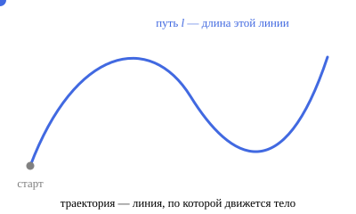
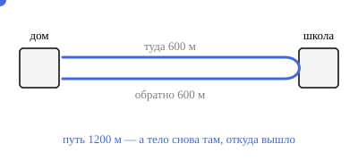
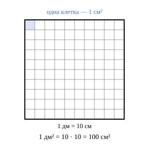

В этом уроке — первые слова механики: движение, траектория, путь, время. И инструмент, без которого не решается ни одна задача: перевод единиц.

Звучит скучно, но баллы на ЕГЭ часто теряют именно здесь. Формула верная, а ответ в $1000$ раз больше, потому что вместо метров подставили километры. Разберёмся так, чтобы перевод единиц стал делом пяти секунд.

## Что значит «тело движется»

Посмотри в окно автобуса. Дома, деревья, столбы уплывают назад. А пассажир напротив сидит неподвижно, хотя едет вместе с тобой.

Физики говорят так: **механическое движение** — это изменение положения тела **относительно других тел** с течением времени.

В этом определении важны две части.

- **«Относительно других тел».** Нельзя сказать просто «тело движется», нужно сказать, относительно чего. Пассажир неподвижен относительно автобуса и движется относительно дороги. Подробно об этом — в уроке 1.4.
- **«С течением времени».** Движение — это процесс. Чтобы его заметить, нужно сравнить, где было тело в один момент и где оно в другой.

Проверь себя: движется ли дом, в котором ты живёшь?

Относительно Земли — нет: он стоит на месте. Относительно Солнца — да: вместе с Землёй он летит по орбите со скоростью около $30$ километров в секунду. Оба ответа верны. Без слов «относительно чего» вопрос не имеет смысла.

## Траектория — след движения

Представь, что тело оставляет за собой след. Так бывает на самом деле: белая полоса за самолётом, лыжня на снегу, линия от бенгальского огня на фотографии с долгой выдержкой. Эта линия называется **траекторией**.

По форме траектории движение бывает двух видов:

- **прямолинейное** — траектория прямая: лифт, падающее яблоко, поезд на прямом перегоне;
- **криволинейное** — траектория кривая: брошенный мяч, машина на повороте, конец часовой стрелки.

## Путь — сколько метров «намотано»

Длина траектории называется **путём**. Обозначают его буквой $l$ («эль»), иногда $s$.

Удобно думать о пути как о счётчике шагов в телефоне. Пока ты идёшь, он только растёт: вперёд, назад, по кругу — каждый шаг прибавляется. Отсюда три свойства пути:

1. Путь — это число с единицей. Направления у него нет.
2. Путь не бывает отрицательным.
3. Путь со временем не уменьшается, даже если тело вернулось туда, откуда вышло.

Ты дошёл до школы ($600$ м) и вернулся домой. Путь — $1200$ м, хотя ты снова дома. Величину, которая говорит, где тело в итоге оказалось, называют перемещением. Её разберём в уроке 1.4.

<pp-task id="ks-basics-10"></pp-task>

## Время: момент и промежуток

Слово «время» в физике значит две разные вещи.

- **Момент времени** отвечает на вопрос «когда?»: в $8{:}15$, на пятой секунде, в момент старта.
- **Промежуток времени** отвечает на вопрос «как долго?»: урок длится $45$ минут, забег — $12$ секунд.

Промежуток — разница двух моментов. Вышел в $8{:}15$, пришёл в $8{:}35$ — значит, шёл $20$ минут. Промежуток обозначают буквой $t$ или $\Delta t$ («дельта тэ»). Греческая буква $\Delta$ в физике всегда значит «изменение», «разница».

В формулах этого урока и следующих $t$ — промежуток времени от начала движения.

## Величина = число × единица

«Длина дороги — 5». Пять чего? Метров, километров, шагов? Без единицы число в физике ничего не значит.

У каждой физической величины есть **числовое значение** и **единица**, и пишут их вместе: $l = 5\ \text{км}$. Отсюда главная мысль урока:

> **Единица — это множитель.** Запись $5\ \text{км}$ означает $5 \cdot (1\ \text{км})$, то есть пять раз по километру.

Сразу получается правило перевода. Чтобы выразить величину в других единицах, **замени единицу на то, чему она равна**:

$$
5\ \text{км} = 5 \cdot (1000\ \text{м}) = 5000\ \text{м}.
$$

Этот приём работает для любых единиц, даже самых хитрых. Дальше мы будем пользоваться только им.

## Зачем нужна система СИ

Раньше каждая страна мерила по-своему. На Руси длину мерили аршинами (около $71$ см), саженями и вёрстами (около $1{,}07$ км), в Англии — футами и милями. Купцы держали таблицы пересчёта, а ошибки стоили денег.

В конце XVIII века во Франции придумали **метрическую систему**. В ней метр и килограмм, а соседние единицы отличаются в $10$, $100$ или $1000$ раз. В 1960 году на её основе договорились о **Международной системе единиц — СИ**. Сейчас ею пользуется наука всего мира, и задачи ЕГЭ тоже.

В механике нужны три основные единицы СИ, ещё две появятся в других разделах:

| Величина | Единица | Обозначение |
|---|---|---|
| длина, путь | метр | м |
| масса | килограмм | кг |
| время | секунда | с |
| температура | кельвин | К |
| сила тока | ампер | А |

Остальные единицы собирают из основных. Например, единица скорости — метр в секунду, м/с.

Зачем это в задачах? **Формула физики даёт верный ответ, только если все величины подставлены в согласованных единицах.** Проще всего — когда все в СИ. Подставишь скорость в км/ч, а время в секундах — формула не сломается. Она молча выдаст бессмыслицу. Поэтому первое действие в любой задаче: выписать данные и перевести их в СИ.

Обрати внимание: основная единица массы — **кило**грамм, а не грамм. Масса $250\ \text{г}$ в СИ — это $0{,}25\ \text{кг}$.

## Степени десяти

Расстояние до Луны — около $384\,000\,000$ м, толщина волоса — около $0{,}00007$ м. Считать нули неудобно и легко ошибиться. Поэтому очень большие и очень маленькие числа записывают через **степени десяти**:

- $10^3 = 10 \cdot 10 \cdot 10 = 1000$ — единица и три нуля;
- $10^6 = 1\,000\,000$ — единица и шесть нулей;
- $10^0 = 1$;
- $10^{-3} = \dfrac{1}{10^3} = 0{,}001$ — единицу три раза разделили на $10$.

Показатель степени говорит, сколько раз умножить на $10$, а если он с минусом — сколько раз разделить.

Пригодится одно правило: **при умножении степени десяти их показатели складываются**.

$$
10^3 \cdot 10^3 = 10^{3+3} = 10^6, \qquad 10^{-2} \cdot 10^6 = 10^{-2+6} = 10^4.
$$

Умножить число на $10^n$ — значит сдвинуть запятую на $n$ знаков вправо. Разделить — на $n$ знаков влево. Не хватает цифр — дописываем нули: $2{,}5 \cdot 10^3 = 2500$, $2{,}5 \cdot 10^{-3} = 0{,}0025$.

Числа часто пишут в **стандартном виде**: одна цифра до запятой, остальное — степенью десяти. $384\,000\,000\ \text{м} = 3{,}84 \cdot 10^8\ \text{м}$, $0{,}00007\ \text{м} = 7 \cdot 10^{-5}\ \text{м}$.

## Приставки — короткая запись множителя

Приставка перед единицей — сокращённая запись множителя. «Кило» значит «тысяча»: $1\ \text{км} = 10^3\ \text{м}$, $1\ \text{кг} = 10^3\ \text{г}$. Главные приставки:

| Приставка | Обозначение | Множитель | Пример |
|---|---|---|---|
| гига | Г | $10^9$ | частота процессора — несколько гигагерц |
| мега | М | $10^6$ | мощность электростанции — сотни мегаватт |
| кило | к | $10^3$ | километр, килограмм |
| деци | д | $10^{-1}$ | $1\ \text{дм} = 10\ \text{см}$ |
| санти | с | $10^{-2}$ | сантиметр |
| милли | м | $10^{-3}$ | миллиметр, миллисекунда |
| микро | мк | $10^{-6}$ | толщина волоса — около $70$ мкм |
| нано | н | $10^{-9}$ | размер вируса — около $100$ нм |

Две ловушки в обозначениях:

- **М** (мега, миллион) и **м** (милли, тысячная) различаются только размером буквы. Мегаватт больше милливатта в $10^9$ раз — в миллиард.
- Буква «м» бывает и приставкой, и единицей. В «мм» первая «м» — милли, вторая — метр. «мс» — миллисекунда, а не «метр в секунду» (его пишут «м/с»).

Попробуй сам. Выбери единицы «из» и «в» и посмотри, на сколько ступенек нужно шагнуть по лестнице степеней десяти и куда при этом уходит запятая.

<pp-prefix value="2,5" from="к" to="м" unit="м">Здесь интерактивная модель перевода единиц с приставками — для неё нужен JavaScript.</pp-prefix>

## Как переводить единицы: три шага

Приём «замени единицу» работает всегда. Распишем его на примере: **сколько миллиметров в $0{,}35$ м?**

1. **Узнай, чему равна старая единица в новых.** $1\ \text{м} = 1000\ \text{мм}$.
2. **Подставь это вместо старой единицы.** $0{,}35\ \text{м} = 0{,}35 \cdot 1000\ \text{мм}$.
3. **Посчитай.** $0{,}35 \cdot 1000 = 350$. Значит, $0{,}35\ \text{м} = 350\ \text{мм}$.

Если шаг 1 сразу не получается, иди через единицу без приставки. Например, **сколько микрометров в $4$ мм?** Мы знаем, что $1\ \text{мм} = 10^{-3}\ \text{м}$ и $1\ \text{м} = 10^{6}\ \text{мкм}$. Значит,

$$
1\ \text{мм} = 10^{-3} \cdot 10^{6}\ \text{мкм} = 10^{3}\ \text{мкм}, \qquad 4\ \text{мм} = 4000\ \text{мкм}.
$$

Проверяй себя здравым смыслом: **единица мельче — число больше**, и наоборот. Миллиметр меньше метра, значит, миллиметров должно получиться больше, чем было метров. Вышло меньше — где-то перепутаны умножение и деление.

Проверь себя: 72 см — это сколько метров?

$1\ \text{см} = 0{,}01\ \text{м}$, поэтому $72\ \text{см} = 72 \cdot 0{,}01\ \text{м} = 0{,}72\ \text{м}$. Метр крупнее сантиметра, и число стало меньше — всё сходится.

<pp-task id="ks-basics-11"></pp-task>

## Время считают не десятками

С секундами приставки работают как обычно: $1\ \text{мс} = 10^{-3}\ \text{с}$. А вот минуты и часы устроены иначе: в них по $60$, а не по $10$ или $100$.

- $1\ \text{мин} = 60\ \text{с}$;
- $1\ \text{ч} = 60\ \text{мин} = 60 \cdot 60\ \text{с} = 3600\ \text{с}$;
- $1\ \text{сут} = 24\ \text{ч} = 86\,400\ \text{с}$.

Приём тот же — заменить единицу: $2{,}5\ \text{ч} = 2{,}5 \cdot 3600\ \text{с} = 9000\ \text{с}$.

Частая ошибка: **$1{,}5$ часа — это не «1 час 50 минут»**, а полтора часа, то есть $1$ ч $30$ мин. Дробная часть часа — это доля часа: $0{,}5\ \text{ч} = 30\ \text{мин}$, $0{,}1\ \text{ч} = 6\ \text{мин}$.

<pp-task id="ks-basics-12"></pp-task>

## Ловушка: квадратные и кубические единицы

Сколько квадратных сантиметров в одном квадратном дециметре? Хочется ответить «$10$», ведь $1\ \text{дм} = 10\ \text{см}$. Посмотри на рисунок:

В квадрате со стороной $1$ дм — $10$ рядов по $10$ клеток, всего $100$ квадратных сантиметров. Приём «замени единицу» даёт то же самое. Нужно лишь помнить, что квадратная единица — это единица, умноженная сама на себя:

$$
1\ \text{дм}^2 = (10\ \text{см})^2 = 10^2\ \text{см}^2 = 100\ \text{см}^2.
$$

Так же $1\ \text{м}^2 = (100\ \text{см})^2 = 10^4\ \text{см}^2$, а $1\ \text{см}^2 = 10^{-4}\ \text{м}^2$. С объёмом — куб: $1\ \text{м}^3 = (100\ \text{см})^3 = 10^6\ \text{см}^3$.

В задачах часто встречается **литр** — это кубический дециметр: $1\ \text{л} = 1\ \text{дм}^3 = 10^{-3}\ \text{м}^3$. А миллилитр — кубический сантиметр: $1\ \text{мл} = 1\ \text{см}^3$.

<pp-task id="ks-basics-13"></pp-task>

## Частые ловушки

- **Не перевели в СИ** перед подстановкой в формулу. Ответ отличается в $1000$ или $3600$ раз.
- **Перепутали умножение и деление** при переводе. Проверка: единица мельче — число больше.
- **Мега и милли.** М и м различаются в $10^9$ раз.
- **Граммы вместо килограммов.** В СИ масса — в килограммах.
- **Квадрат и куб.** $1\ \text{м}^2 = 10^4\ \text{см}^2$, а не $100$.
- **Дробные часы.** $1{,}5\ \text{ч}$ — это $1$ ч $30$ мин, а не $1$ ч $50$ мин.

## Коротко

- Механическое движение — изменение положения тела относительно других тел с течением времени.
- Траектория — линия, по которой движется тело. Путь $l$ — её длина: он не бывает отрицательным и со временем не уменьшается.
- Время бывает моментом («когда?») и промежутком («как долго?»).
- Величина = число × единица. Чтобы перевести, замени единицу на то, чему она равна.
- Основные единицы СИ в механике: метр, килограмм, секунда. Перед расчётом — всё в СИ.
- Приставки: Г $10^9$, М $10^6$, к $10^3$, д $10^{-1}$, с $10^{-2}$, м $10^{-3}$, мк $10^{-6}$, н $10^{-9}$.
- $1\ \text{ч} = 3600\ \text{с}$, $1\ \text{м}^2 = 10^4\ \text{см}^2$, $1\ \text{л} = 10^{-3}\ \text{м}^3$.

Дальше — урок 1.2: что такое скорость и откуда берётся правило «км/ч делим на $3{,}6$».
