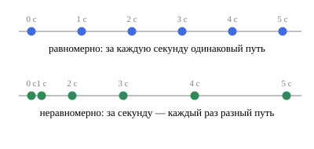
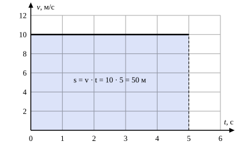

В уроке 1.1 мы научились измерять путь и время. Теперь соединим их в одну величину — скорость. С неё начинается почти каждая задача по механике.

## Кто быстрее?

Два бегуна. Первый пробежал $100$ м за $12$ с, второй — $100$ м за $15$ с. Кто быстрее? Конечно, первый: тот же путь он прошёл за меньшее время.

Теперь другая пара. За $10$ секунд один пробежал $80$ м, другой — $70$ м. Быстрее тот, кто за то же время прошёл больше.

А если и пути, и времена разные? Один пробежал $100$ м за $12{,}5$ с, другой $60$ м за $7{,}5$ с. Сравнить «на глаз» уже не получится. Нужен способ свести каждое движение к одному числу.

Идея простая: **посчитаем, какой путь тело проходит за одну секунду**. Первый бегун: $100 : 12{,}5 = 8$ м за каждую секунду. Второй: $60 : 7{,}5 = 8$ м. Они бегут одинаково быстро.

## Что показывает скорость

**Скорость** — это путь, пройденный за единицу времени:

$$
v = \frac{s}{t}.
$$

- $s$ — путь, м;
- $v$ — скорость, м/с;
- $t$ — время, с.

Единица скорости в СИ — **метр в секунду**, м/с. Читай её буквально: «сколько метров за каждую секунду». Скорость $8\ \text{м/с}$ значит, что каждую секунду тело проходит $8$ метров.

Из этого смысла сразу следуют ещё две формы той же формулы, и учить их отдельно не нужно.

- **Путь.** Тело проходит $8$ м каждую секунду. За $5$ секунд — $8 \cdot 5 = 40$ м. Значит, $s = vt$.
- **Время.** Нужно пройти $40$ м по $8$ м за секунду. Сколько раз по $8$ укладывается в $40$? Пять. Значит, $t = \dfrac{s}{v}$.

Проверить, что формула составлена верно, помогают единицы. В $s = vt$ справа $\dfrac{\text{м}}{\text{с}} \cdot \text{с} = \text{м}$ — получился путь, всё сходится. Если бы ты по ошибке написал $s = \dfrac{v}{t}$, вышли бы $\dfrac{\text{м}}{\text{с}^2}$, а это не метры.

<pp-task id="ks-basics-02"></pp-task>

## Равномерное движение

Вагон метро на перегоне, эскалатор, капля, которая медленно стекает по стеклу. Во всех этих случаях тело каждую секунду проходит один и тот же путь.

Такое движение называют **равномерным**: тело за **любые** равные промежутки времени проходит равные пути. Слово «любые» важно. Мало, чтобы совпадали пути за целые секунды: за каждую половину секунды и каждую десятую пути тоже должны быть равны.

Представь, что движение снимают со вспышкой раз в секунду. При равномерном движении отметки ложатся через равные промежутки. Если тело разгоняется, промежутки растут.

При равномерном движении скорость не меняется, и формула $s = vt$ верна для любого промежутка времени. Если движение неравномерное, $v = s/t$ даёт только **среднюю** скорость. О ней — урок 1.3.

## Километры в час и метры в секунду

На спидометре и дорожных знаках скорость в километрах в час. В задачах её почти всегда нужно перевести в СИ. Переведём $72\ \text{км/ч}$ приёмом «замени единицу» из урока 1.1. Километр — это $1000$ м, час — $3600$ с:

$$
72\ \frac{\text{км}}{\text{ч}} = 72 \cdot \frac{1000\ \text{м}}{3600\ \text{с}} = \frac{72}{3{,}6}\ \frac{\text{м}}{\text{с}} = 20\ \frac{\text{м}}{\text{с}}.
$$

Число $3{,}6$ появилось само: $3600 : 1000 = 3{,}6$. Отсюда правило:

> **Из км/ч в м/с — делим на $3{,}6$. Из м/с в км/ч — умножаем на $3{,}6$.**

Чтобы не перепутать, вспомни здравый смысл. Метр гораздо меньше километра, но и секунда гораздо меньше часа. Что перевешивает? За час машина проезжает $72$ км, а за одну секунду — всего $20$ метров. Число в м/с всегда **меньше**, чем в км/ч.

Полезно помнить несколько скоростей, чтобы проверять ответы:

| Что движется | м/с | км/ч |
|---|---|---|
| пешеход | $1{,}5$ | $5{,}4$ |
| велосипедист | $5$ | $18$ |
| автомобиль в городе | $15$ | $54$ |
| самолёт | $250$ | $900$ |
| звук в воздухе | $340$ | $1224$ |

Получилось, что велосипедист едет $300$ м/с? Значит, где-то ошибка в переводе.

Проверь себя: что больше — 36 км/ч или 12 м/с?

$36\ \text{км/ч} = 36 : 3{,}6 = 10\ \text{м/с}$. Значит, $12\ \text{м/с}$ больше. Сравнивать скорости можно только в одних единицах.

<pp-task id="ks-basics-01"></pp-task>

## Сначала единицы, потом формула

В задаче скорость дана в км/ч, а время — в минутах. Подставлять сразу нельзя: $72 \cdot 10 = 720$ — это не километры и не метры, а бессмыслица.

Есть два честных пути, оба дают верный ответ.

1. **Всё в СИ.** $72\ \text{км/ч} = 20\ \text{м/с}$, $10\ \text{мин} = 600\ \text{с}$. Тогда $s = 20 \cdot 600 = 12\,000\ \text{м}$.
2. **Согласовать единицы между собой.** Скорость в км/ч, значит время — в часах: $10\ \text{мин} = \dfrac{1}{6}\ \text{ч}$. Тогда $s = 72 \cdot \dfrac{1}{6} = 12\ \text{км}$.

Ответ один и тот же: $12\,000\ \text{м} = 12\ \text{км}$. Если сомневаешься, выбирай первый путь: в СИ ошибиться труднее.

<pp-task id="ks-basics-03"></pp-task>

<pp-task id="ks-basics-14"></pp-task>

## График пути

Движение удобно рисовать. По горизонтали откладывают время $t$, по вертикали — пройденный путь $s$. При равномерном движении $s = vt$: каждую секунду путь растёт на одно и то же число метров. Поэтому точки графика ложатся на **прямую, которая выходит из начала координат**.

Запусти машину в модели ниже. Потом поменяй скорость и запусти ещё раз: прошлый график останется пунктиром, и их можно сравнить.

<pp-uniform v="10">Здесь интерактивная модель равномерного движения — для неё нужен JavaScript.</pp-uniform>

Что видно на графике:

- **Чем больше скорость, тем круче прямая.** За ту же секунду быстрое тело набирает больше метров.
- **Скорость можно прочитать с графика.** Возьми любую точку на прямой и раздели её путь на её время. Удобнее брать точку на пересечении линий сетки.
- **Тело стоит — путь не растёт.** График идёт горизонтально.
- **Путь не убывает.** График пути никогда не идёт вниз: путь не бывает отрицательным и не уменьшается.

<pp-task id="ks-basics-04"></pp-task>

## График скорости

Можно нарисовать и скорость от времени. При равномерном движении скорость не меняется, поэтому график $v(t)$ — **горизонтальная прямая**.

На этом графике есть интересная вещь. Под прямой получается прямоугольник. Его высота — скорость $v$, ширина — время $t$, а площадь равна $v \cdot t$, то есть пройденному пути.

**Путь равен площади под графиком скорости.** Сейчас это просто другой способ посчитать $s = vt$. Но когда скорость начнёт меняться (тема «Равноускоренное движение»), формулы $s = vt$ уже не будет. А площадь под графиком по-прежнему будет давать путь.

## Частые ловушки

- **Не перевели км/ч в м/с.** Делить на $3{,}6$. В м/с число меньше.
- **Смешали единицы**: скорость в км/ч, время в секундах или минутах. Сначала согласуй единицы, потом подставляй.
- **Перевернули формулу.** Проверяй единицами: $\dfrac{\text{м}}{\text{с}} \cdot \text{с} = \text{м}$.
- **Прочитали значение с графика «на глаз»**, а точка не на линии сетки. Сначала найди скорость по удобной точке, потом считай.

## Коротко

- Скорость — путь за единицу времени: $v = \dfrac{s}{t}$, в СИ — м/с, «метров за каждую секунду».
- $s = vt$ и $t = \dfrac{s}{v}$ — та же связь. Проверяй формулы единицами.
- Равномерное движение — за любые равные промежутки времени равные пути.
- $1\ \text{м/с} = 3{,}6\ \text{км/ч}$: из км/ч в м/с — делим на $3{,}6$.
- График пути при равномерном движении — прямая из начала координат; чем круче, тем быстрее.
- График скорости — горизонтальная прямая; площадь под ним равна пути.

Дальше — урок 1.3: что делать, если скорость в пути менялась, и почему средняя скорость — не среднее арифметическое.
