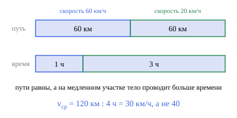

В жизни никто не едет с постоянной скоростью. Светофоры, пробки, разгон, остановки. Но спросить «с какой скоростью мы ехали?» всё равно хочется. На этот вопрос отвечает средняя скорость. И на ней ЕГЭ ловит больше всего учеников.

## Что такое средняя скорость

Ты ехал на дачу $2$ часа и проехал $120$ км. Где-то стояли в пробке, где-то неслись под $90$ км/ч. Но в итоге получилось так, как будто ты всю дорогу ехал ровно со скоростью $60$ км/ч. Это и есть средняя скорость.

**Средняя скорость** — весь путь, делённый на всё время движения:

$$
v_{\text{ср}} = \frac{l_{\text{весь}}}{t_{\text{всё}}}.
$$

Её смысл: **с такой постоянной скоростью тело прошло бы тот же путь за то же время**.

Два слова в определении важны.

- **Весь путь** — сумма путей на всех участках.
- **Всё время** — включая остановки. Если автобус $10$ минут стоял на остановке, эти $10$ минут входят во время, хотя путь за них не вырос.

## Главная ловушка

Машина проехала половину пути со скоростью $60$ км/ч, а вторую половину — со скоростью $20$ км/ч. Какая средняя скорость?

Рука сама пишет $\dfrac{60 + 20}{2} = 40$. Это неверно. Посчитаем честно. Длина пути не дана, но это не мешает: возьмём любую удобную, например $120$ км, по $60$ км на половину.

- Первая половина: $t_1 = \dfrac{60}{60} = 1$ ч.
- Вторая половина: $t_2 = \dfrac{60}{20} = 3$ ч.
- Средняя скорость: $v_{\text{ср}} = \dfrac{120}{1 + 3} = 30$ км/ч.

Не $40$, а $30$! Почему так? Посмотри, как делится время.

Половины пути равны, а времени на медленной половине ушло втрое больше. Большую часть поездки машина ехала медленно. Поэтому средняя скорость ближе к медленной, чем к быстрой.

> **Средняя скорость — не среднее арифметическое скоростей.** Медленные участки длятся дольше и «весят» больше.

А если взять другую длину пути, скажем $300$ км? Получится то же самое: $30$ км/ч. Длина сокращается, поэтому её можно выбирать любой.

## Когда среднее арифметическое всё-таки работает

Есть один случай, когда можно просто сложить скорости и поделить пополам. Это когда **равны не пути, а времена**.

Машина час ехала со скоростью $60$ км/ч и час — со скоростью $20$ км/ч. Путь: $60 + 20 = 80$ км, время: $2$ ч. Средняя скорость: $80 : 2 = 40$ км/ч. Ровно среднее арифметическое!

Так получилось потому, что оба участка «весят» одинаково: на каждый ушёл час. Но запоминать два случая не нужно. Считай всегда через путь и время, и ответ будет верным в любом случае.

Проверь себя: велосипедист 2 ч ехал со скоростью 15 км/ч и 1 ч — со скоростью 30 км/ч. Средняя скорость 22,5 км/ч?

Нет. Путь: $15 \cdot 2 + 30 \cdot 1 = 60$ км, время: $3$ ч, средняя скорость $60 : 3 = 20$ км/ч. Времена разные, поэтому среднее арифметическое не работает. Медленный участок длился дольше и потянул среднюю скорость вниз.

## Как считать: алгоритм

1. **Разбей движение на участки**, на каждом из которых скорость постоянна. Остановка — тоже участок, со скоростью $0$.
2. **Для каждого участка найди то, чего не хватает**: путь $s = vt$ или время $t = s/v$.
3. **Сложи все пути и все времена.**
4. **Раздели весь путь на всё время.**

Если путь не дан, возьми удобное число или обозначь его буквой: она сократится.

<pp-task id="ks-basics-05"></pp-task>

Если получилось $50$ — посмотри ещё раз на главную ловушку. Её ставят на ЕГЭ постоянно.

<pp-task id="ks-basics-15"></pp-task>

## Как это выглядит на ЕГЭ

*Велосипедист проехал первые $6\ \text{км}$ со скоростью $12\ \text{км/ч}$, а следующие $10\ \text{км}$ — со скоростью $20\ \text{км/ч}$. Найди среднюю скорость на всём пути.*

Не торопимся складывать скорости. Сначала время на каждом участке:

$$
t_1 = \frac{6}{12} = 0{,}5\ \text{ч}, \qquad t_2 = \frac{10}{20} = 0{,}5\ \text{ч}.
$$

Весь путь $16\ \text{км}$, всё время $1\ \text{ч}$. Средняя скорость:

$$
v_{\text{ср}} = \frac{16}{1} = 16\ \text{км/ч}.
$$

Здесь времена на участках вышли одинаковыми, поэтому ответ совпал со средним арифметическим $\dfrac{12 + 20}{2} = 16$. Мы только что разобрали, почему так бывает. Это совпадение, а не правило.

## Частые ловушки

- **Среднее арифметическое скоростей.** Работает, только если равны времена. Считай через весь путь и всё время.
- **Забыли остановку.** Время стоянки входит во всё время.
- **«Путь не дан — задачу не решить».** Возьми удобное число или букву: путь сократится.
- **Разные единицы на участках.** Одно время в минутах, другое в часах — сначала приведи к одному.

## Коротко

- $v_{\text{ср}} = \dfrac{l_{\text{весь}}}{t_{\text{всё}}}$ — с такой постоянной скоростью тело прошло бы тот же путь за то же время.
- Всё время включает остановки.
- Средняя скорость — не среднее арифметическое. Совпадает с ним, только когда времена участков равны.
- Алгоритм: участки → путь и время каждого → суммы → деление.

Дальше — урок 1.4: относительно чего движется тело и чем перемещение отличается от пути.
