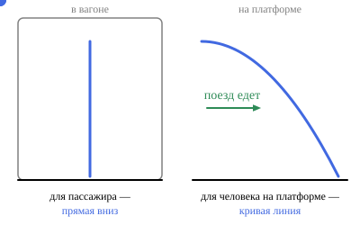
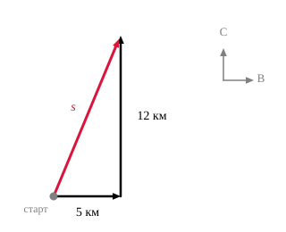

До сих пор мы говорили «тело проехало $5$ метров» и не уточняли ни откуда смотрим, ни куда оно проехало. Для задач 7 класса этого хватало. В 9 классе — нет: нужно знать, относительно чего движение и в какую сторону. Этот урок вводит три понятия, на которых держится вся кинематика ЕГЭ: систему отсчёта, материальную точку и перемещение.

## Одно движение — разные описания

Ты сидишь в поезде и читаешь. Для соседа по купе ты неподвижен. Для человека на платформе ты мчишься со скоростью поезда. Кто из них прав? Оба.

Ещё интереснее с траекторией. Пассажир роняет мяч. Для него мяч падает прямо вниз, к ногам. А человек на платформе видит другое: пока мяч падает, поезд вместе с мячом уезжает вперёд. Поэтому для него мяч летит по кривой.

Мяч один, падение одно, а траектории разные. Значит, траектория, путь и скорость зависят от того, **откуда** смотреть. Это свойство называют **относительностью движения**.

## Система отсчёта

Раз движение относительно, его нельзя описать, не договорившись, откуда смотрим. Для этого выбирают **систему отсчёта**. Она состоит из трёх частей.

1. **Тело отсчёта** — то, относительно чего описываем движение: Земля, поезд, берег реки.
2. **Система координат**, связанная с телом отсчёта. Она позволяет сказать числами, где находится тело: «в $30$ метрах к востоку от перекрёстка».
3. **Часы** — чтобы говорить, когда тело было в каждой точке.

Обычно тело отсчёта — Земля, и это не проговаривают. «Машина едет со скоростью $60$ км/ч» значит «относительно дороги». Но иногда удобнее другая система: поезд, лодка, эскалатор. Как переходить от одной системы к другой — урок 1.6.

## Материальная точка

Настоящие тела большие и сложные. У автомобиля крутятся колёса, у бегуна двигаются руки и ноги. Описывать движение каждой части — огромная работа. Часто она и не нужна.

Если размеры тела **не важны в задаче**, тело заменяют точкой, у которой есть масса. Это **материальная точка**.

- Автомобиль едет из Москвы в Тверь, $170$ км. Его длина — $4$ м, это ничтожно мало по сравнению с дорогой. Автомобиль — точка.
- Тот же автомобиль паркуется задом в узкое место. Теперь важен каждый сантиметр его длины. Он уже не точка.
- Земля, летящая вокруг Солнца, — точка: её размер примерно в $12\,000$ раз меньше радиуса орбиты.
- Земля, которая вращается вокруг своей оси, — не точка. Иначе не понять, почему в Москве день, а во Владивостоке ночь.

Так что «точка» — свойство не тела, а задачи. Одно и то же тело в одной задаче точка, а в другой — нет. В задачах ЕГЭ по кинематике тела почти всегда материальные точки.

Проверь себя: можно ли считать материальной точкой поезд длиной 300 м?

Зависит от задачи. Если поезд едет из Москвы в Петербург и нужно найти время в пути — да: $300$ м ничтожно мало по сравнению с $700$ км. Если нужно найти, за сколько секунд поезд проедет мост длиной $200$ м, — нет: поезд въезжает на мост головой, а съезжает хвостом, и его длина входит в ответ.

## Перемещение

Ты обошёл стадион по кругу и вернулся на старт. Прошёл $400$ метров, а оказался там же, где был. Путь — $400$ м. Но хочется величину, которая говорит, **где тело оказалось**, а не сколько оно прошло.

Такая величина — **перемещение** $\vec s$. Это стрелка, проведённая **из начального положения тела в конечное**. После круга по стадиону стрелку провести некуда: начало и конец совпали, перемещение равно нулю.

Попробуй сам. Выбери маршрут и проведи по нему тело. Синим отмечен пройденный путь, красная стрелка — перемещение.

<pp-path track="stadium">Здесь интерактивная модель «путь и перемещение» — для неё нужен JavaScript.</pp-path>

Что видно в модели:

- **Путь только растёт**, а перемещение может и уменьшаться. На обратной дороге путь прибавляется, а стрелка перемещения становится короче.
- **Путь всегда не меньше модуля перемещения**: $l \ge |\vec s|$. Прямая — кратчайшая линия между двумя точками, а перемещение и есть отрезок прямой.
- **Равенство $l = |\vec s|$** — только при движении по прямой без разворотов.

Чтобы не путать: путь — это то, что насчитает шагомер. Перемещение — то, что увидит спутник, если сравнит две фотографии: где ты был и где стал.

<pp-task id="ks-basics-16"></pp-task>

## Что такое вектор

У перемещения есть не только величина («$300$ метров»), но и направление («на север»). Такие величины называют **векторами**. Их рисуют стрелками и обозначают буквой со стрелкой сверху: $\vec s$.

- **Модуль** вектора — длина стрелки, просто число. Его пишут $|\vec s|$ или просто $s$ без стрелки.
- **Направление** — куда смотрит стрелка.

Величины, у которых есть только число, называют **скалярами**. Их можно складывать как обычные числа.

| Скаляры | Векторы |
|---|---|
| путь, время, масса, температура | перемещение, скорость, ускорение, сила |

Запомни: путь — скаляр, перемещение — вектор. Скорость в физике — тоже вектор. Она показывает и как быстро, и куда движется тело.

## Сложение векторов

Ты прошёл $5$ км на восток, а потом $12$ км на север. Где ты оказался?

Векторы складывают **по цепочке**: начало второй стрелки ставят в конец первой. Сумма — стрелка из начала первой в конец второй.

Получился прямоугольный треугольник. Перемещение — его гипотенуза, и её длину находят по теореме Пифагора:

$$
|\vec s| = \sqrt{5^2 + 12^2} = \sqrt{25 + 144} = \sqrt{169} = 13\ \text{км}.
$$

Путь при этом $5 + 12 = 17$ км. Он, как и должно быть, больше перемещения.

Ещё два случая встречаются в задачах постоянно.

- **Векторы в одну сторону** — модули складываются. $3$ км на восток и ещё $2$ км на восток — это $5$ км на восток.
- **Векторы в противоположные стороны** — модули вычитаются. $3$ км на восток и $2$ км на запад — это $1$ км на восток. А путь — $5$ км.

<pp-task id="ks-basics-06"></pp-task>

## Частые ловушки

- **Путают путь и перемещение**, особенно когда тело разворачивается. Путь считают по участкам и складывают все длины. Перемещение — только отрезок от начала до конца.
- **Складывают векторы как числа.** $6$ км на север и $8$ км на восток — это не $14$ км перемещения. Числа складывают, только если векторы смотрят в одну сторону.
- **Забывают про систему отсчёта.** «Скорость $5$ м/с» — относительно чего? Если в задаче есть поезд, река или эскалатор, это главный вопрос.
- **Считают тело точкой, когда его размер важен**: поезд на мосту, автомобиль на парковке.

## Коротко

- Движение относительно: траектория, путь и скорость зависят от системы отсчёта.
- Система отсчёта — тело отсчёта, связанная с ним система координат и часы.
- Материальная точка — тело, размерами которого в этой задаче можно пренебречь.
- Перемещение $\vec s$ — вектор из начального положения в конечное. Путь — длина траектории.
- $l \ge |\vec s|$; равенство — только по прямой без разворотов.
- Векторы складывают по цепочке. Перпендикулярные — по теореме Пифагора.

Дальше — урок 1.5: как описать вектор числами с помощью оси и проекций и записать уравнение движения.
