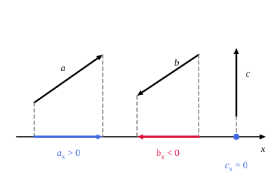
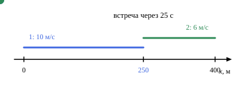
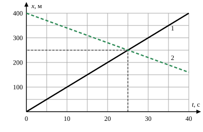

В уроке 1.4 перемещение стало стрелкой. Стрелки хорошо рисовать, но считать с ними неудобно. В этом уроке мы заменим стрелку обычным числом — только со знаком. С этим числом получится главная формула кинематики ЕГЭ: уравнение движения. Оно отвечает сразу на два вопроса: где тело будет в любой момент и когда встретятся два тела.

## Координатная ось

Машина едет по прямому шоссе. Чтобы сказать числом, где она, нужно договориться о трёх вещах.

1. **Начало отсчёта** — точка, где координата равна нулю. Например, автобусная остановка.
2. **Направление оси** — в какую сторону координаты растут. Например, в сторону города.
3. **Единица** — в метрах, как всегда в СИ.

Теперь положение машины — одно число, **координата** $x$. Машина в $300$ м от остановки в сторону города: $x = 300$ м. В $200$ м в другую сторону: $x = -200$ м. Минус — не ошибка, он значит «по другую сторону от начала».

Ось можно направить куда угодно, и начало поставить где угодно. Ответ на вопрос задачи от этого не изменится. Изменятся только числа по дороге. Выбирай так, чтобы считать было удобно: обычно начало — там, где тело в начальный момент, а ось — по его движению.

## Проекция вектора

Положи вектор над осью и посвети на него сверху. Его «тень» на оси — отрезок. Длину этой тени **со знаком** называют **проекцией** вектора на ось. Проекцию вектора $\vec a$ на ось $Ox$ пишут $a_x$.

- Вектор смотрит **по оси** — проекция **положительна**.
- Вектор смотрит **против оси** — проекция **отрицательна**.
- Вектор **перпендикулярен** оси — тени нет, проекция **равна нулю**.

В этом уроке все движения — вдоль одной прямой, и ось мы направляем вдоль неё. Тогда проекция вектора — это просто его модуль со знаком: «$+$», если вектор смотрит по оси, и «$-$», если против. Вектор $5$ м по оси — проекция $+5$ м. Вектор $5$ м против оси — проекция $-5$ м.

Так стрелка превратилась в число. Знак хранит направление, а модуль — длину.

## Перемещение через координаты

Тело было в точке $x_0$, а оказалось в точке $x$. Проекция его перемещения — **конечная координата минус начальная**:

$$
s_x = x - x_0.
$$

Проверим на примере. Машина была в точке $x_0 = 100$ м и приехала в точку $x = 400$ м. $s_x = 400 - 100 = 300$ м — она сдвинулась на $300$ м по оси, всё верно. А если наоборот, из $400$ в $100$? $s_x = 100 - 400 = -300$ м: те же $300$ м, но против оси.

Порядок важен: всегда **«конец минус начало»**. Так проекция сама получает правильный знак.

Проверь себя: тело перешло из точки −2 м в точку 6 м. Какой знак у проекции перемещения?

$s_x = 6 - (-2) = 8$ м, знак плюс: тело сдвинулось по оси на $8$ метров. Будь внимателен с минусом начальной координаты: минус на минус даёт плюс.

<pp-task id="ks-basics-07"></pp-task>

## Скорость со знаком

Скорость — тоже вектор: у неё есть направление. Её проекцию на ось пишут $v_x$. Правило знаков то же самое.

- Машина едет по оси со скоростью $15$ м/с: $v_x = 15$ м/с.
- Машина едет против оси со скоростью $15$ м/с: $v_x = -15$ м/с.

Слово «скорость» в задачах значит модуль, оно всегда положительное. Проекция $v_x$ бывает и отрицательной. Скорость $-15$ м/с не бывает, а проекция скорости $-15$ м/с — бывает.

## Уравнение движения

При равномерном движении проекция перемещения за время $t$ равна $s_x = v_x t$. Это та же формула $s = vt$ из урока 1.2, только со знаком. А раз $s_x = x - x_0$, получаем:

$$
x - x_0 = v_x t \quad \Rightarrow \quad x = x_0 + v_x t.
$$

Это **уравнение равномерного движения**. Оно говорит, где тело будет в любой момент времени.

- $x_0$ — начальная координата: где тело было при $t = 0$, м;
- $v_x$ — проекция скорости, м/с; минус, если тело едет против оси;
- $t$ — время от начала отсчёта, с;
- $x$ — координата в момент $t$, м.

**Пример.** Велосипедист в начальный момент в точке $x_0 = 100$ м и едет против оси со скоростью $5$ м/с. Тогда $v_x = -5$ м/с и

$$
x = 100 - 5t.
$$

Где он будет через $8$ с? $x = 100 - 5 \cdot 8 = 60$ м. А когда проедет начало координат? Там $x = 0$: $0 = 100 - 5t$, значит $t = 20$ с.

В задачах ЕГЭ уравнение часто дают готовым, например $x = 12 - 4t$. Сравни его с общим видом $x = x_0 + v_x t$: число без $t$ — это $x_0 = 12$ м, число перед $t$ — это $v_x = -4$ м/с. Значит, тело стартует в точке $12$ м и едет против оси со скоростью $4$ м/с.

<pp-task id="ks-basics-17"></pp-task>

## График координаты

График $x(t)$ при равномерном движении — **прямая**.

- Где прямая пересекает ось $x$ (при $t = 0$) — там $x_0$, начальная координата.
- **Наклон** прямой — это проекция скорости: на сколько метров меняется $x$ за секунду.
- Прямая **идёт вверх** — $v_x > 0$, тело едет по оси. **Идёт вниз** — $v_x < 0$, едет против оси. **Горизонтальна** — тело стоит.

Не путай с графиком пути из урока 1.2. Путь никогда не убывает, поэтому график пути не идёт вниз. Координата может уменьшаться, если тело едет против оси.

## Встреча двух тел

Два автомобиля едут навстречу друг другу. Первый стартует из точки $0$ со скоростью $10$ м/с по оси, второй — из точки $400$ м со скоростью $6$ м/с против оси. Где и когда они встретятся?

Встретиться — значит оказаться **в одной точке в один момент**, то есть иметь одинаковые координаты. План решения такой.

1. **Запиши уравнение для каждого тела.** $x_1 = 0 + 10t = 10t$; $x_2 = 400 - 6t$ (минус: второй едет против оси).
2. **Приравняй координаты.** $10t = 400 - 6t$.
3. **Найди время.** $16t = 400$, $t = 25$ с.
4. **Подставь время, чтобы найти место.** $x = 10 \cdot 25 = 250$ м. Проверка по второму: $400 - 6 \cdot 25 = 250$ м, совпало.

На графике это видно сразу. У каждого автомобиля своя прямая $x(t)$, и встреча — **точка пересечения** прямых: её абсцисса — время встречи, ордината — место.

Тот же метод работает и для догонялок: один едет за другим быстрее, и надо найти, когда догонит. Тоже приравниваем координаты. Ещё один способ, через скорость сближения, — в уроке 1.6.

<pp-task id="ks-basics-08"></pp-task>

## Частые ловушки

- **Потеряли знак.** Тело едет против оси — $v_x < 0$, в уравнении будет минус.
- **«Начало минус конец».** Правильно $s_x = x - x_0$: конец минус начало.
- **Путают координату и путь.** Координата может быть отрицательной и уменьшаться. Путь — нет.
- **Нашли время встречи, а спрашивали место.** Подставь время в любое из уравнений.
- **Неправильно прочитали готовое уравнение.** В $x = 12 - 4t$ проекция скорости $-4$, а не $4$.

## Коротко

- Координата $x$ — положение тела на оси, число со знаком.
- Проекция вектора — длина его «тени» на оси со знаком: по оси «$+$», против «$-$», поперёк $0$.
- $s_x = x - x_0$ — конец минус начало.
- Уравнение равномерного движения: $x = x_0 + v_x t$.
- График $x(t)$ — прямая: начинается в $x_0$, наклон равен $v_x$.
- Встреча — равенство координат: $x_1(t) = x_2(t)$; на графике — пересечение прямых.

Дальше — урок 1.6: как движение выглядит из движущегося поезда или лодки и как складывать скорости.
