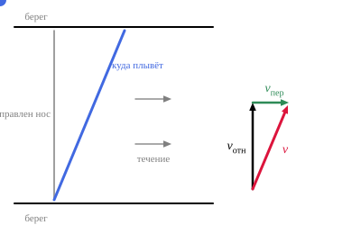

В уроке 1.4 мы выяснили, что движение выглядит по-разному из разных систем отсчёта. Пассажир неподвижен относительно поезда и мчится относительно Земли. Теперь научимся пересчитывать скорость из одной системы в другую. Это нужно в задачах про поезда, реки, эскалаторы и ветер, и они есть на ЕГЭ каждый год.

## Эскалатор

Эскалатор в метро едет со скоростью $1$ м/с.

- Ты **стоишь** на ступеньке. Относительно эскалатора ты неподвижен, а относительно стен поднимаешься со скоростью $1$ м/с: тебя везёт эскалатор.
- Ты **идёшь вверх** со скоростью $0{,}5$ м/с относительно ступенек. Теперь каждую секунду эскалатор поднимает тебя на $1$ м, и ещё на $0{,}5$ м ты поднимаешься сам. Относительно стен — $1{,}5$ м/с.
- Ты **бежишь вниз** по эскалатору, который едет вверх, со скоростью $1$ м/с относительно ступенек. Эскалатор поднимает тебя на $1$ м за секунду, а ты спускаешься на $1$ м. Относительно стен ты стоишь на месте, как на беговой дорожке.

Во всех трёх случаях скорость относительно стен — это **твоя скорость относительно ступенек плюс скорость самих ступенек**. Это и есть закон сложения скоростей.

## Закон сложения скоростей

Удобно говорить о двух системах отсчёта.

- **Неподвижная** — обычно Земля, берег, стены.
- **Подвижная** — то, что само едет: поезд, вода в реке, эскалатор.

У тела есть три скорости, и у каждой своё название.

- $\vec v$ — скорость тела **относительно неподвижной** системы (относительно земли).
- $\vec v_{\text{отн}}$ — скорость тела **относительно подвижной** системы (относительно поезда, воды). Её называют **относительной**.
- $\vec v_{\text{пер}}$ — скорость **самой подвижной системы** относительно неподвижной (поезда, течения). Её называют **переносной**: она «переносит» тело вместе с собой.

Закон сложения скоростей:

$$
\vec v = \vec v_{\text{отн}} + \vec v_{\text{пер}}.
$$

Главное в любой такой задаче — правильно назвать подвижную систему. Спроси себя: **что везёт тело?** Поезд везёт пассажира, река — лодку, ветер — самолёт. Это и есть подвижная система, а её скорость — переносная.

## Вдоль одной прямой

Если все скорости направлены вдоль одной прямой, векторы складываются со знаками, как в уроке 1.5.

- **В одну сторону** — модули складываются. Ты идёшь по вагону к голове поезда со скоростью $1$ м/с, поезд едет со скоростью $20$ м/с. Относительно земли: $20 + 1 = 21$ м/с.
- **В противоположные стороны** — модули вычитаются. Идёшь к хвосту: $20 - 1 = 19$ м/с, всё ещё вперёд по ходу поезда.

Классика ЕГЭ — **лодка на реке**. Скорость лодки в стоячей воде $5$ м/с, течение $2$ м/с. По течению лодка плывёт относительно берега со скоростью $5 + 2 = 7$ м/с, против течения — $5 - 2 = 3$ м/с. Если путь туда и обратно одинаковый, обратно лодка плывёт дольше.

Проверь себя: может ли лодка, плывущая против течения, двигаться назад относительно берега?

Да, если течение быстрее, чем лодка плывёт относительно воды. Скорость лодки $2$ м/с, течение $3$ м/с: $2 - 3 = -1$ м/с. Лодка смотрит носом вверх по реке, работает мотором, а её всё равно сносит вниз со скоростью $1$ м/с.

## Скорость одного тела относительно другого

Часто нужно знать, как одно тело движется относительно другого: как быстро сближаются два поезда или как догоняет машина. Тогда второе тело и есть подвижная система. Скорость первого тела относительно второго:

$$
\vec v_{12} = \vec v_1 - \vec v_2.
$$

Вдоль одной прямой это даёт два простых правила.

- **Навстречу** — скорость сближения равна **сумме** модулей. Две машины едут навстречу по $60$ км/ч, сближаются со скоростью $120$ км/ч.
- **В одну сторону** — скорость сближения равна **разности** модулей. Машина $90$ км/ч догоняет грузовик $60$ км/ч, приближается к нему со скоростью $30$ км/ч.

Это быстрый способ решать задачи на встречу. Вспомни пример из урока 1.5: автомобили в $400$ м друг от друга едут навстречу со скоростями $10$ и $6$ м/с. Они сближаются со скоростью $10 + 6 = 16$ м/с, значит встретятся через $400 : 16 = 25$ с. Тот же ответ, и без уравнений.

<pp-task id="ks-basics-18"></pp-task>

## Под углом: лодка поперёк реки

Лодка плывёт через реку и держит нос строго поперёк, на другой берег. Скорость лодки относительно воды $1{,}2$ м/с, течение $0{,}5$ м/с. Куда и с какой скоростью она поплывёт?

Вода везёт лодку вдоль берега, мотор толкает её поперёк. Скорости перпендикулярны, и складываются они как векторы в уроке 1.4 — по цепочке.

Получился прямоугольный треугольник, и скорость относительно берега — его гипотенуза:

$$
v = \sqrt{v_{\text{отн}}^2 + v_{\text{пер}}^2} = \sqrt{1{,}2^2 + 0{,}5^2} = \sqrt{1{,}44 + 0{,}25} = \sqrt{1{,}69} = 1{,}3\ \text{м/с}.
$$

Лодка плывёт не поперёк, а наискосок, и причаливает ниже по течению. Тут есть красивое следствие. Если ширина реки $60$ м, лодка пересечёт её за $60 : 1{,}2 = 50$ с. Течение на это время **не влияет**: оно сносит лодку вдоль берега, а не мешает плыть поперёк. За эти $50$ с лодку снесёт на $0{,}5 \cdot 50 = 25$ м.

<pp-task id="ks-basics-09"></pp-task>

## Где закон не работает

Закон сложения скоростей верен для всех скоростей, с которыми мы сталкиваемся в жизни. Но для очень быстрых тел, близких к скорости света, он перестаёт работать. Свет летит со скоростью $300\,000$ км/с, и его скорость одинакова в любой системе отсчёта: хоть догоняй его, хоть лети навстречу. Как так получается — в теме про специальную теорию относительности. В задачах по механике смело складывай скорости.

## Частые ловушки

- **Не ту систему назвали подвижной.** Спроси: что везёт тело? Его скорость — переносная.
- **Сложили модули перпендикулярных скоростей.** Поперёк и вдоль складывают по теореме Пифагора, а не числами.
- **Перепутали сумму и разность** при сближении. Навстречу — сумма, вдогонку — разность.
- **Забыли длину тела.** Поезд проезжает мимо окна или по мосту — его длина входит в путь.
- **Разные единицы.** Скорость поезда в км/ч, длина в метрах — переведи в СИ.

## Коротко

- Закон сложения скоростей: $\vec v = \vec v_{\text{отн}} + \vec v_{\text{пер}}$. Подвижная система — то, что везёт тело.
- Вдоль одной прямой: в одну сторону модули складываются, в разные — вычитаются.
- Скорость одного тела относительно другого: $\vec v_{12} = \vec v_1 - \vec v_2$. Навстречу — сумма модулей, вдогонку — разность.
- Перпендикулярные скорости складывают по теореме Пифагора. Время переправы зависит только от скорости поперёк реки.
- Для скоростей, близких к скорости света, закон не работает.

Это последний урок темы. Ты прошёл всю основу кинематики: от перевода единиц до сложения скоростей. Дальше — тема «Равноускоренное движение», где скорость начинает меняться.
