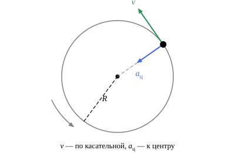

Колесо велосипеда, карусель, стрелка часов, спутник на орбите — всё это движение по окружности. Тема встречается в задаче 1, в задачах 5–6, а позже понадобится для спутников, силы Лоренца и колебаний.

Начнём с того, что можно посчитать секундомером, — сколько оборотов и за какое время. Потом перейдём к скорости и к самому неожиданному: ускорению у тела, скорость которого «не меняется».

## Шаг 1. Период и частота (9 класс)

Карусель делает круг за $10$ секунд. Колесо велосипеда — два оборота в секунду. Чтобы описать вращение, хватает двух чисел.

**Период** $T$ — время одного полного оборота, с.

**Частота** $\nu$ — число оборотов за секунду. Единица — герц: $1\ \text{Гц} = 1\ \text{об/с} = 1\ \text{с}^{-1}$.

Если тело сделало $N$ оборотов за время $t$:

$$
T = \frac{t}{N}, \qquad \nu = \frac{N}{t} = \frac{1}{T}.
$$

Период и частота — обратные числа: быстрее крутится — меньше период, больше частота.

<pp-task id="ks-circ-01"></pp-task>

## Шаг 2. Линейная скорость (9 класс)

Точка на краю карусели за один оборот проходит длину окружности $2\pi R$ и тратит на это период $T$. Значит, её скорость

$$
v = \frac{2\pi R}{T} = 2\pi R \nu.
$$

Это обычная скорость «путь делить на время» из темы «Основы кинематики». Её называют **линейной**, чтобы не путать с угловой (о ней в следующем шаге).

Скорость в каждый момент направлена по **касательной** к окружности. Если карусель вдруг отпустит тебя, ты полетишь по касательной, а не от центра. Искры от точильного круга летят именно так.

<pp-task id="ks-circ-02"></pp-task>

## Шаг 3. Скорость не меняется, а ускорение есть (9 класс)

Ты едешь на карусели. Скорость по модулю одна и та же, но тебя всё время тянет наружу, а держаться приходится изо всех сил. Почему?

Вспомним: ускорение — это изменение **вектора** скорости, $\vec a = \Delta\vec v / \Delta t$. При движении по окружности модуль скорости постоянный, но **направление** всё время меняется. А раз меняется вектор скорости — есть ускорение.

При равномерном движении по окружности ускорение направлено **к центру**. Его называют **центростремительным**:

$$
a_{\text{ц}} = \frac{v^2}{R}.
$$

- $v$ — линейная скорость, м/с;
- $R$ — радиус окружности, м.

Скорость направлена по касательной, ускорение — к центру, они перпендикулярны. Поэтому ускорение поворачивает скорость, но не меняет её модуль.

<pp-task id="ks-circ-03"></pp-task>

## Шаг 4. Угловая скорость (10 класс)

Все точки вращающегося диска делают оборот за одно и то же время. Значит, у них **одинаковые** $T$ и $\nu$. А линейная скорость разная: край пластинки проходит за оборот большую окружность, чем точка у центра.

Чтобы описать вращение одним числом для всего тела, вводят **угловую скорость** $\omega$ — угол поворота за секунду. Углы здесь меряют в радианах: полный оборот — $2\pi$ радиан.

$$
\omega = \frac{\Delta\varphi}{\Delta t} = \frac{2\pi}{T} = 2\pi\nu.
$$

Связь с линейной скоростью:

$$
v = \omega R.
$$

Одинаковая $\omega$ — у всех точек тела, а линейная скорость тем больше, чем дальше точка от оси.

<pp-task id="ks-circ-04"></pp-task>

## Шаг 5. Ускорение через угловую скорость (10 класс)

Подставим $v = \omega R$ в формулу ускорения:

$$
a_{\text{ц}} = \frac{v^2}{R} = \omega^2 R.
$$

Какой формулой пользоваться, зависит от того, что одинаково:

- для точек **одного вращающегося тела** одинакова $\omega$ — бери $a = \omega^2 R$: ускорение растёт с радиусом;
- для тел с **одинаковой линейной скоростью** (машина проходит повороты на одной скорости) бери $a = v^2/R$: чем круче поворот (меньше $R$), тем больше ускорение.

<pp-task id="ks-circ-05"></pp-task>

## Шаг 6. Ремённая передача и шестерёнки (10 класс)

Велосипедная цепь соединяет две звёздочки. Цепь не проскальзывает, значит, точки на ободах обеих звёздочек движутся с **одинаковой линейной скоростью**. А угловые скорости разные:

$$
\omega_1 R_1 = \omega_2 R_2, \qquad \nu_1 R_1 = \nu_2 R_2.
$$

Маленькая звёздочка крутится быстрее большой. Так же работают шестерёнки и ремень в стиральной машине.

<pp-task id="ks-circ-06"></pp-task>

## Шаг 7. Колесо, которое катится (10 класс)

Колесо машины катится без проскальзывания со скоростью $v$. Его движение — сумма двух: колесо едет вперёд вместе с осью и одновременно вращается вокруг оси.

Сложим скорости, как в теме «Основы кинематики»: $\vec v = \vec v_{\text{отн}} + \vec v_{\text{пер}}$. Переносная скорость — скорость оси $v$. Относительно оси все точки обода движутся со скоростью $v$ по касательной (иначе колесо проскальзывало бы).

- Нижняя точка: вращение назад, ось вперёд — $v - v = 0$. Точка касания с дорогой в этот момент неподвижна.
- Центр: $v$.
- Верхняя точка: вращение и ось — обе вперёд, $v + v = 2v$.

Поэтому спицы сверху на фотографии смазаны, а снизу видны чётко.

<pp-task id="ks-circ-07"></pp-task>

## Частые ловушки

- **«Скорость постоянна — значит, ускорения нет».** При движении по окружности ускорение есть всегда, оно направлено к центру.
- **Путают обороты в минуту и герцы.** $600\ \text{об/мин} = 10\ \text{об/с} = 10\ \text{Гц}$.
- **Забывают $2\pi$** при переходе от частоты к угловой скорости.
- **Считают, что у точек одного диска одинаковая линейная скорость.** Одинакова угловая.

## Как это выглядит на ЕГЭ

*Точка на краю диска радиусом $0{,}2\ \text{м}$ делает $5$ оборотов за $2\ \text{с}$. Найди её центростремительное ускорение. Число $\pi$ принять равным $3{,}14$.*

Период — время одного оборота:

$$
T = \frac{2}{5} = 0{,}4\ \text{с}.
$$

Угловая скорость:

$$
\omega = \frac{2\pi}{T} = \frac{6{,}28}{0{,}4} = 15{,}7\ \text{рад/с}.
$$

Ускорение:

$$
a = \omega^2 R = 15{,}7^2 \cdot 0{,}2 \approx 49{,}3\ \text{м/с}^2.
$$

## Коротко

- $T$ — время оборота, $\nu = 1/T$ — обороты в секунду.
- $v = 2\pi R / T = \omega R$, скорость направлена по касательной.
- $\omega = 2\pi/T = 2\pi\nu$ — одинакова для всех точек тела.
- Ускорение направлено к центру: $a = v^2/R = \omega^2 R$.
- Цепь или ремень: одинаковы линейные скорости ободов, $\nu_1 R_1 = \nu_2 R_2$.
- Колесо без проскальзывания: внизу $0$, в центре $v$, вверху $2v$.
