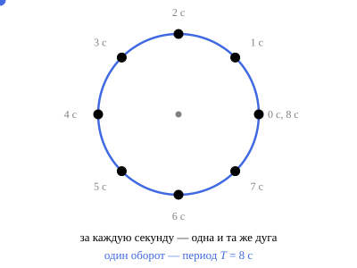

Стрелка часов, карусель, барабан стиральной машины, колесо велосипеда. Всё это крутится, и точка на каждом из них бегает по окружности — снова и снова по одному и тому же кругу. В теме «Основы кинематики» мы описывали движение по прямой: где тело и как быстро оно едет. У вращения есть описание проще: сколько оборотов и за какое время.

## Равномерное движение по окружности

Посмотри на точку на краю карусели. Она движется по окружности и за каждую секунду проходит одну и ту же дугу. Такое движение называют **равномерным движением по окружности**. Это как равномерное движение из урока 1.2, только не по прямой, а по кругу.

На рисунке точка отмечена через каждую секунду. Отметки стоят на равных расстояниях: за каждую секунду точка проходит одну восьмую окружности. Через $8\ \text{с}$ она вернулась туда, откуда начала, и дальше всё повторяется.

В этой теме движение почти всегда будет равномерным. Так крутятся колёса, вентиляторы, стрелки часов. И почти так же — Луна вокруг Земли.

## Период

Раз движение повторяется, достаточно описать один оборот.

**Период** $T$ — время одного полного оборота. Единица — секунда.

На рисунке $T = 8\ \text{с}$. У секундной стрелки часов $T = 60\ \text{с}$, у минутной $T = 1\ \text{ч} = 3600\ \text{с}$. У Земли, которая вращается вокруг своей оси, период — сутки.

Как найти период, если засекли время нескольких оборотов? Карусель сделала $N = 5$ оборотов за $t = 40\ \text{с}$. Один оборот длится в пять раз меньше:

$$
T = \frac{t}{N} = \frac{40}{5} = 8\ \text{с}.
$$

Почему бы просто не засечь один оборот? Секундомер включают и выключают руками, всегда с небольшим опозданием. Если мерить сразу много оборотов, эта ошибка делится на их число.

## Частота

Колесо велосипеда на спуске крутится быстро: несколько оборотов за секунду. Тут удобнее другое число.

**Частота** $\nu$ (греческая буква «ню») — число оборотов за одну секунду:

$$
\nu = \frac{N}{t}.
$$

Единица частоты — **герц**: $1\ \text{Гц}$ — это один оборот в секунду. Пишут и $\text{об/с}$ или $\text{с}^{-1}$ — это одно и то же.

## Период и частота — обратные числа

Колесо делает $4$ оборота в секунду. Сколько длится один оборот? Четверть секунды. Вентилятор делает $10$ оборотов в секунду — один оборот длится десятую долю секунды. Так всегда:

$$
\nu = \frac{1}{T}, \qquad T = \frac{1}{\nu}.
$$

Чем быстрее крутится тело, тем **больше** частота и тем **меньше** период. Карусель с рисунка: $T = 8\ \text{с}$, значит, $\nu = \dfrac{1}{8} = 0{,}125\ \text{Гц}$ — за секунду одна восьмая оборота.

Проверь себя: найди период и частоту секундной стрелки.

Один оборот — одна минута: $T = 60\ \text{с}$. Частота $\nu = \dfrac{1}{60} \approx 0{,}017\ \text{Гц}$. За секунду стрелка проходит одну шестидесятую круга — одно деление циферблата.

<pp-task id="ks-circ-01"></pp-task>

## Обороты в минуту

На моторах, дрелях и стиральных машинах быстроту вращения пишут в **оборотах в минуту**. В физике её сначала переводят в обороты в секунду. В минуте $60$ секунд, поэтому делим на $60$.

**Пример.** Барабан стиральной машины при отжиме делает $900$ оборотов в минуту. Частота:

$$
\nu = \frac{900}{60} = 15\ \text{Гц}.
$$

Период:

$$
T = \frac{1}{15}\ \text{с} \approx 0{,}067\ \text{с}.
$$

Правило то же, что в уроке 1.1: сначала единицы СИ, потом формулы.

<pp-task id="ks-circ-08"></pp-task>

## Частые ловушки

- **Не перевели минуты в секунды.** $600\ \text{об/мин}$ — это $10\ \text{Гц}$, а не $600$.
- **Нашли период вместо частоты** или наоборот. Проверь по смыслу: период — секунды на один оборот, частота — обороты за одну секунду.
- **Решили, что большой период — быстрое вращение.** Наоборот: большой период значит, что оборот длится долго.

## Коротко

- Равномерное движение по окружности: за равные промежутки времени точка проходит равные дуги.
- Период $T$ — время одного оборота: $T = \dfrac{t}{N}$.
- Частота $\nu$ — число оборотов за секунду: $\nu = \dfrac{N}{t}$. Единица — герц.
- $\nu = \dfrac{1}{T}$: быстрее вращение — больше частота, меньше период.
- Обороты в минуту делим на $60$ — получаем герцы.

Дальше — урок 4.2: с какой скоростью бежит точка по окружности и куда эта скорость направлена.
