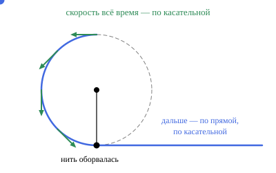

В уроке 4.1 мы считали обороты. Но «один оборот за минуту» — это быстро или медленно? Для колеса обозрения — нормально. А для колеса машины — почти стоит. Чтобы понять, как быстро движется сама точка, нужна обычная скорость: сколько метров за секунду.

## Путь за один оборот

За один оборот точка проходит всю окружность. Длина окружности радиусом $R$ — это $2\pi R$, где $\pi \approx 3{,}14$. Время одного оборота — период $T$. Делим путь на время, как в уроке 1.2:

$$
v = \frac{2\pi R}{T}.
$$

Так как $\dfrac{1}{T} = \nu$, то же самое можно записать через частоту:

$$
v = 2\pi R \nu.
$$

Эту скорость называют **линейной**. Это та же самая скорость «метры в секунду», а слово нужно, чтобы не спутать её с угловой скоростью из урока 4.4.

**Пример.** Колесо обозрения радиусом $30\ \text{м}$ делает оборот за $10\ \text{мин} = 600\ \text{с}$. Скорость кабинки:

$$
v = \frac{2 \cdot 3{,}14 \cdot 30}{600} = 0{,}314\ \text{м/с}.
$$

Это в несколько раз медленнее пешехода. Поэтому в кабинку можно зайти прямо на ходу.

**Ещё пример.** Земля поворачивается вокруг своей оси за сутки. Точка на экваторе находится в $6400\ \text{км}$ от оси. Её скорость:

$$
v = \frac{2 \cdot 3{,}14 \cdot 6{,}4 \cdot 10^{6}\ \text{м}}{86\,400\ \text{с}} \approx 465\ \text{м/с}.
$$

Это быстрее звука. Мы этого не чувствуем, потому что всё вокруг движется вместе с нами: в системе отсчёта Земли мы стоим (урок 1.4).

Чем больше радиус и чем меньше период, тем быстрее движется точка.

<pp-task id="ks-circ-02"></pp-task>

## Куда направлена скорость

Скорость — вектор (урок 1.4). Модуль мы нашли. А направление в каждый момент — **по касательной** к окружности. Касательная — это прямая, которая касается окружности в одной точке. Она перпендикулярна радиусу, проведённому в эту точку.

Почему по касательной? За очень короткое время точка проходит крошечную дугу. Такая дуга почти не отличается от отрезка касательной — по нему точка и движется в этот момент.

Проверить это легко: отпусти тело. Раскрути камень на верёвке над головой. Если верёвка оборвётся, камень полетит **по касательной** — не к центру, не от центра и не по кругу.

На рисунке вид сверху. Пока нить цела, она всё время заворачивает камень на окружность. В нижней точке нить оборвалась. Скорость камня в этот момент была направлена вправо — и камень полетел вправо, по прямой. Заворачивать его больше нечему.

То же самое видно в жизни:

- искры от точильного круга — это раскалённые крошки металла. Они отрываются от круга и летят по касательной;
- с колеса велосипеда без крыла грязь летит по касательной — прямо на спину велосипедисту;
- метатель молота раскручивает снаряд и отпускает его в тот момент, когда скорость смотрит в нужную сторону.

Проверь себя: ты раскручиваешь мяч на верёвке над головой. Верёвка рвётся в тот момент, когда мяч прямо перед тобой и движется слева направо. Куда полетит мяч?

Вправо — туда, куда была направлена его скорость в момент обрыва. Не на тебя, не от тебя, а по касательной к окружности.

## Модуль постоянный, направление — нет

Посмотри ещё раз на рисунок. Все стрелки скорости одной длины: при равномерном движении модуль скорости не меняется. Но смотрят они в разные стороны. Каждое мгновение направление скорости немного поворачивается.

Значит, **вектор** скорости всё время меняется, хотя её модуль постоянный. Запомни это: в уроке 4.3 из этого получится самое интересное в теме.

## Обратная задача

Иногда скорость известна, а надо найти, сколько оборотов делает колесо. Выразим частоту из $v = 2\pi R \nu$:

$$
\nu = \frac{v}{2\pi R}.
$$

Смысл простой: за секунду точка проходит $v$ метров, а один оборот — это $2\pi R$ метров. Делим одно на другое и получаем число оборотов за секунду.

**Пример.** Точка на ободе колеса радиусом $0{,}25\ \text{м}$ движется со скоростью $3{,}14\ \text{м/с}$. Один оборот — $2 \cdot 3{,}14 \cdot 0{,}25 = 1{,}57\ \text{м}$. За секунду колесо делает $\dfrac{3{,}14}{1{,}57} = 2$ оборота.

<pp-task id="ks-circ-09"></pp-task>

## Частые ловушки

- **Забыли двойку.** Длина окружности — $2\pi R$. Не $\pi R$ и не $\pi R^2$: $\pi R^2$ — это площадь круга.
- **Не перевели сантиметры в метры.** Радиус $30\ \text{см}$ — это $0{,}3\ \text{м}$.
- **Решили, что сорвавшееся тело летит от центра.** Оно летит по касательной, туда, куда смотрела скорость.
- **«Скорость постоянна».** Постоянен только модуль. Направление меняется всё время.

## Коротко

- Линейная скорость $v = \dfrac{2\pi R}{T} = 2\pi R \nu$.
- Скорость направлена по касательной к окружности, перпендикулярно радиусу.
- Если тело отпустить, оно летит по касательной, по прямой.
- При равномерном движении по окружности модуль скорости постоянен, а направление всё время меняется.

Дальше — урок 4.3: если вектор скорости меняется, значит, есть ускорение. Куда оно направлено?
