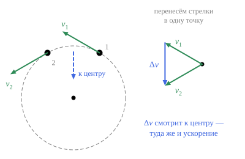
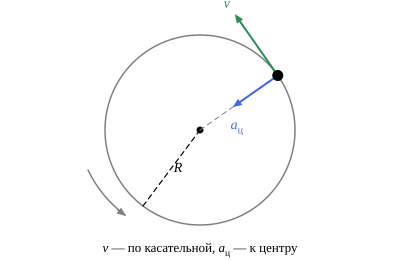

Ты на карусели. Скорость не меняется, а держаться приходится изо всех сил — будто тебя тянет наружу. Машина входит в поворот, спидометр стоит на месте, а пассажиров прижимает к двери. Что-то явно происходит, хотя скорость «та же». В этом уроке разберёмся, что именно.

## Ускорение — это изменение вектора скорости

Вспомним урок 2.2. Ускорение — вектор:

$$
\vec a = \frac{\Delta \vec v}{\Delta t}.
$$

Ускорение есть всегда, когда меняется **вектор** скорости. А вектор меняется, если меняется его длина **или направление**. В уроке 2.2 менялась длина: машина разгонялась или тормозила. А в уроке 4.2 мы видели, что при движении по окружности всё время меняется направление.

Вывод неожиданный, но честный: **у тела, которое равномерно движется по окружности, есть ускорение.** Слово «равномерно» здесь говорит только о модуле скорости: он не меняется. Вектор скорости меняется — значит, ускорение есть.

## Куда направлено ускорение

Возьмём на окружности две близкие точки, $1$ и $2$. Тело проходит их одно за другим. Скорости в этих точках одной длины, обе по касательной, но смотрят немного по-разному.

Чтобы найти изменение скорости, перенесём обе стрелки в одну точку. Вектор можно переносить, если не менять его длину и направление (урок 1.4). Изменение — «конец минус начало», как в уроке 2.2: $\Delta \vec v = \vec v_2 - \vec v_1$. Это стрелка от конца $\vec v_1$ к концу $\vec v_2$.

На рисунке она смотрит **вниз** — туда же, где центр окружности. Чем ближе взять точки, тем точнее $\Delta \vec v$ направлено прямо в центр. А ускорение смотрит туда же, куда изменение скорости.

Поэтому ускорение при равномерном движении по окружности направлено **к центру**. Его называют **центростремительным** — «стремящимся к центру».

## Формула

Модуль центростремительного ускорения:

$$
a_{\text{ц}} = \frac{v^2}{R}.
$$

- $v$ — скорость, м/с;
- $R$ — радиус окружности, м.

Вывод формулы есть в учебнике 9 класса, а в задачах нужна сама формула. Но её можно понять и без вывода:

- чем **быстрее** движется тело, тем быстрее поворачивается вектор скорости, и тем он длиннее. Оба множителя растут, поэтому $v$ стоит в квадрате;
- чем **меньше** радиус, тем круче поворот. Поэтому $R$ стоит в знаменателе.

Скорость смотрит по касательной, ускорение — к центру. Они **перпендикулярны**. Сравни с уроком 2.2:

- ускорение по скорости — скорость растёт;
- ускорение против скорости — скорость убывает;
- ускорение поперёк скорости — скорость не растёт и не убывает, а **поворачивает**.

**Пример.** Машина проходит поворот радиусом $50\ \text{м}$ со скоростью $10\ \text{м/с}$:

$$
a_{\text{ц}} = \frac{10^2}{50} = 2\ \text{м/с}^2.
$$

Каждую секунду скорость машины меняется на $2\ \text{м/с}$, как при разгоне. Только меняется не модуль, а направление.

Проверь себя: точка движется по окружности радиусом 3 м со скоростью 6 м/с. Найди её ускорение и укажи, куда оно направлено.

$a = \dfrac{6^2}{3} = \dfrac{36}{3} = 12\ \text{м/с}^2$. Направлено к центру окружности.

<pp-task id="ks-circ-03"></pp-task>

## Скорость в квадрате

Из-за квадрата ускорение очень чувствительно к скорости. Пройди тот же поворот вдвое быстрее — ускорение вырастет вчетверо. Поэтому перед крутыми поворотами ставят знак ограничения скорости: небольшая прибавка скорости даёт большую прибавку ускорения.

<pp-task id="ks-circ-10"></pp-task>

## А почему тянет наружу?

На карусели кажется, что тебя тянет **от** центра. А ускорение направлено **к** центру. Противоречия нет.

Твоё тело «хочет» лететь прямо, по касательной, как камень с оборванной нитью из урока 4.2. А сиденье и поручень не пускают и всё время заворачивают тебя к центру. Ты чувствуешь, как поручень тянет тебя внутрь, и тебе кажется, что тебя тянет наружу. Почему тела «хотят» лететь прямо и что их заворачивает — это уже динамика, тема «Законы Ньютона».

## Частые ловушки

- **«Скорость постоянна — значит, ускорения нет».** При движении по окружности ускорение есть всегда: меняется направление скорости.
- **«Ускорение направлено наружу».** Центростремительное ускорение направлено к центру.
- **Забыли квадрат:** $a = v^2/R$, а не $v/R$.
- **Взяли диаметр вместо радиуса.** В формуле — радиус.

## Коротко

- Ускорение есть, когда меняется вектор скорости: его модуль или направление.
- При равномерном движении по окружности ускорение направлено к центру — центростремительное.
- $a_{\text{ц}} = \dfrac{v^2}{R}$.
- Ускорение перпендикулярно скорости: оно поворачивает скорость, но не меняет её модуль.
- Скорость вдвое больше — ускорение вчетверо больше.

Дальше — урок 4.4: у разных точек одного колеса разные скорости. Но есть одна величина, общая для всего колеса, — угловая скорость.
