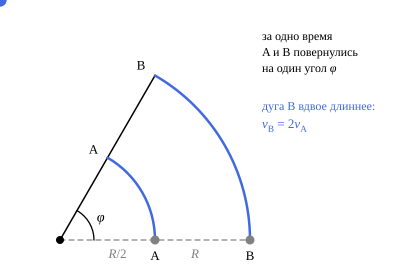

Посмотри на вращающийся диск. Точка у края и точка ближе к центру делают оборот за одно и то же время: у них одинаковые период и частота. А линейные скорости разные: за оборот точка у края проходит большую окружность. Хочется одно число, которое описывает вращение всего диска сразу, а не каждой точки отдельно. Это угловая скорость.

## Все точки поворачиваются на один угол

Отметим на одной спице две точки: $A$ — на середине, $B$ — на краю. Повернём диск.

За одно и то же время обе точки повернулись на **один и тот же угол** $\varphi$ — они ведь на одной спице. А пути разные: дуга точки $B$ вдвое длиннее, потому что $B$ вдвое дальше от оси.

Получается, угол поворота — общий для всего диска. Осталось научиться его мерить.

## Радиан

Углы в физике вращения мерят не в градусах, а в **радианах**.

**Один радиан** — это угол, при котором длина дуги равна радиусу.

Сколько радиан в полном обороте? Длина всей окружности $2\pi R$ — это $2\pi$ радиусов. Значит, полный оборот — это $2\pi \approx 6{,}28$ радиана:

$$
360^\circ = 2\pi\ \text{рад}, \qquad 180^\circ = \pi\ \text{рад}, \qquad 90^\circ = \frac{\pi}{2}\ \text{рад}.
$$

Радианы удобны тем, что длину дуги находить очень просто:

$$
l = \varphi R \qquad (\varphi \text{ в радианах}).
$$

На рисунке угол один, а $R$ у точки $B$ вдвое больше — поэтому и дуга вдвое длиннее.

## Угловая скорость

**Угловая скорость** $\omega$ («омега») — угол, на который тело поворачивается за секунду:

$$
\omega = \frac{\Delta\varphi}{\Delta t}.
$$

Единица — радиан в секунду, $\text{рад/с}$. За один период тело поворачивается на полный оборот, $2\pi$ радиан. Поэтому

$$
\omega = \frac{2\pi}{T} = 2\pi\nu.
$$

**Пример.** Секундная стрелка делает оборот за $60\ \text{с}$:

$$
\omega = \frac{2 \cdot 3{,}14}{60} \approx 0{,}105\ \text{рад/с}.
$$

Это угловая скорость **всей** стрелки — и кончика, и середины.

Не путай частоту и угловую скорость. Частота — число **оборотов** за секунду, угловая скорость — число **радиан** за секунду. В одном обороте $2\pi$ радиан, поэтому $\omega$ в $2\pi$ раз больше $\nu$.

<pp-task id="ks-circ-11"></pp-task>

## Связь с линейной скоростью

Перепишем формулу из урока 4.2:

$$
v = \frac{2\pi R}{T} = \frac{2\pi}{T} \cdot R = \omega R.
$$

$$
v = \omega R.
$$

У всех точек тела $\omega$ одна и та же, а линейная скорость тем больше, чем дальше точка от оси. Кончик секундной стрелки длиной $10\ \text{см}$ движется со скоростью $0{,}105 \cdot 0{,}1 \approx 0{,}01\ \text{м/с}$ — около сантиметра в секунду. А её середина — вдвое медленнее.

Поиграй с моделью. Точки $A$ и $B$ сидят на одной спице и всё время остаются на ней — угловая скорость у них одна. Подвигай точку $A$ к оси и от оси: её скорость меняется, а $\omega$ — нет. Уменьши период — диск закрутится быстрее, и все стрелки вырастут. А кнопка «Отпустить» напомнит урок 4.2: отпущенная точка летит по касательной.

<pp-circle t="2" r="1">Здесь интерактивная модель вращающегося диска: две точки на одной спице, их скорости и ускорения. Для неё нужен JavaScript.</pp-circle>

<pp-task id="ks-circ-04"></pp-task>

## Ускорение через угловую скорость

Подставим $v = \omega R$ в формулу урока 4.3:

$$
a_{\text{ц}} = \frac{v^2}{R} = \frac{\omega^2 R^2}{R} = \omega^2 R.
$$

Теперь у нас две формулы ускорения, и они как будто спорят. В $\dfrac{v^2}{R}$ радиус в знаменателе — дальше от центра, ускорение меньше. В $\omega^2 R$ радиус в числителе — дальше от центра, ускорение больше. Кто прав?

Обе формулы верны. Разница в том, что **одинаково** у тел, которые сравнивают:

- **точки одного вращающегося тела** — одинакова $\omega$. Бери $a = \omega^2 R$: чем дальше от оси, тем больше ускорение. В модели точка $B$ вдвое дальше от оси, чем $A$ в середине спицы, — и её стрелка ускорения вдвое длиннее;
- **тела с одинаковой линейной скоростью** — например, машина проходит разные повороты на одной скорости. Бери $a = \dfrac{v^2}{R}$: чем круче поворот, тем больше ускорение.

Проверь себя: на диске отмечены точки в 5 см и в 20 см от оси. Во сколько раз линейная скорость дальней точки больше?

У точек одного диска одинаковая $\omega$, а $v = \omega R$. Значит, скорости относятся как расстояния до оси: $\dfrac{20}{5} = 4$. В $4$ раза.

<pp-task id="ks-circ-12"></pp-task>

<pp-task id="ks-circ-05"></pp-task>

## Как это выглядит на ЕГЭ

*Точка на краю диска радиусом $0{,}2\ \text{м}$ делает $5$ оборотов за $2\ \text{с}$. Найди её центростремительное ускорение. Число $\pi$ принять равным $3{,}14$.*

Период — время одного оборота:

$$
T = \frac{2}{5} = 0{,}4\ \text{с}.
$$

Угловая скорость:

$$
\omega = \frac{2\pi}{T} = \frac{6{,}28}{0{,}4} = 15{,}7\ \text{рад/с}.
$$

Ускорение:

$$
a = \omega^2 R = 15{,}7^2 \cdot 0{,}2 \approx 49{,}3\ \text{м/с}^2.
$$

Это почти в пять раз больше ускорения свободного падения — хотя диск крутится всего $2{,}5$ раза в секунду.

## Частые ловушки

- **Забыли $2\pi$.** Частота $3\ \text{Гц}$ — это не $3\ \text{рад/с}$, а $2\pi \cdot 3 \approx 18{,}8\ \text{рад/с}$.
- **Подставили градусы.** В формулах $l = \varphi R$ и $v = \omega R$ угол — только в радианах.
- **«У точек одного диска одинаковая линейная скорость».** Одинакова угловая, а линейная растёт с расстоянием до оси.
- **Взяли $a = v^2/R$ и решили, что у дальних точек диска ускорение меньше.** Забыли, что $v$ тоже растёт с $R$. Для точек одного тела удобнее $a = \omega^2 R$.

## Коротко

- Радиан — угол, при котором дуга равна радиусу. Полный оборот — $2\pi$ рад; $l = \varphi R$.
- Угловая скорость $\omega = \dfrac{\Delta\varphi}{\Delta t} = \dfrac{2\pi}{T} = 2\pi\nu$, рад/с.
- $\omega$ одинакова у всех точек вращающегося тела.
- $v = \omega R$: дальше от оси — быстрее.
- $a_{\text{ц}} = \dfrac{v^2}{R} = \omega^2 R$. Одинакова $\omega$ — бери $\omega^2 R$; одинакова $v$ — бери $v^2/R$.

Дальше — урок 4.5: что будет, если соединить два колеса ремнём или цепью.
