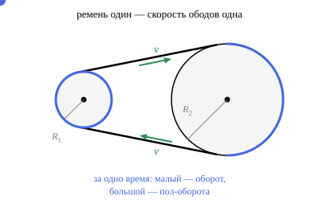

Велосипедист крутит педали не спеша, примерно оборот в секунду. А колесо при этом крутится в два-три раза быстрее. Как так? Педали и колесо соединены цепью, а цепь надета на звёздочки разного размера. Так же устроены ремень в стиральной машине, коробка передач в машине и шестерёнки в механических часах. Во всех этих устройствах работают всего два правила.

## Правило первое: ремень не проскальзывает

Два шкива — колёса с желобком — соединены ремнём. Ремень движется целиком, как одна лента: каждая его часть проходит за секунду одно и то же расстояние. Если ремень не проскальзывает, точки на ободе каждого шкива движутся вместе с ремнём.

Значит, у ободов обоих шкивов **одинаковая линейная скорость** — скорость ремня.

На рисунке большой шкив вдвое больше малого. За одно и то же время точки на их ободах проходят одинаковый путь. Но для малого шкива это целый оборот, а для большого — только половина. Малый крутится вдвое быстрее.

Запишем это формулами. Линейные скорости равны, а $v = \omega R$ (урок 4.4):

$$
\omega_1 R_1 = \omega_2 R_2.
$$

То же самое с частотами — ведь $v = 2\pi R \nu$, и $2\pi$ сокращается:

$$
\nu_1 R_1 = \nu_2 R_2.
$$

Во сколько раз шкив меньше, во столько раз он крутится быстрее:

$$
\frac{\nu_2}{\nu_1} = \frac{R_1}{R_2}.
$$

## Шестерёнки и цепь

У шестерёнок нет ремня, но правило то же. Зубья входят друг в друга, поэтому точки касания движутся вместе, с одной скоростью. Велосипедная цепь работает как ремень, только с зубьями — чтобы не проскальзывала.

Одна разница: два шкива на ремне крутятся в **одну** сторону, а две сцепленные шестерёнки — в **разные**.

**Пример.** Большая шестерёнка радиусом $6\ \text{см}$ делает $1$ оборот в секунду. Она сцеплена с маленькой радиусом $2\ \text{см}$. Маленькая втрое меньше — значит, крутится втрое быстрее:

$$
\nu_2 = \nu_1 \frac{R_1}{R_2} = 1 \cdot \frac{6}{2} = 3\ \text{об/с}.
$$

Проверь себя по смыслу: маленькое колесо всегда крутится быстрее большого. Если получилось наоборот — дробь перевёрнута.

<pp-task id="ks-circ-06"></pp-task>

## Правило второе: одна ось — одна угловая скорость

Задняя звёздочка велосипеда и заднее колесо сидят на одной оси. Это по сути одно тело: они поворачиваются вместе, на один и тот же угол. Значит, у них **одинаковая угловая скорость** (урок 4.4), а линейные скорости разные: обод колеса гораздо дальше от оси, чем зубья звёздочки.

Итак, два правила:

- **ремень, цепь, зубья** — одинаковая **линейная** скорость ободов: $\nu_1 R_1 = \nu_2 R_2$;
- **одна ось** — одинаковая **угловая** скорость: $\nu_1 = \nu_2$.

Любая задача о передачах — это цепочка из этих двух шагов.

**Пример.** Велосипедист делает педалями $1$ оборот в секунду. Передняя звёздочка (на педалях) радиусом $10\ \text{см}$, задняя — $5\ \text{см}$. Радиус колеса $35\ \text{см}$. С какой скоростью едет велосипед?

1. Цепь: задняя звёздочка вдвое меньше передней, значит, крутится вдвое быстрее: $\nu = 1 \cdot \dfrac{10}{5} = 2\ \text{об/с}$.
2. Одна ось: колесо делает столько же — $2\ \text{об/с}$.
3. Скорость обода колеса: $v = 2\pi R \nu = 2 \cdot 3{,}14 \cdot 0{,}35 \cdot 2 \approx 4{,}4\ \text{м/с}$. Это почти $16\ \text{км/ч}$.

С такой скоростью и едет велосипед — почему именно с ней, разберём в уроке 4.6.

Проверь себя: на велосипеде с переключением передач педали крутят с той же частотой. Какую заднюю звёздочку выбрать, чтобы ехать быстрее, — большую или маленькую?

Маленькую. Цепь даёт одинаковую линейную скорость, поэтому маленькая звёздочка крутится быстрее большой. А колесо на одной оси со звёздочкой и крутится вместе с ней. Зато педали крутить тяжелее — поэтому в гору выбирают большую звёздочку.

## Обороты в минуту

В технике частоту часто дают в оборотах в минуту. Ничего нового: сначала переведи в обороты в секунду, как в уроке 4.1, — или реши задачу прямо в оборотах в минуту и переведи в конце. Правило $\nu_1 R_1 = \nu_2 R_2$ работает в любых единицах частоты, лишь бы одинаковых с обеих сторон. И радиусы можно не переводить в метры: они входят отношением.

<pp-task id="ks-circ-13"></pp-task>

## Частые ловушки

- **Перевернули дробь.** Маленькое колесо крутится быстрее большого. Проверяй ответ по смыслу.
- **Решили, что у колёс на ремне одинаковые частоты.** Одинаковы линейные скорости ободов, а частоты разные.
- **Перенесли правило ремня на одну ось.** У звёздочки и колеса на одной оси одинакова угловая скорость, а линейные разные.
- **Смешали единицы.** Слева обороты в минуту, справа в секунду — так нельзя.

## Коротко

- Ремень, цепь, сцепленные зубья: у ободов одинаковая линейная скорость, $\omega_1 R_1 = \omega_2 R_2$, $\nu_1 R_1 = \nu_2 R_2$.
- Маленькое колесо крутится быстрее большого во столько раз, во сколько оно меньше.
- Колёса на одной оси: одинаковая угловая скорость.
- Задачу о передаче решай цепочкой: ремень — ось — ремень — …

Дальше — урок 4.6: колесо, которое не просто крутится, а катится по дороге. У него верхняя точка движется быстрее машины, а нижняя стоит.
