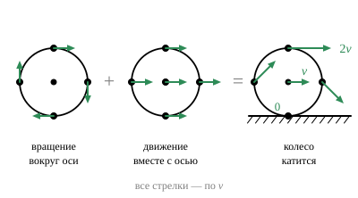
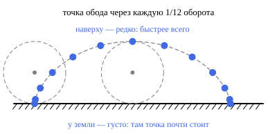

Посмотри на фотографию едущего велосипеда. Спицы в верхней части колеса смазаны, а внизу, у самой дороги, видны чётко. Колесо одно, крутится целиком, с одной угловой скоростью. Почему же его точки движутся с такими разными скоростями? Потому что относительно дороги колесо не только крутится, но ещё и едет вперёд. В этом уроке сложим два этих движения.

## Без проскальзывания

Колесо **катится без проскальзывания**, если не буксует и не скользит юзом. Обод как будто разматывается по дороге, как рулетка: каждый сантиметр обода ложится на свой сантиметр дороги.

Отсюда важное следствие. За один оборот колесо разматывает всю окружность обода, $2\pi R$, и ровно на столько же уезжает вперёд. За то же время, за период $T$. Значит, ось движется со скоростью

$$
v = \frac{2\pi R}{T} = \omega R.
$$

А это ровно скорость, с которой точки обода бегут вокруг оси (урок 4.2). Две скорости совпали: **скорость оси** и **скорость обода относительно оси** — одна и та же $v$. Это и есть условие качения без проскальзывания.

## Два движения сразу

Посадим наблюдателя на раму велосипеда. Для него ось стоит на месте, а колесо просто вращается: каждая точка обода движется по касательной со скоростью $v$. А сама рама вместе с осью едет относительно дороги вперёд со скоростью $v$.

Скорость точки относительно дороги — сумма, как в уроке 1.6:

$$
\vec v_{\text{точки}} = \vec v_{\text{отн. оси}} + \vec v_{\text{оси}}.
$$

Сложим стрелки для четырёх точек обода и центра.

- **Верхняя точка.** Вращение несёт её вперёд со скоростью $v$, ось — тоже вперёд, $v$. Вместе $v + v = 2v$. Верх колеса движется **вдвое быстрее** велосипеда.
- **Центр.** Он не вращается, только едет с осью: $v$.
- **Нижняя точка.** Вращение несёт её **назад** со скоростью $v$, ось — вперёд, $v$. Вместе $v - v = 0$. Точка, которая касается дороги, в этот момент **стоит**. Так и должно быть: если бы она двигалась относительно дороги, шина тёрлась бы об асфальт — это и есть проскальзывание.

Отсюда и фотография: спицы наверху движутся быстро и смазываются, а внизу почти стоят.

**Пример.** Машина едет со скоростью $20\ \text{м/с}$. Верх её колеса движется относительно дороги со скоростью $40\ \text{м/с}$ — это $144\ \text{км/ч}$. А низ — стоит.

Проверь себя: велосипедист едет со скоростью 6 м/с. С какой скоростью движется нижняя точка колеса относительно велосипедиста? А относительно дороги?

Относительно велосипедиста колесо просто вращается, и все точки обода движутся со скоростью $6\ \text{м/с}$. Нижняя — назад. А относительно дороги нижняя точка стоит: $6 - 6 = 0$. Одна точка — две разные скорости в двух системах отсчёта, как в уроке 1.6.

<pp-task id="ks-circ-07"></pp-task>

<pp-task id="ks-circ-14"></pp-task>

## Боковые точки

Возьмём точку обода впереди, на уровне оси. Вращение несёт её **вниз** со скоростью $v$, ось — **вперёд** со скоростью $v$. Эти скорости перпендикулярны, и складывать их надо как векторы — как лодку поперёк реки в уроке 1.6. По теореме Пифагора:

$$
v_{\text{бок}} = \sqrt{v^2 + v^2} = v\sqrt{2} \approx 1{,}41\,v.
$$

Направлена эта скорость наискосок — вперёд и вниз, под углом $45^\circ$. У задней точки на уровне оси — так же $v\sqrt{2}$, но вперёд и вверх. Например, при скорости машины $10\ \text{м/с}$ боковые точки обода движутся со скоростью около $14\ \text{м/с}$.

Модули не складываются, если скорости смотрят в разные стороны. Ответ $2v$ для боковой точки — ошибка.

<pp-task id="ks-circ-15"></pp-task>

## Путь точки обода

Какую линию рисует на фоне дороги точка обода? Не окружность — ведь колесо едет. Отметим точку через каждую двенадцатую часть оборота.

Получилась арка. Такая линия называется **циклоидой**. Отметки стоят через равное время, но расставлены неравномерно. Наверху они далеко друг от друга: там точка движется быстрее всего, со скоростью $2v$. У земли отметки собираются в кучку: точка замедляется, на мгновение касается дороги с нулевой скоростью и снова поднимается. Колесо не трётся о дорогу, а ставит обод на неё и поднимает обратно.

## Частые ловушки

- **Забыли вращение.** Скорость верхней точки — не $v$, а $2v$.
- **Решили, что нижняя точка движется назад.** Назад — только относительно оси. Относительно дороги она стоит.
- **Сложили модули у боковой точки.** Скорости перпендикулярны: $v\sqrt{2}$, а не $2v$.
- **Спутали системы отсчёта.** Сначала реши, относительно чего спрашивают скорость: дороги или оси.

## Коротко

- Без проскальзывания скорость оси равна скорости обода относительно оси: $v = \omega R$.
- Движение точки колеса — сумма вращения вокруг оси и движения вместе с осью.
- Относительно дороги: верхняя точка $2v$, центр $v$, нижняя $0$, боковые на уровне оси $v\sqrt{2}$.
- Траектория точки обода — циклоида: у земли точка почти стоит, наверху быстрее всего.

Это последний урок темы. Ты научился описывать любое вращение: от стрелки часов до колеса машины. Но мы так и не ответили на вопрос, почему тело движется по окружности, а не улетает по касательной. Что заворачивает его к центру — это следующая тема, «Законы Ньютона»: там мы узнаем, откуда берётся любое ускорение.
