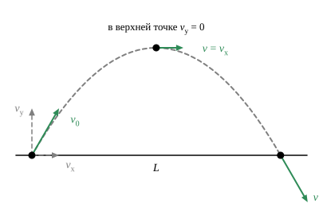

Камень с моста, мяч в баскетбольное кольцо, струя воды из шланга — всё это одно и то же движение с ускорением $g$. Тема нужна в задаче 1, в задачах 5–6 и очень часто в задаче 26.

Нового здесь мало: это равноускоренное движение, у которого ускорение заранее известно. Начнём с камня, который просто падает, а закончим броском под углом, где пригодятся векторы и проекции.

## Шаг 1. Все тела падают одинаково

Отпусти камень — он падает всё быстрее. Если сопротивлением воздуха можно пренебречь, ускорение у всех тел одинаковое — и у камня, и у гири, и у монеты. Первым это показал Галилей. Это **ускорение свободного падения**:

$$
g \approx 9{,}8\ \text{м/с}^2,
$$

а на ЕГЭ обычно берут $g = 10\ \text{м/с}^2$.

Пёрышко в комнате падает медленно не потому, что оно «лёгкое», а потому что для него сопротивление воздуха велико по сравнению с силой тяжести. В трубке, откуда откачан воздух, пёрышко и монета падают вместе.

Раз ускорение известно, работают формулы равноускоренного движения. Тело, которое отпустили без толчка, через время $t$ имеет скорость

$$
v = g t.
$$

<pp-task id="ks-fall-01"></pp-task>

## Шаг 2. Высота падения

Путь из покоя при равноускоренном движении — $\dfrac{at^2}{2}$. Подставляем $a = g$:

$$
h = \frac{g t^2}{2}.
$$

Отсюда время падения с высоты $h$: $t = \sqrt{2h/g}$.

За первую секунду тело пролетает $5\ \text{м}$, за две — $20$, за три — $45$. Высота растёт как квадрат времени.

<pp-task id="ks-fall-02"></pp-task>

## Шаг 3. Бросок вверх

**Свободное падение** — это движение только под действием силы тяжести. Тело, брошенное вверх, тоже падает свободно: и когда летит вверх, и в верхней точке, и когда падает. Ускорение всё время направлено вниз и равно $g$.

Направим ось $Oy$ вверх. Тогда $a_y = -g$:

$$
v_y = v_{0y} - g t,
$$

$$
y = y_0 + v_{0y} t - \frac{g t^2}{2}.
$$

Это те же формулы, что и в теме «Равноускоренное движение», с $a_y = -g$. По дороге вверх мяч тормозит, как автобус перед остановкой. В верхней точке $v_y = 0$, отсюда:

- время подъёма $t_{\text{под}} = v_0 / g$;
- максимальная высота $h = \dfrac{v_0^2}{2g}$ — это «тормозной путь» $\dfrac{v_0^2}{2a}$ с $a = g$.

<pp-task id="ks-fall-03"></pp-task>

## Шаг 4. Симметрия полёта

Подъём и спуск — зеркальные. Время спуска с высоты $h$ равно времени подъёма. На уровень броска тело вернётся с той же по модулю скоростью, только направленной вниз.

Из формулы без времени $v^2 = 2gh$ получаем скорость тела, упавшего с высоты $h$ без начальной скорости:

$$
v = \sqrt{2 g h}.
$$

<pp-task id="ks-fall-04"></pp-task>

## Шаг 5. Независимость движений и горизонтальный бросок

Теперь главная идея темы. Если толкнуть шарик со стола горизонтально и одновременно уронить другой с той же высоты, они упадут на пол **одновременно**. Горизонтальная скорость никак не мешает падать.

Движение по горизонтали и по вертикали **независимы**:

- по горизонтали ускорения нет, и тело летит равномерно: $x = v_0 t$;
- по вертикали — обычное свободное падение: $h = \dfrac{g t^2}{2}$.

Время полёта зависит только от высоты: $t = \sqrt{2h/g}$. Дальность $L = v_0 t$.

Это и есть векторная формула из темы «Равноускоренное движение», разложенная на две оси.

<pp-task id="ks-fall-05"></pp-task>

## Шаг 6. Бросок под углом: раскладываем скорость

Мяч брошен под углом $\alpha$ к горизонту со скоростью $v_0$. Разложим начальную скорость на две проекции — как стрелку на «тень» по горизонтали и по вертикали:

$$
v_{0x} = v_0 \cos\alpha, \qquad v_{0y} = v_0 \sin\alpha.
$$

Дальше всё как в шаге 5, только по вертикали — бросок вверх из шага 3:

$$
x = v_0 \cos\alpha \cdot t,
$$

$$
y = v_0 \sin\alpha \cdot t - \frac{g t^2}{2}.
$$

Траектория — парабола. В верхней точке вертикальная скорость равна нулю, а горизонтальная остаётся. Скорость тела там равна $v_0\cos\alpha$, а не нулю. Высота подъёма — как у броска вверх со скоростью $v_{0y}$:

$$
H = \frac{v_{0y}^2}{2g} = \frac{v_0^2 \sin^2\alpha}{2g}.
$$

<pp-task id="ks-fall-06"></pp-task>

## Шаг 7. Время полёта и дальность

Если тело брошено с земли и падает на землю, время полёта — дважды время подъёма:

$$
t_{\text{пол}} = \frac{2 v_0 \sin\alpha}{g}.
$$

За это время по горизонтали оно пролетит $L = v_0 \cos\alpha \cdot t_{\text{пол}}$. Упрощаем через $2\sin\alpha\cos\alpha = \sin 2\alpha$:

$$
L = \frac{v_0^2 \sin 2\alpha}{g}.
$$

Дальность максимальна при $\alpha = 45^\circ$. Углы, дополняющие друг друга до $90^\circ$ (например, $30^\circ$ и $60^\circ$), дают одинаковую дальность.

Эти формулы работают, только если точки броска и падения на одной высоте и воздух не мешает.

Попробуй сам. Брось мяч под углом $30^\circ$, а потом под углом $60^\circ$ с той же скоростью: где он упадёт? Посмотри, как ведут себя проекции скорости: горизонтальная (зелёная по оси $x$) не меняется, а вертикальная уменьшается до нуля в верхней точке и меняет направление.

<pp-projectile v0="20" angle="30" h0="0">Здесь интерактивная модель броска — для неё нужен JavaScript.</pp-projectile>

<pp-task id="ks-fall-07"></pp-task>

## Шаг 8. Скорость в любой точке

В любой момент полёта скорость — сумма двух перпендикулярных проекций. Горизонтальная не меняется, вертикальная растёт по модулю как при падении:

$$
v_x = v_0 \cos\alpha, \qquad v_y = v_0 \sin\alpha - g t.
$$

Модуль скорости — по теореме Пифагора:

$$
v = \sqrt{v_x^2 + v_y^2}.
$$

Так же решают задачи, где тело падает ниже точки броска (с балкона, с обрыва): готовые формулы дальности там не работают, а уравнения $x(t)$ и $y(t)$ — работают всегда.

<pp-task id="ks-fall-08"></pp-task>

## Частые ловушки

- **«В верхней точке скорость равна нулю».** Нулю равна только вертикальная проекция. Ускорение там тоже не ноль — оно равно $g$.
- **Формулу дальности применяют, когда тело падает ниже точки броска.** Тогда решай через уравнения $x(t)$ и $y(t)$.
- **Путают синус и косинус.** Если угол отсчитан от горизонта: горизонталь — косинус, вертикаль — синус.
- **Масса не влияет на движение** при свободном падении. Если в задаче дана масса, она, скорее всего, нужна для энергии или импульса.

## Как это выглядит на ЕГЭ

*Мяч бросили с земли под углом $30^\circ$ к горизонту со скоростью $20\ \text{м/с}$. На каком расстоянии от точки броска он упадёт? $g = 10\ \text{м/с}^2$, сопротивление воздуха не учитывать.*

Раскладываем скорость:

$$
v_x = 20 \cos 30^\circ \approx 17{,}3\ \text{м/с},
$$

$$
v_{0y} = 20 \sin 30^\circ = 10\ \text{м/с}.
$$

Время полёта — это время подъёма, умноженное на два:

$$
t = \frac{2 v_{0y}}{g} = \frac{2 \cdot 10}{10} = 2\ \text{с}.
$$

По горизонтали мяч летит равномерно:

$$
L = v_x t \approx 17{,}3 \cdot 2 \approx 34{,}6\ \text{м}.
$$

## Коротко

- При свободном падении $\vec a = \vec g$ всегда, летит тело вверх или вниз; $g = 10\ \text{м/с}^2$.
- Падение из покоя: $v = gt$, $h = gt^2/2$, $v = \sqrt{2gh}$.
- Подъём: $t = v_0/g$, $h = v_0^2/(2g)$; спуск симметричен подъёму.
- Горизонталь и вертикаль независимы: по $x$ — равномерно, по $y$ — с ускорением $g$.
- $v_{0x} = v_0\cos\alpha$, $v_{0y} = v_0\sin\alpha$.
- $L = v_0^2 \sin 2\alpha / g$, максимум при $45^\circ$ (с земли на землю).
- В верхней точке $v = v_0 \cos\alpha$; в любой точке $v = \sqrt{v_x^2 + v_y^2}$.
