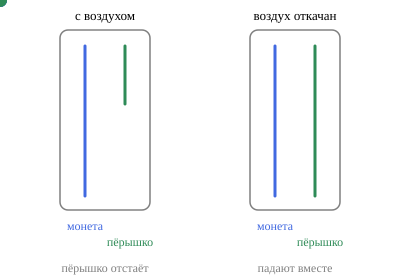

Отпусти камень — он падает всё быстрее. В теме «Равноускоренное движение» мы научились описывать движение, у которого скорость меняется на одно и то же число каждую секунду. Падение — самый частый пример такого движения. В этом уроке разберёмся, с каким ускорением падают тела и почему оно одинаковое у всех.

## Что падает быстрее?

Возьми в одну руку тяжёлую книгу, в другую — лист бумаги. Отпусти одновременно. Книга упадёт первой, лист будет долго планировать. Кажется, тяжёлое падает быстрее.

Теперь сомни лист в плотный комок и повтори. Комок и книга упадут почти одновременно. Масса листа не изменилась — изменилась только его форма. Значит, дело было не в массе, а в **воздухе**: плоский лист цепляется за воздух, а комок — почти нет.

Больше двух тысяч лет люди верили, что тяжёлые тела падают быстрее лёгких. Первым это опроверг Галилей в начале XVII века. Он показал опытами: если сопротивление воздуха мало, тела разной массы падают **одинаково**.

## Трубка без воздуха

Лучше всего это видно в опыте с длинной стеклянной трубкой. В неё кладут монету и пёрышко, закрывают и быстро переворачивают.

- Пока в трубке воздух, монета падает быстро, а пёрышко медленно опускается.
- Из трубки откачивают воздух насосом и переворачивают снова. Теперь монета и пёрышко падают **вместе**, рядом, и одновременно ударяются о дно.

Пёрышко в комнате падает медленно не потому, что оно «лёгкое». Для него сопротивление воздуха велико по сравнению с притяжением Земли. Убери воздух — и пёрышко падает как камень.

Движение, когда на тело действует **только** притяжение Земли, называют **свободным падением**. В задачах почти всегда пишут «сопротивлением воздуха пренебречь». Эта фраза и значит: считай падение свободным.

## Ускорение свободного падения

Если измерить, как растёт скорость падающего тела, окажется, что каждую секунду она увеличивается примерно на $9{,}8\ \text{м/с}$. Это ускорение одинаково для всех тел в данном месте Земли. Его называют **ускорением свободного падения** и обозначают буквой $g$:

$$
g \approx 9{,}8\ \text{м/с}^2.
$$

На ЕГЭ почти всегда берут $g = 10\ \text{м/с}^2$, так считать проще. Это значение обычно дано в условии. Мы тоже везде будем брать $10$.

Ускорение $g$ — вектор, как любое ускорение (урок 2.2). Оно всегда направлено **вертикально вниз**, к центру Земли.

## Скорость падения

Свободное падение — равноускоренное движение. Значит, работает формула из урока 2.1: $v = v_0 + at$. Пусть тело отпустили без толчка, то есть $v_0 = 0$, а ускорение $a = g$:

$$
v = g t.
$$

Каждую секунду скорость растёт на $10\ \text{м/с}$:

| Время падения | $0$ | $1\ \text{с}$ | $2\ \text{с}$ | $3\ \text{с}$ | $4\ \text{с}$ |
|---|---|---|---|---|---|
| Скорость | $0$ | $10\ \text{м/с}$ | $20\ \text{м/с}$ | $30\ \text{м/с}$ | $40\ \text{м/с}$ |

**Пример.** Сосулька падает с крыши $2\ \text{с}$. Какая у неё скорость перед ударом о землю? $v = 10 \cdot 2 = 20\ \text{м/с}$ — это $72\ \text{км/ч}$, скорость машины в городе. Поэтому зимой у домов вешают таблички «Осторожно, сосульки».

Масса в формулу $v = gt$ не входит. Камень, гиря и монета за одно и то же время падения наберут одну и ту же скорость.

Проверь себя: камень и мячик отпустили одновременно с одной высоты. Камень вдвое тяжелее. Чья скорость через 1 с будет больше?

Одинаковая: $v = gt = 10\ \text{м/с}$ у обоих. Если сопротивлением воздуха можно пренебречь, ускорение у всех тел одно и то же — $g$. Масса на свободное падение не влияет.

<pp-task id="ks-fall-01"></pp-task>

<pp-task id="ks-fall-09"></pp-task>

## А если воздух мешает?

В жизни воздух мешает всегда. Для камня, гири, мяча на небольших высотах это сопротивление мало, и формулы свободного падения дают хороший ответ. А для пёрышка, листа бумаги, парашютиста или капли дождя сопротивление воздуха — главное, и эти формулы уже не работают. Капля дождя, падая с километровой высоты, по формулам свободного падения разогналась бы до $140\ \text{м/с}$. На деле её скорость — несколько метров в секунду.

В задачах ЕГЭ по кинематике сопротивлением воздуха почти всегда пренебрегают. Если в условии этого не сказано, но речь о камне или мяче, всё равно считай падение свободным.

## Частые ловушки

- **«Тяжёлое падает быстрее».** Нет: без воздуха ускорение у всех тел одинаковое — $g$.
- **Взяли $g = 9{,}8$, а ответ ждут с $g = 10$.** Смотри, что дано в условии. На ЕГЭ почти всегда $10\ \text{м/с}^2$.
- **Перепутали скорость и высоту.** $v = gt$ — это скорость, в м/с. Высоту падения считают по другой формуле — о ней урок 3.2.
- **Ищут, куда подставить массу.** В формулах свободного падения массы нет. Если масса дана, она нужна для другого вопроса: энергии, импульса или силы.

## Коротко

- Свободное падение — движение только под действием притяжения Земли, без сопротивления воздуха.
- Без воздуха все тела падают с одним и тем же ускорением $g \approx 9{,}8\ \text{м/с}^2$; на ЕГЭ $g = 10\ \text{м/с}^2$.
- Вектор $\vec g$ всегда направлен вертикально вниз.
- Тело, отпущенное без толчка: $v = gt$ — каждую секунду плюс $10\ \text{м/с}$.
- Масса на свободное падение не влияет.

Дальше — урок 3.2: какую высоту тело пролетает за время падения и сколько времени падает с заданной высоты.
