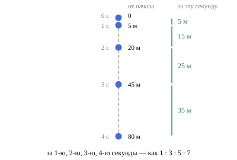

Мальчик бросает камешек в колодец и считает: «раз, два» — плюх. Какой глубины колодец? В уроке 3.1 мы узнали, как растёт скорость падающего тела. Теперь найдём, какое расстояние оно пролетает, — и научимся решать обратную задачу: сколько времени падать с заданной высоты.

## Сколько тело пролетает

Свободное падение из покоя — это разгон из покоя с ускорением $g$. Путь при таком разгоне мы нашли в уроке 2.3 как площадь треугольника под графиком скорости: $s = \dfrac{at^2}{2}$. Подставим $a = g$ и назовём пройденный по вертикали путь высотой падения $h$:

$$
h = \frac{g t^2}{2}.
$$

С $g = 10\ \text{м/с}^2$ формула становится совсем простой: $h = 5t^2$.

| Время падения | $1\ \text{с}$ | $2\ \text{с}$ | $3\ \text{с}$ | $4\ \text{с}$ |
|---|---|---|---|---|
| Высота | $5\ \text{м}$ | $20\ \text{м}$ | $45\ \text{м}$ | $80\ \text{м}$ |

За первую секунду тело пролетает всего $5\ \text{м}$, а за четыре — уже $80$, высоту 25-этажного дома. Время выросло вчетверо — высота выросла в шестнадцать раз. Высота растёт как **квадрат** времени.

**Пример.** Тот самый колодец: камешек летел до воды $2\ \text{с}$. Глубина до воды $h = 5 \cdot 2^2 = 20\ \text{м}$. Звук всплеска идёт вверх долю секунды, в простых задачах его не учитывают.

<pp-task id="ks-fall-02"></pp-task>

## Сколько времени падать

Часто известна высота, а нужно время. Выразим его из $h = \dfrac{gt^2}{2}$. Умножим обе части на $2$ и разделим на $g$: $t^2 = \dfrac{2h}{g}$. Время положительно, поэтому

$$
t = \sqrt{\frac{2h}{g}}.
$$

**Пример.** С высоты $45\ \text{м}$: $t = \sqrt{\dfrac{2 \cdot 45}{10}} = \sqrt{9} = 3\ \text{с}$. Сверься с таблицей выше — совпало.

Обрати внимание: время растёт медленнее высоты. Чтобы падать вдвое дольше, высота нужна вчетверо больше.

Проверь себя: одно тело падает с высоты 5 м, другое — с 20 м. Во сколько раз дольше падает второе?

Высота больше в $4$ раза, а время — в $\sqrt{4} = 2$ раза: $1\ \text{с}$ и $2\ \text{с}$. Время пропорционально корню из высоты.

<pp-task id="ks-fall-11"></pp-task>

## Скорость удара о землю

С какой скоростью тело ударится о землю, если оно падало с высоты $h$? Можно в два шага: найти время $t = \sqrt{2h/g}$, а потом скорость $v = gt$. Но есть путь короче — формула без времени из урока 2.4:

$$
v^2 - v_0^2 = 2as.
$$

При падении из покоя $v_0 = 0$, $a = g$, $s = h$. Получаем $v^2 = 2gh$:

$$
v = \sqrt{2 g h}.
$$

**Пример.** Мяч упал с балкона высотой $5\ \text{м}$. Его скорость у земли $v = \sqrt{2 \cdot 10 \cdot 5} = \sqrt{100} = 10\ \text{м/с}$. Проверим в два шага: время $t = \sqrt{2 \cdot 5 / 10} = 1\ \text{с}$, скорость $v = 10 \cdot 1 = 10\ \text{м/с}$. Совпало.

Эта формула удобна, когда время в задаче не нужно и не дано. И снова: масса в неё не входит.

<pp-task id="ks-fall-04"></pp-task>

## Метры за каждую секунду

Посмотрим на падение так, как в уроке 2.3 смотрели на разгон машины: отметим, где тело через каждую секунду.

Отметки расходятся всё шире: тело разгоняется. Высоты от начала — $5$, $20$, $45$, $80\ \text{м}$. А за **каждую отдельную** секунду:

- за первую — $5\ \text{м}$;
- за вторую — $20 - 5 = 15\ \text{м}$;
- за третью — $45 - 20 = 25\ \text{м}$;
- за четвёртую — $80 - 45 = 35\ \text{м}$.

Это правило нечётных чисел из урока 2.3: $5 : 15 : 25 : 35 = 1 : 3 : 5 : 7$. Оно работает, потому что падение начинается **из покоя**. За первую секунду всегда $5\ \text{м}$, за $n$-ю — в $(2n - 1)$ раз больше.

Как и тогда, различай: «**за третью** секунду» — от $2$ до $3\ \text{с}$, это $25\ \text{м}$. «**За три** секунды» — от $0$ до $3\ \text{с}$, это $45\ \text{м}$.

Проверь себя: сколько метров тело, падающее из покоя, пролетает за пятую секунду?

За первую секунду — $5\ \text{м}$, за пятую — в $2 \cdot 5 - 1 = 9$ раз больше: $45\ \text{м}$. Проверка: $5 \cdot 5^2 - 5 \cdot 4^2 = 125 - 80 = 45\ \text{м}$.

<pp-task id="ks-fall-10"></pp-task>

## Частые ловушки

- **Забыли двойку:** $h = gt^2$ вместо $\dfrac{gt^2}{2}$. Проверяй по таблице: за $1\ \text{с}$ — $5\ \text{м}$, а не $10$.
- **Забыли корень** в $t = \sqrt{2h/g}$ или $v = \sqrt{2gh}$. Время в квадрате — это не время. Проверяй единицы: под корнем $\text{м}^2/\text{с}^2$ даёт м/с.
- **Перепутали «за третью секунду» и «за три секунды».**
- **Применили $1 : 3 : 5$ к телу, брошенному вниз с начальной скоростью.** Правило — только для падения из покоя.

## Коротко

- Падение из покоя: $h = \dfrac{gt^2}{2} = 5t^2$ — за $1, 2, 3, 4\ \text{с}$ это $5, 20, 45, 80\ \text{м}$.
- Время падения с высоты $h$: $t = \sqrt{\dfrac{2h}{g}}$.
- Скорость удара: $v = \sqrt{2gh}$ — из формулы без времени.
- За последовательные секунды тело пролетает $5, 15, 25, 35\ \text{м}$ — как $1 : 3 : 5 : 7$.

Дальше — урок 3.3: что будет, если мяч подбросить вверх, и почему он тоже «падает свободно» всю дорогу.
