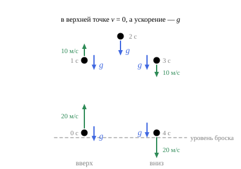
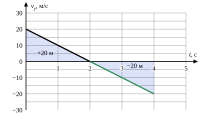

Подбрось мяч вверх. Он летит всё медленнее, на мгновение зависает и падает обратно тебе в руки. В уроках 3.1 и 3.2 тело падало из покоя. Теперь у него есть начальная скорость, и направлена она вверх — против ускорения. Мы уже встречали такое движение: это торможение и разворот из уроков 2.2 и 2.5.

## Мяч падает всю дорогу

Свободное падение — это движение, когда на тело действует только притяжение Земли. Слово «падение» сбивает с толку: кажется, что тело должно лететь вниз. Но мяч, брошенный вверх, тоже падает свободно — и когда летит вверх, и в верхней точке, и когда летит вниз. Пока он в воздухе, на него действует только Земля.

Значит, ускорение мяча всю дорогу одно и то же: $g = 10\ \text{м/с}^2$, **вниз**.

Посмотрим, что это значит, на броске со скоростью $20\ \text{м/с}$:

- по дороге вверх скорость направлена вверх, а ускорение — вниз. Мяч **тормозит**: каждую секунду теряет $10\ \text{м/с}$, как автобус перед остановкой;
- через $2\ \text{с}$ скорость стала нулём — это верхняя точка;
- ускорение не исчезло, оно по-прежнему вниз. Поэтому мяч не «зависает», а сразу начинает разгоняться вниз — каждую секунду плюс $10\ \text{м/с}$.

На рисунке подъём и спуск разнесены в стороны, чтобы стрелки не накладывались. На самом деле мяч летит вверх и вниз по одной вертикали.

## Формулы с осью вверх

Чтобы не путаться в знаках, направим ось $Oy$ **вверх**, а начало поставим в точку броска. Тогда начальная скорость положительна: $v_{0y} = v_0$. А ускорение направлено против оси: $a_y = -g$. Подставим это в формулы урока 2.5:

$$
v_y = v_0 - g t,
$$

$$
y = v_0 t - \frac{g t^2}{2}.
$$

Пока $v_y > 0$, мяч летит вверх. Когда $v_y < 0$, он летит вниз. Координата $y$ — это высота мяча над точкой броска.

## Время и высота подъёма

В верхней точке мяч на мгновение останавливается: $v_y = 0$. Из $0 = v_0 - g t$ находим **время подъёма**:

$$
t_{\text{под}} = \frac{v_0}{g}.
$$

Высоту подъёма проще всего найти как «тормозной путь» из урока 2.4: $s = \dfrac{v_0^2}{2a}$ с $a = g$:

$$
H = \frac{v_0^2}{2g}.
$$

**Пример.** Мяч подбросили со скоростью $20\ \text{м/с}$. Время подъёма $t_{\text{под}} = 20 / 10 = 2\ \text{с}$. Высота $H = \dfrac{20^2}{2 \cdot 10} = 20\ \text{м}$. Проверка по уравнению координаты: $y(2) = 20 \cdot 2 - 5 \cdot 2^2 = 40 - 20 = 20\ \text{м}$. Совпало.

Заметь: высота подъёма растёт как **квадрат** скорости. Брось вдвое быстрее — мяч взлетит вчетверо выше.

<pp-task id="ks-fall-03"></pp-task>

## Подъём и спуск — зеркальные

Посмотри ещё раз на рисунок. Через $1\ \text{с}$ после броска мяч на высоте $15\ \text{м}$ летит вверх со скоростью $10\ \text{м/с}$. Через $3\ \text{с}$ — на той же высоте $15\ \text{м}$ и с той же скоростью $10\ \text{м/с}$, только вниз. Через $4\ \text{с}$ мяч вернулся в точку броска со скоростью $20\ \text{м/с}$ — такой же, с какой его бросили.

Так всегда, если воздух не мешает. Подъём и спуск — зеркальные:

- время спуска равно времени подъёма, поэтому весь полёт до точки броска длится $2t_{\text{под}} = \dfrac{2v_0}{g}$;
- на любой высоте скорость вниз по модулю равна скорости вверх на той же высоте;
- в точку броска тело возвращается с той же по модулю скоростью $v_0$.

Спуск — это обычное падение из покоя с высоты $H$ (урок 3.2). Его время $\sqrt{2H/g} = \sqrt{v_0^2/g^2} = v_0/g$ — ровно время подъёма.

Проверь себя: мяч подбросили вверх, и он вернулся в руку через 4 с. С какой скоростью его бросили?

Подъём длился половину полёта, $2\ \text{с}$. За это время скорость упала до нуля, теряя по $10\ \text{м/с}$ каждую секунду. Значит, $v_0 = g t_{\text{под}} = 10 \cdot 2 = 20\ \text{м/с}$.

<pp-task id="ks-fall-12"></pp-task>

## График скорости

Нарисуем $v_y(t)$ для броска со скоростью $20\ \text{м/с}$. По формуле $v_y = 20 - 10t$ это прямая, которая идёт вниз. В момент $t = 2\ \text{с}$ она пересекает ось времени — это верхняя точка — и уходит под ось: мяч летит вниз.

Наклон графика одинаковый всю дорогу: ускорение не меняется. Никакого излома в верхней точке нет.

Площади под графиком, как в уроке 2.5, — это перемещения. Треугольник над осью — $+20\ \text{м}$, мяч поднялся. Треугольник под осью — $-20\ \text{м}$, мяч опустился. В сумме перемещение за $4\ \text{с}$ — ноль: мяч вернулся в руку. А **путь** — сумма площадей без знаков: $20 + 20 = 40\ \text{м}$.

## Путь и перемещение

Вот где легко ошибиться. Мяч бросили вверх со скоростью $20\ \text{м/с}$. Какой путь он пролетит за $3\ \text{с}$?

Если просто подставить в уравнение, $y(3) = 20 \cdot 3 - 5 \cdot 9 = 15\ \text{м}$. Но это **координата**, то есть перемещение от точки броска. А мяч сначала поднялся на $20\ \text{м}$ (за $2\ \text{с}$), а потом за оставшуюся $1\ \text{с}$ упал на $5\ \text{м}$. Путь:

$$
s = 20 + 5 = 25\ \text{м}.
$$

Правило то же, что в уроке 2.5: если тело развернулось, путь считай **по частям** — до верхней точки и после неё.

<pp-task id="ks-fall-13"></pp-task>

## Частые ловушки

- **«В верхней точке ускорение равно нулю».** Нулю равна скорость. Ускорение всё время $g$ и вниз — иначе мяч остался бы висеть.
- **Знак ускорения.** Если ось $Oy$ направлена вверх, то $a_y = -g$ всю дорогу, и при подъёме, и при спуске.
- **Посчитали только подъём**, когда спрашивают время всего полёта. До точки броска — $2v_0/g$.
- **Приняли координату за путь**, когда мяч уже летит вниз. Сначала найди время подъёма и проверь, успел ли мяч развернуться.

## Коротко

- Тело, брошенное вверх, падает свободно всю дорогу: ускорение $g$, вниз, и в верхней точке тоже.
- Ось вверх: $v_y = v_0 - gt$, $y = v_0 t - \dfrac{gt^2}{2}$.
- Время подъёма $t_{\text{под}} = \dfrac{v_0}{g}$, высота подъёма $H = \dfrac{v_0^2}{2g}$.
- Спуск зеркален подъёму: весь полёт $\dfrac{2v_0}{g}$, в точку броска тело возвращается со скоростью $v_0$.
- После разворота путь больше перемещения: считай по частям.

Дальше — урок 3.4: что будет, если толкнуть мяч не вверх, а вбок, и почему горизонтальная скорость не мешает падать.
