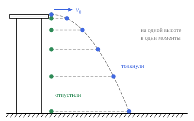

Шарик скатывается со стола и летит на пол по дуге. Струя воды из горизонтального шланга тоже изгибается вниз. До сих пор тела в этой теме двигались только по вертикали. Теперь у тела есть скорость вбок — и мы увидим главную идею всей темы: два движения, которые друг другу не мешают.

## Два шарика

Положи на край стола два шарика. Один просто столкни с края, чтобы он упал почти отвесно. Другой в тот же момент щелчком толкни вперёд. Какой упадёт на пол первым?

Кажется, что толкнутый: он ведь «быстрее». Или наоборот, уроненный: ему лететь ближе. Но на самом деле они стукнут об пол **одновременно**. Если снять опыт со вспышкой, видно ещё больше: в каждый момент оба шарика на **одной высоте**.

Толкнутый шарик улетает вбок, но вниз он падает точно так же, как уроненный. Горизонтальная скорость никак не мешает падать — и падение никак не мешает лететь вбок.

Проверь сам. Поменяй высоту обрыва и скорость броска. Как бы ты ни бросал, мячи остаются на одной высоте и падают вместе.

<pp-drop h="20" v0="10">Здесь интерактивная модель: два мяча одновременно покидают край обрыва, один отпустили, другой бросили горизонтально. Для неё нужен JavaScript.</pp-drop>

## Независимость движений

Разложим движение на два — как в уроке 1.5 раскладывали вектор на проекции. Ускорение $\vec g$ направлено вертикально вниз. Значит:

- **по горизонтали** ускорения нет. Скорость по горизонтали не меняется, и тело движется **равномерно**, как в уроке 1.2;
- **по вертикали** — то же свободное падение, что в уроке 3.2. Начальной вертикальной скорости нет, тело падает из покоя.

Направим ось $Ox$ по горизонтали в сторону броска, ось $Oy$ — вертикально вниз, начало — в точку броска. Тогда

$$
x = v_0 t, \qquad y = \frac{g t^2}{2}.
$$

Каждая формула — старая знакомая. Новое только в том, что они работают **одновременно и независимо**: время $t$ общее, а больше их ничто не связывает.

## Время и дальность полёта

Тело падает с высоты $h$. Сколько оно летит? Вертикальное движение не знает о горизонтальном, поэтому время — как у тела, которое просто отпустили (урок 3.2):

$$
t = \sqrt{\frac{2h}{g}}.
$$

Время полёта задаёт **только высота**. Скорость броска на него не влияет.

За это время по горизонтали тело равномерно пролетит **дальность**:

$$
L = v_0 t.
$$

**Пример.** С обрыва высотой $20\ \text{м}$ бросили камень горизонтально со скоростью $10\ \text{м/с}$. Время полёта $t = \sqrt{2 \cdot 20 / 10} = 2\ \text{с}$. Дальность $L = 10 \cdot 2 = 20\ \text{м}$. Брось вдвое быстрее — камень улетит вдвое дальше, на $40\ \text{м}$, но в воздухе пробудет те же $2\ \text{с}$.

Проверь себя: пулю выстрелили горизонтально, и в тот же момент с той же высоты уронили другую пулю. Какая упадёт на землю раньше?

Одновременно (если земля ровная и воздух не мешает). Время падения задаёт только высота, а она одинаковая. Выпущенная пуля улетит на сотни метров, но вниз она падает точно так же, как уроненная.

<pp-task id="ks-fall-05"></pp-task>

<pp-task id="ks-fall-14"></pp-task>

## Траектория — парабола

Какую линию рисует тело? Из $x = v_0 t$ время $t = x / v_0$. Подставим в $y$:

$$
y = \frac{g}{2 v_0^2}\, x^2.
$$

Это парабола — та же кривая, что график $y = x^2$ из алгебры, только растянутая. Чем больше скорость броска, тем она пологая. Струя из шланга, шарик со стола, мяч с балкона — всё это половинки парабол.

Вспомни урок 1.4: мяч, который пассажир роняет в вагоне, для пассажира падает отвесно, а для человека на платформе летит по кривой. Теперь ясно, по какой: для платформы у мяча есть горизонтальная скорость поезда, и это горизонтальный бросок.

## Скорость в любой точке

Как найти скорость тела в полёте? Её горизонтальная проекция всё время одна и та же, $v_x = v_0$. Вертикальная растёт, как при падении: $v_y = gt$. Эти две проекции перпендикулярны. Полную скорость складываем, как в уроке 1.6 складывали скорости лодки и течения, — по теореме Пифагора:

$$
v = \sqrt{v_x^2 + v_y^2} = \sqrt{v_0^2 + (gt)^2}.
$$

**Пример.** Мяч брошен горизонтально со скоростью $6\ \text{м/с}$. Через $0{,}8\ \text{с}$: $v_x = 6\ \text{м/с}$, $v_y = 10 \cdot 0{,}8 = 8\ \text{м/с}$. Скорость $v = \sqrt{6^2 + 8^2} = \sqrt{100} = 10\ \text{м/с}$.

Скорость в каждой точке направлена по касательной к траектории. Чем дольше тело летит, тем больше $v_y$ и тем круче оно идёт вниз.

<pp-task id="ks-fall-08"></pp-task>

## Частые ловушки

- **«Брошенное быстрее падает дольше (или быстрее)».** Нет: время полёта зависит только от высоты, $t = \sqrt{2h/g}$.
- **Сложили проекции скорости как числа.** $6 + 8 = 14$ — неверно. Проекции перпендикулярны: $\sqrt{6^2 + 8^2} = 10$.
- **Забыли, что горизонтальная скорость не меняется.** Ускорение направлено вниз, вбок тело не тормозит и не разгоняется.
- **Подставили в $L = v_0 t$ высоту вместо времени.** Сначала найди время из высоты, потом дальность.

## Коротко

- Движения по горизонтали и по вертикали независимы: по $x$ — равномерно, по $y$ — свободное падение.
- Время полёта задаёт только высота: $t = \sqrt{\dfrac{2h}{g}}$.
- Дальность $L = v_0 t$.
- Траектория — парабола.
- Скорость в любой точке: $v_x = v_0$, $v_y = gt$, $v = \sqrt{v_x^2 + v_y^2}$.

Дальше — урок 3.5: что меняется, если бросить тело не горизонтально, а под углом вверх.
