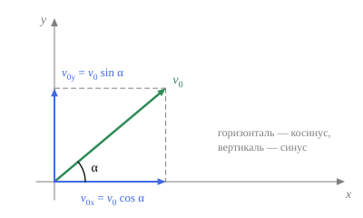
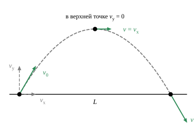

Футболист бьёт по мячу, и тот летит по высокой дуге. Баскетболист бросает в кольцо. Ядро толкают под углом. В уроке 3.3 мы бросали вверх, в уроке 3.4 — вбок. Бросок под углом — это оба сразу: у тела есть скорость и вверх, и вбок. Задача урока — разобрать его на эти две части.

## Раскладываем скорость

Мяч брошен со скоростью $v_0$ под углом $\alpha$ к горизонту. Его скорость направлена наискосок. Разложим её на две проекции, как в уроке 1.5: представь, что солнце светит сверху, и стрелка $\vec v_0$ отбрасывает тень на землю, а фонарь сбоку даёт тень на стену.

Стрелка и две её проекции образуют прямоугольный треугольник. Скорость $v_0$ — гипотенуза, угол $\alpha$ — при горизонтальном катете. По определению синуса и косинуса:

$$
v_{0x} = v_0 \cos\alpha, \qquad v_{0y} = v_0 \sin\alpha.
$$

Как не перепутать? Косинус — у катета, **прилежащего** к углу. Угол отсчитан от горизонта, значит, горизонталь прилежит к нему — у неё косинус. Вертикаль — напротив угла, у неё синус.

Проверка на крайних случаях. При $\alpha = 0$ бросок горизонтальный: $v_{0x} = v_0 \cos 0 = v_0$, $v_{0y} = 0$ — как в уроке 3.4. При $\alpha = 90^\circ$ бросок вертикальный: $v_{0x} = 0$, $v_{0y} = v_0$ — как в уроке 3.3. Всё сходится.

**Пример.** $v_0 = 20\ \text{м/с}$, $\alpha = 30^\circ$. Тогда $v_{0x} = 20 \cos 30^\circ \approx 20 \cdot 0{,}87 \approx 17{,}3\ \text{м/с}$, $v_{0y} = 20 \sin 30^\circ = 20 \cdot 0{,}5 = 10\ \text{м/с}$.

Проверь себя: мяч бросили под углом 60° со скоростью 10 м/с. Чему равны проекции начальной скорости?

$v_{0x} = 10 \cos 60^\circ = 10 \cdot 0{,}5 = 5\ \text{м/с}$, $v_{0y} = 10 \sin 60^\circ \approx 8{,}7\ \text{м/с}$. Угол круче — больше вертикальная проекция и меньше горизонтальная.

## Два движения

Дальше — та же независимость, что в уроке 3.4. Ускорение $\vec g$ направлено вниз, поэтому:

- **по горизонтали** — равномерное движение со скоростью $v_{0x}$;
- **по вертикали** — бросок вверх со скоростью $v_{0y}$, как в уроке 3.3.

Ось $Ox$ — по горизонтали в сторону броска, ось $Oy$ — вверх, начало — в точке броска:

$$
x = v_0 \cos\alpha \cdot t,
$$

$$
y = v_0 \sin\alpha \cdot t - \frac{g t^2}{2}.
$$

Проекции скорости в момент $t$:

$$
v_x = v_0 \cos\alpha, \qquad v_y = v_0 \sin\alpha - g t.
$$

Эти четыре формулы описывают **любой** бросок под углом: с земли, с крыши, с обрыва. Траектория — снова парабола, только теперь она сначала поднимается, а потом опускается.

## Верхняя точка

Что происходит наверху? Вертикальное движение — бросок вверх, поэтому в верхней точке $v_y = 0$, как в уроке 3.3. А горизонтальная проекция не меняется весь полёт. Значит, в верхней точке тело **не останавливается**: оно летит горизонтально со скоростью

$$
v = v_0 \cos\alpha.
$$

Это наименьшая скорость за весь полёт, но не ноль.

Посмотри на рисунок. В начале скорость направлена вверх-вбок. В верхней точке остаётся только горизонтальная часть. При падении на землю скорость снова такая же по модулю, как в начале, только направлена вниз-вбок: вертикальное движение зеркальное, а горизонтальное не менялось.

<pp-task id="ks-fall-15"></pp-task>

## Высота подъёма

Как высоко поднимется тело? Вертикальное движение — это бросок вверх со скоростью $v_{0y}$. В уроке 3.3 высота подъёма была $\dfrac{v_0^2}{2g}$. Теперь вместо всей скорости подставляем её вертикальную проекцию:

$$
H = \frac{v_{0y}^2}{2g} = \frac{v_0^2 \sin^2\alpha}{2g}.
$$

А время подъёма — как в уроке 3.3, тоже по вертикальной проекции:

$$
t_{\text{под}} = \frac{v_{0y}}{g} = \frac{v_0 \sin\alpha}{g}.
$$

**Пример.** Мяч бросили под углом $60^\circ$ со скоростью $20\ \text{м/с}$. Вертикальная проекция $v_{0y} = 20 \sin 60^\circ \approx 17{,}3\ \text{м/с}$. Высота подъёма $H = \dfrac{17{,}3^2}{20} \approx \dfrac{300}{20} = 15\ \text{м}$. Горизонтальная скорость на высоту не влияет: если бы мяч бросили вертикально вверх со скоростью $17{,}3\ \text{м/с}$, он поднялся бы на те же $15\ \text{м}$.

<pp-task id="ks-fall-06"></pp-task>

## Частые ловушки

- **«В верхней точке скорость равна нулю».** Нулю равна только $v_y$. Скорость там $v_0 \cos\alpha$, а ускорение — по-прежнему $g$.
- **Перепутали синус и косинус.** Угол от горизонта: горизонталь — косинус, вертикаль — синус. Если угол дан от вертикали, всё наоборот: нарисуй треугольник.
- **В $H = \dfrac{v^2}{2g}$ подставили всю скорость.** Высоту определяет только вертикальная проекция.
- **Забыли квадрат синуса:** $H = \dfrac{v_0^2 \sin^2\alpha}{2g}$, а не $\dfrac{v_0^2 \sin\alpha}{2g}$.

## Коротко

- Проекции начальной скорости: $v_{0x} = v_0\cos\alpha$, $v_{0y} = v_0\sin\alpha$ (угол от горизонта).
- По горизонтали — равномерно, по вертикали — бросок вверх со скоростью $v_{0y}$.
- $x = v_0 \cos\alpha \cdot t$, $y = v_0 \sin\alpha \cdot t - \dfrac{gt^2}{2}$ — работают для любого броска.
- В верхней точке $v_y = 0$, а скорость $v = v_0 \cos\alpha$.
- Высота подъёма $H = \dfrac{v_0^2 \sin^2\alpha}{2g}$, время подъёма $\dfrac{v_0 \sin\alpha}{g}$.

Дальше — урок 3.6: где тело упадёт, под каким углом бросать дальше всего и что делать, если тело падает ниже точки броска.
