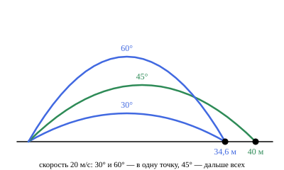

Куда упадёт мяч? Это главный вопрос в задачах про бросок под углом. В уроке 3.5 мы разложили бросок на два движения и нашли верхнюю точку. Теперь доведём полёт до конца: найдём время полёта и дальность, узнаем, под каким углом бросать дальше всего, и разберём бросок с крыши, где готовые формулы перестают работать.

## Время полёта

Пусть тело брошено с земли и падает на землю — на ту же высоту, с которой его бросили. Вертикальное движение — бросок вверх со скоростью $v_{0y}$, а в уроке 3.3 мы выяснили, что спуск длится столько же, сколько подъём. Значит, весь полёт — дважды время подъёма:

$$
t_{\text{пол}} = \frac{2 v_{0y}}{g} = \frac{2 v_0 \sin\alpha}{g}.
$$

То же получится из уравнения $y = v_0 \sin\alpha \cdot t - \dfrac{gt^2}{2} = 0$. Вынесем $t$: $t\left(v_0\sin\alpha - \dfrac{gt}{2}\right) = 0$. Корень $t = 0$ — момент броска, второй корень — момент падения, тот же $\dfrac{2v_0\sin\alpha}{g}$.

## Дальность

За время полёта тело равномерно летит по горизонтали со скоростью $v_0 \cos\alpha$. Дальность:

$$
L = v_0 \cos\alpha \cdot t_{\text{пол}} = \frac{2 v_0^2 \sin\alpha \cos\alpha}{g}.
$$

Из тригонометрии $2\sin\alpha\cos\alpha = \sin 2\alpha$. Получаем формулу, которую стоит помнить:

$$
L = \frac{v_0^2 \sin 2\alpha}{g}.
$$

**Пример (так выглядит задача 1 ЕГЭ).** Мяч бросили с земли под углом $30^\circ$ к горизонту со скоростью $20\ \text{м/с}$. На каком расстоянии от точки броска он упадёт?

Решим по шагам, через проекции — так надёжнее, чем вспоминать готовую формулу:

- проекции: $v_x = 20 \cos 30^\circ \approx 17{,}3\ \text{м/с}$, $v_{0y} = 20 \sin 30^\circ = 10\ \text{м/с}$;
- время полёта: $t = \dfrac{2 \cdot 10}{10} = 2\ \text{с}$;
- дальность: $L = 17{,}3 \cdot 2 \approx 34{,}6\ \text{м}$.

Проверим по формуле — ответ тот же:

$$
L = \frac{20^2 \sin 60^\circ}{10} = 40 \cdot 0{,}866 \approx 34{,}6\ \text{м}.
$$

## Под каким углом бросать дальше всего

В формуле дальности от угла зависит только $\sin 2\alpha$. Синус не бывает больше единицы, а $\sin 2\alpha = 1$ при $2\alpha = 90^\circ$. Значит, с земли на землю тело летит **дальше всего при $\alpha = 45^\circ$**, и тогда

$$
L_{\max} = \frac{v_0^2}{g}.
$$

Почему не круче и не положе? Бросишь полого — горизонтальная скорость большая, но мяч быстро упадёт. Бросишь круто — мяч долго в воздухе, но медленно летит вбок. $45^\circ$ — лучший компромисс.

Ещё одна особенность: $\sin 60^\circ = \sin 120^\circ$. Поэтому углы $30^\circ$ и $60^\circ$ дают **одинаковую дальность**. Так для любых двух углов, которые в сумме дают $90^\circ$: $20^\circ$ и $70^\circ$, $40^\circ$ и $50^\circ$. Крутой бросок летит выше и дольше, пологий — ниже и быстрее, а падают они в одну точку.

Проверь это на модели. Брось мяч под углом $30^\circ$, а потом под $60^\circ$ с той же скоростью: прошлая траектория останется пунктиром. Потом попробуй $45^\circ$. Посмотри и на стрелки скорости: горизонтальная проекция весь полёт одна и та же, а вертикальная уменьшается до нуля в верхней точке и меняет направление.

<pp-projectile v0="20" angle="30" h0="0">Здесь интерактивная модель броска — для неё нужен JavaScript.</pp-projectile>

Проверь себя: мяч бросили под углом 45° со скоростью 20 м/с. Как далеко он улетит и какова его скорость в верхней точке?

$L = \dfrac{20^2 \sin 90^\circ}{10} = 40\ \text{м}$. В верхней точке остаётся горизонтальная проекция: $v = 20 \cos 45^\circ \approx 14{,}1\ \text{м/с}$.

<pp-task id="ks-fall-07"></pp-task>

<pp-task id="ks-fall-16"></pp-task>

## Когда готовые формулы не работают

Формулы $t_{\text{пол}} = \dfrac{2v_0\sin\alpha}{g}$ и $L = \dfrac{v_0^2\sin 2\alpha}{g}$ мы вывели для полёта **с земли на землю**: подъём и спуск зеркальные. Если тело брошено с крыши, балкона или обрыва и падает ниже, спуск длиннее подъёма, и формулы дают неверный ответ.

Зато уравнения $x(t)$ и $y(t)$ из урока 3.5 работают **всегда**. Подвинь в модели высоту броска — увидишь, как траектория удлиняется вниз.

**Пример.** С крыши высотой $15\ \text{м}$ бросили мяч под углом $30^\circ$ к горизонту вверх со скоростью $20\ \text{м/с}$. Где он упадёт?

1. Ось $Oy$ — вверх, начало — **на земле** под точкой броска. Тогда $y_0 = 15\ \text{м}$, $v_{0y} = 20 \sin 30^\circ = 10\ \text{м/с}$.
2. Уравнение высоты: $y = 15 + 10t - 5t^2$.
3. Мяч на земле, когда $y = 0$: $5t^2 - 10t - 15 = 0$, то есть $t^2 - 2t - 3 = 0$. Корни $t = 3$ и $t = -1$. Отрицательное время не подходит: $t = 3\ \text{с}$.
4. Дальность: $L = v_x t = 20 \cos 30^\circ \cdot 3 \approx 17{,}3 \cdot 3 \approx 52\ \text{м}$.

По формуле «с земли на землю» вышло бы $2\ \text{с}$ и $34{,}6\ \text{м}$ — заметно меньше. Мяч летит дольше, потому что падает на $15\ \text{м}$ ниже точки броска.

Так же находят скорость в любой точке: $v_x = v_0\cos\alpha$, $v_y = v_0\sin\alpha - gt$ и, как в уроке 3.4, $v = \sqrt{v_x^2 + v_y^2}$.

<pp-task id="ks-fall-17"></pp-task>

## Частые ловушки

- **Применили $L = \dfrac{v_0^2 \sin 2\alpha}{g}$, когда тело падает ниже точки броска.** Тогда решай через $x(t)$ и $y(t)$.
- **Подставили $\sin 45^\circ$ вместо $\sin 90^\circ$.** В формуле дальности синус **двойного** угла.
- **Взяли отрицательный корень** квадратного уравнения. Время полёта положительное.
- **«Больше угол — дальше полёт».** Нет: дальше всего при $45^\circ$, а $30^\circ$ и $60^\circ$ дают одну дальность.

## Коротко

- С земли на землю: $t_{\text{пол}} = \dfrac{2v_0\sin\alpha}{g}$ — дважды время подъёма.
- Дальность $L = \dfrac{v_0^2 \sin 2\alpha}{g}$; наибольшая при $\alpha = 45^\circ$: $L_{\max} = \dfrac{v_0^2}{g}$.
- Углы, дополняющие друг друга до $90^\circ$, дают одинаковую дальность.
- Если точки броска и падения на разной высоте — только уравнения $x(t)$, $y(t)$: найди $t$ из $y = 0$, потом $L = v_x t$.
- Скорость в любой точке: $v = \sqrt{v_x^2 + v_y^2}$.

Это последний урок темы. Ты научился описывать любой полёт без сопротивления воздуха: от камня в колодце до мяча с крыши. Дальше — тема «Движение по окружности»: там скорость не меняется по модулю, а ускорение всё равно есть.
