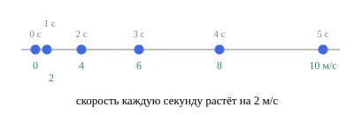

До сих пор скорость тела не менялась. Но так почти не бывает: машина трогается, разгоняется, тормозит. В этом уроке мы научимся описывать числом, **как быстро** меняется скорость.

## Скорость, которая меняется

Ты сидишь в машине на светофоре. Загорается зелёный, водитель жмёт на газ, и ты смотришь на спидометр каждую секунду. Переведём его показания в м/с:

| Время, с | $0$ | $1$ | $2$ | $3$ | $4$ | $5$ |
|---|---|---|---|---|---|---|
| Скорость, м/с | $0$ | $2$ | $4$ | $6$ | $8$ | $10$ |

Каждую секунду скорость прибавляет одно и то же: $2\ \text{м/с}$. Если снять машину со вспышкой раз в секунду, отметки будут ложиться всё дальше друг от друга: с каждой секундой машина едет быстрее и проезжает больше.

Спидометр показывает скорость **в данный момент**. Её называют **мгновенной скоростью**. В уроке 1.3 была средняя скорость — путь, делённый на всё время. Мгновенная — то, что видно на спидометре сейчас. При равномерном движении они совпадают, а при разгоне — нет.

## Что показывает ускорение

Чтобы описать разгон одним числом, посчитаем, **на сколько меняется скорость за одну секунду**. Эту величину называют **ускорением**:

$$
a = \frac{v - v_0}{t}.
$$

- $v_0$ — начальная скорость, м/с;
- $v$ — скорость через время $t$, м/с;
- $t$ — время, с;
- $a$ — ускорение, $\text{м/с}^2$.

Единица выглядит странно, но читается просто: «**метр в секунду за секунду**». Ускорение $2\ \text{м/с}^2$ значит: каждую секунду скорость растёт на $2\ \text{м/с}$. Квадрат появился потому, что мы два раза делим на секунды: сначала метры на секунды — это скорость, потом скорость ещё раз на секунды.

Сравни с уроком 1.2. Скорость — сколько метров добавляется за секунду. Ускорение — сколько **метров в секунду** добавляется за секунду. Тот же приём, только на ступеньку выше.

Если скорость каждую секунду меняется на одну и ту же величину, ускорение постоянно. Такое движение называют **равноускоренным**. Вся эта тема — про него.

Проверь себя: у какого тела ускорение больше — у машины, которая за 10 с разогналась с 0 до 20 м/с, или у велосипедиста, который за 2 с разогнался с 0 до 6 м/с?

Машина: $a = \dfrac{20}{10} = 2\ \text{м/с}^2$. Велосипедист: $a = \dfrac{6}{2} = 3\ \text{м/с}^2$. Ускорение больше у велосипедиста, хотя скорость у машины выше. Ускорение говорит не о том, как быстро тело едет, а о том, как быстро меняется его скорость.

<pp-task id="ks-accel-01"></pp-task>

## Скорость в любой момент

Перепишем формулу ускорения так, чтобы найти скорость. Умножим обе части на $t$ и перенесём $v_0$:

$$
v = v_0 + at.
$$

Запоминать отдельно не нужно — достаточно смысла: **была скорость $v_0$, и каждую секунду к ней добавляется $a$**. За $t$ секунд добавится $at$.

**Пример.** Мотоцикл едет со скоростью $5\ \text{м/с}$ и начинает разгоняться с ускорением $1{,}5\ \text{м/с}^2$. Какой будет скорость через $6\ \text{с}$?

$$
v = 5 + 1{,}5 \cdot 6 = 5 + 9 = 14\ \text{м/с}.
$$

Проверь единицы: $\text{м/с}^2 \cdot \text{с} = \text{м/с}$ — получилась скорость, как и должно быть.

## Торможение

Автобус подъезжает к остановке. Каждую секунду его скорость не растёт, а **уменьшается** на одно и то же число. Это тоже равноускоренное движение, только скорость убывает.

Для торможения формула та же по смыслу: была скорость $v_0$, и каждую секунду из неё **вычитается** $a$:

$$
v = v_0 - at,
$$

где $a$ — модуль ускорения, то есть число без знака. Автобус ехал $15\ \text{м/с}$ и тормозит с ускорением $3\ \text{м/с}^2$. Через $1\ \text{с}$ его скорость $12\ \text{м/с}$, через $2\ \text{с}$ — $9\ \text{м/с}$, и так далее.

<pp-task id="ks-accel-02"></pp-task>

## Когда тело остановится

Тормозящий автобус в какой-то момент встанет. Тогда $v = 0$:

$$
0 = v_0 - at \quad \Rightarrow \quad t = \frac{v_0}{a}.
$$

Смысл снова простой: скорость $v_0$ «тает» на $a$ каждую секунду — сколько секунд, чтобы её не осталось? Автобус с $15\ \text{м/с}$ при торможении $3\ \text{м/с}^2$ встанет через $15 : 3 = 5\ \text{с}$.

А что после остановки? **Автобус просто стоит.** Тормоза не разгоняют его назад. Формула $v = v_0 - at$ при $t = 7\ \text{с}$ дала бы $-6\ \text{м/с}$, но это бессмыслица: после $5\ \text{с}$ она уже не работает. Это одна из главных ловушек темы, мы ещё вернёмся к ней в уроке 2.4.

Проверь себя: поезд тормозит с ускорением 0,5 м/с² и останавливается через 40 с. С какой скоростью он ехал?

За каждую секунду скорость уменьшалась на $0{,}5\ \text{м/с}$, за $40\ \text{с}$ — на $0{,}5 \cdot 40 = 20\ \text{м/с}$. И до нуля. Значит, $v_0 = 20\ \text{м/с}$, то есть $72\ \text{км/ч}$.

<pp-task id="ks-accel-09"></pp-task>

## Частые ловушки

- **Умножили скорость на время** вместо деления. $a = \dfrac{v - v_0}{t}$: скорость **делим** на время. Проверяй единицами — должно выйти $\text{м/с}^2$.
- **Забыли начальную скорость.** «Трогается с места» значит $v_0 = 0$. «Ехал со скоростью…» — $v_0$ не ноль.
- **Не перевели км/ч в м/с.** Ускорение в задачах в $\text{м/с}^2$, значит, и скорость нужна в м/с.
- **Применили формулу после остановки.** Если $t$ больше, чем $v_0 / a$, тело уже стоит.
- **Решили, что большое ускорение — это большая скорость.** Нет: ускорение — это то, как быстро скорость меняется.

## Коротко

- Мгновенная скорость — скорость в данный момент, её показывает спидометр.
- Ускорение — изменение скорости за единицу времени: $a = \dfrac{v - v_0}{t}$, единица $\text{м/с}^2$.
- Равноускоренное движение — скорость каждую секунду меняется на одно и то же.
- Разгон: $v = v_0 + at$. Торможение: $v = v_0 - at$, $a$ — модуль ускорения.
- Время до остановки $t = \dfrac{v_0}{a}$; после остановки тело стоит.

Дальше — урок 2.2: почему разгон и торможение — это одна формула, если вспомнить, что ускорение — вектор.
