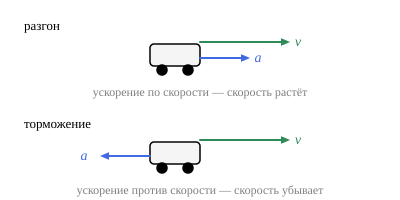
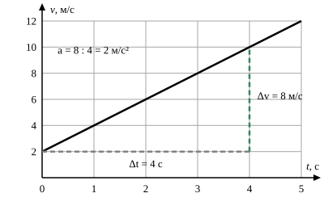

В уроке 2.1 у нас было две формулы: $v = v_0 + at$ для разгона и $v = v_0 - at$ для торможения. Каждый раз надо решать, какую брать. А если тело сначала тормозит, а потом едет обратно? В этом уроке мы сведём всё к одной формуле — с помощью проекций из урока 1.5.

## Куда направлено ускорение

Скорость — вектор. Ускорение показывает, как меняется этот вектор, поэтому оно тоже вектор:

$$
\vec a = \frac{\Delta \vec v}{\Delta t}.
$$

Здесь $\Delta \vec v = \vec v - \vec v_0$ — изменение скорости, «конец минус начало», как с перемещением в уроке 1.5. Куда смотрит $\Delta \vec v$, туда смотрит и ускорение.

- **Разгон.** Машина едет вправо, скорость растёт: была $10\ \text{м/с}$, стала $14\ \text{м/с}$. Изменение — $4\ \text{м/с}$ вправо. Ускорение направлено **по скорости**.
- **Торможение.** Машина едет вправо, скорость падает: была $14\ \text{м/с}$, стала $10\ \text{м/с}$. Изменение — $4\ \text{м/с}$ влево, против движения. Ускорение направлено **против скорости**.

Обрати внимание: при торможении машина едет **вправо**, а ускорение смотрит **влево**. Направление ускорения не обязано совпадать с направлением движения. Ускорение показывает не куда тело едет, а куда «тянут» его скорость.

Отсюда важный вывод. Слова «тело тормозит» не значат «у тела нет ускорения» или «ускорение отрицательное само по себе». У тормозящего тела ускорение есть, просто оно смотрит против скорости.

## Одна формула со знаками

Выберем ось $Ox$ и возьмём проекции, как в уроке 1.5: вектор по оси — плюс, против оси — минус. Векторное равенство $\vec v = \vec v_0 + \vec a t$ превращается в равенство чисел:

$$
v_x = v_{0x} + a_x t.
$$

Эта формула работает **всегда** — и при разгоне, и при торможении. Знаки сами сделают всю работу.

**Пример.** Автобус едет по оси со скоростью $15\ \text{м/с}$ и тормозит с ускорением $3\ \text{м/с}^2$. Скорость смотрит по оси: $v_{0x} = +15\ \text{м/с}$. Ускорение — против скорости, значит, против оси: $a_x = -3\ \text{м/с}^2$. Через $4\ \text{с}$:

$$
v_x = 15 + (-3) \cdot 4 = 3\ \text{м/с}.
$$

Получилось то же, что в уроке 2.1 по формуле торможения. Но теперь не надо выбирать формулу — надо только правильно поставить знаки.

Как понять по знакам, что происходит:

- $v_x$ и $a_x$ **одного знака** — тело разгоняется.
- $v_x$ и $a_x$ **разных знаков** — тело тормозит.

Проверь себя: v₀ₓ = −10 м/с, aₓ = −2 м/с². Тело разгоняется или тормозит?

Знаки одинаковые — разгоняется. Тело едет против оси, и ускорение тоже смотрит против оси, то есть по скорости. Через $1\ \text{с}$ $v_x = -12\ \text{м/с}$: модуль скорости вырос. Минус не значит «тормозит», он значит «против оси».

## Разворот

Шайбу толкнули вверх по гладкой ледяной горке. Она поднимается всё медленнее, на миг останавливается и скользит обратно, всё быстрее. Всё это время ускорение одно и то же: оно направлено вниз вдоль склона.

Формулы урока 2.1 тут неудобны: сначала торможение, потом разгон, две формулы. А в проекциях — одна. Направим ось вверх по склону. Пусть шайбу толкнули со скоростью $6\ \text{м/с}$, ускорение $2\ \text{м/с}^2$ вниз:

$$
v_x = 6 - 2t.
$$

| $t$, с | $0$ | $1$ | $2$ | $3$ | $4$ | $5$ |
|---|---|---|---|---|---|---|
| $v_x$, м/с | $6$ | $4$ | $2$ | $0$ | $-2$ | $-4$ |

До $3\ \text{с}$ проекция положительна — шайба едет вверх. В $3\ \text{с}$ она равна нулю — шайба остановилась. После — **отрицательна**: шайба уже едет вниз. Отрицательный ответ здесь не ошибка, а информация.

Чем это отличается от автобуса из урока 2.1, который после остановки стоит? Тормоза автобуса действуют, только пока он едет, а горка тянет шайбу вниз всегда. Как понять, какой случай в задаче, — тема «Законы Ньютона». Пока запомни: в задаче всегда сказано, движется ли тело дальше с тем же ускорением.

<pp-task id="ks-accel-03"></pp-task>

## График скорости

Нарисуем $v_x(t)$ при равноускоренном движении. Скорость каждую секунду меняется на одно и то же, поэтому точки ложатся на **наклонную прямую**.

Что видно на графике:

- **При $t = 0$** прямая начинается на высоте $v_{0x}$ — это начальная скорость.
- **Наклон прямой — ускорение.** Возьми две точки, найди, на сколько выросла скорость и за какое время: $a_x = \dfrac{\Delta v_x}{\Delta t}$. На рисунке $\dfrac{8}{4} = 2\ \text{м/с}^2$.
- **Прямая идёт вверх** — $a_x > 0$. **Вниз** — $a_x < 0$. **Горизонтальна** — ускорения нет, движение равномерное.
- **Где прямая пересекает ось времени**, $v_x = 0$ — тело остановилось. Если прямая уходит под ось, тело поехало обратно.

Если тебе дают формулу вида $v_x = 8 - 2t$, сравни её с $v_x = v_{0x} + a_x t$: число без $t$ — это $v_{0x} = 8\ \text{м/с}$, число перед $t$ — это $a_x = -2\ \text{м/с}^2$.

<pp-task id="ks-accel-10"></pp-task>

## Частые ловушки

- **Решили, что ускорение смотрит туда, куда едет тело.** При торможении — наоборот.
- **Поставили знак, не выбрав ось.** Сначала ось, потом знаки проекций.
- **Испугались отрицательной скорости в ответе.** $v_x < 0$ значит «едет против оси».
- **Путают «отрицательное ускорение» и «торможение».** Тело тормозит, когда знаки $v_x$ и $a_x$ разные, а не когда $a_x < 0$.
- **Читают ускорение по высоте графика.** Высота графика $v_x(t)$ — скорость, а ускорение — наклон.

## Коротко

- Ускорение — вектор: $\vec a = \dfrac{\Delta \vec v}{\Delta t}$.
- Разгон — ускорение по скорости, торможение — против скорости.
- В проекциях одна формула на все случаи: $v_x = v_{0x} + a_x t$.
- Знаки $v_x$ и $a_x$ одинаковые — разгоняется, разные — тормозит.
- Если ускорение не пропадает после остановки, тело разворачивается, $v_x$ меняет знак.
- График $v_x(t)$ — прямая; начальная высота — $v_{0x}$, наклон — $a_x$.

Дальше — урок 2.3: как найти путь, если скорость всё время разная.
