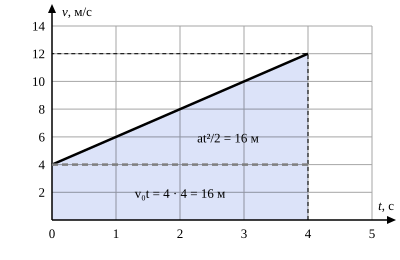
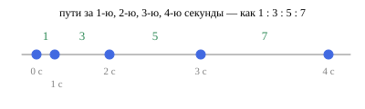

Скорость машины всё время разная — в начале $0$, через $5\ \text{с}$ уже $10\ \text{м/с}$. Формула $s = vt$ не годится: какую $v$ в неё подставлять? В этом уроке поможет одна идея из урока 1.2, которая тогда казалась просто другим способом посчитать: путь — это площадь под графиком скорости.

## Площадь под графиком

Вспомним урок 1.2. При равномерном движении график $v(t)$ — горизонтальная прямая, а под ней прямоугольник. Его площадь $v \cdot t$ — это путь.

Теперь пусть скорость меняется. Разобьём время на маленькие кусочки, например по $0{,}1\ \text{с}$. За такой короткий кусочек скорость почти не успевает измениться, и путь за него — почти $v \cdot 0{,}1$, площадь узкого столбика под графиком. Сложим все столбики — получим площадь всей фигуры под графиком. Чем кусочки мельче, тем точнее.

> **Путь равен площади под графиком скорости.** Это правило верно для любого движения, не только равноускоренного.

Посмотри, как это работает. Запусти машину, потом поменяй начальную скорость или ускорение. Отметки на дороге ставятся каждую секунду, а под графиком закрашивается площадь — она растёт ровно так, как растёт путь.

<pp-accel v0="0" a="2">Здесь интерактивная модель равноускоренного движения — для неё нужен JavaScript.</pp-accel>

Попробуй отрицательное ускорение при ненулевой начальной скорости. Машина затормозит и встанет, график ляжет на ось времени, и закрашенная площадь перестанет расти. Путь больше не растёт — машина стоит.

## Разгон из покоя

Начнём с самого простого случая. Машина трогается с места ($v_0 = 0$) с ускорением $a$. Через время $t$ её скорость $v = at$. График $v(t)$ — прямая из начала координат, а под ней **треугольник** с катетами $t$ и $at$:

$$
s = \frac{1}{2} \cdot t \cdot at = \frac{at^2}{2}.
$$

**Пример.** Велосипедист трогается с ускорением $2\ \text{м/с}^2$. За $5\ \text{с}$ он проедет $\dfrac{2 \cdot 5^2}{2} = 25\ \text{м}$. Проверим по смыслу: в конце его скорость $10\ \text{м/с}$, в начале $0$. Если бы он все $5\ \text{с}$ ехал со скоростью $10\ \text{м/с}$, проехал бы $50\ \text{м}$. Но он разгонялся, и вышло вдвое меньше.

Обрати внимание на $t^2$. Время выросло вдвое — путь вырос **вчетверо**: за $10\ \text{с}$ велосипедист проедет уже $100\ \text{м}$.

<pp-task id="ks-accel-04"></pp-task>

## Разгон с начальной скоростью

Теперь пусть в начале скорость уже была: $v_0 = 4\ \text{м/с}$, и за $4\ \text{с}$ она равномерно выросла до $12\ \text{м/с}$. Под графиком — **трапеция**. Разрежем её пунктиром на две простые фигуры.

- **Прямоугольник** высотой $v_0$ и шириной $t$. Его площадь $v_0 t$ — путь, который тело прошло бы, если бы ехало без разгона.
- **Треугольник** над ним, катеты $t$ и $at$. Его площадь $\dfrac{at^2}{2}$ — добавка за счёт разгона.

Вместе:

$$
s = v_0 t + \frac{at^2}{2}.
$$

На рисунке ускорение $a = \dfrac{12 - 4}{4} = 2\ \text{м/с}^2$, и $s = 4 \cdot 4 + \dfrac{2 \cdot 16}{2} = 16 + 16 = 32\ \text{м}$.

Для торможения в проекциях формула та же, только $a_x < 0$, как в уроке 2.2:

$$
s_x = v_{0x} t + \frac{a_x t^2}{2}.
$$

Треугольник «вычитается» из прямоугольника: тормозящее тело проходит меньше, чем прошло бы без торможения.

## Средняя скорость при разгоне

У той же трапеции площадь можно посчитать и по-другому — как в геометрии: **полусумма оснований на высоту**. Основания здесь — $v_0$ и $v$, высота — $t$:

$$
s = \frac{v_0 + v}{2} \cdot t.
$$

Проверим: $\dfrac{4 + 12}{2} \cdot 4 = 32\ \text{м}$, совпало. Эта формула удобна, когда известны начальная и конечная скорость, а ускорение не дано.

Отсюда следует, что при **равноускоренном** движении средняя скорость — ровно среднее арифметическое начальной и конечной:

$$
v_{\text{ср}} = \frac{v_0 + v}{2}.
$$

Стоп, а как же урок 1.3? Там среднее арифметическое скоростей было ловушкой. Всё верно: там скорость менялась **скачком** — полпути одна, полпути другая. А здесь она растёт **равномерно**, и сколько времени тело было «медленнее середины», столько же оно было «быстрее». Поэтому только для равноускоренного движения эта формула верна.

Проверь себя: машина разгоняется из покоя до 20 м/с. Какова её средняя скорость за время разгона?

$v_{\text{ср}} = \dfrac{0 + 20}{2} = 10\ \text{м/с}$. Если разгон длился, например, $8\ \text{с}$, путь $10 \cdot 8 = 80\ \text{м}$.

<pp-task id="ks-accel-11"></pp-task>

<pp-task id="ks-accel-05"></pp-task>

## Правило нечётных чисел

Ещё раз посмотрим на разгон из покоя. Пусть $a = 2\ \text{м/с}^2$, тогда $s = t^2$. За $1\ \text{с}$ тело проходит $1\ \text{м}$, за $2\ \text{с}$ — $4\ \text{м}$, за $3\ \text{с}$ — $9\ \text{м}$, за $4\ \text{с}$ — $16\ \text{м}$. Пути от начала относятся как $1 : 4 : 9 : 16$ — как квадраты.

А сколько тело проходит **за каждую отдельную секунду**? За первую — $1\ \text{м}$. За вторую — $4 - 1 = 3\ \text{м}$. За третью — $9 - 4 = 5\ \text{м}$. За четвёртую — $16 - 9 = 7\ \text{м}$.

Получились нечётные числа:

$$
s_1 : s_2 : s_3 : s_4 : \ldots = 1 : 3 : 5 : 7 : \ldots
$$

Это верно при любом ускорении, если тело начинает **из покоя**: от ускорения зависит только масштаб, а отношения те же. На ЕГЭ это правило экономит время. Главное — различать «**за** третью секунду» (от $2$ до $3\ \text{с}$) и «**за три** секунды» (от $0$ до $3\ \text{с}$).

<pp-task id="ks-accel-08"></pp-task>

## Частые ловушки

- **Подставили в $s = vt$ конечную скорость.** При разгоне так нельзя: тело не всё время ехало быстро.
- **Забыли двойку** в $\dfrac{at^2}{2}$. Проверяй по треугольнику: площадь — **половина** произведения катетов.
- **Взяли среднее арифметическое скоростей**, когда движение не равноускоренное. Формула $\dfrac{v_0 + v}{2}$ — только для постоянного ускорения.
- **Перепутали «за третью секунду» и «за три секунды».**
- **Применили $1 : 3 : 5$ при ненулевой начальной скорости.** Правило — только для старта из покоя.

## Коротко

- Путь равен площади под графиком скорости — при любом движении.
- Из покоя: $s = \dfrac{at^2}{2}$, площадь треугольника.
- С начальной скоростью: $s_x = v_{0x}t + \dfrac{a_x t^2}{2}$ — прямоугольник плюс треугольник.
- $s = \dfrac{v_0 + v}{2} \cdot t$; при равноускоренном движении $v_{\text{ср}} = \dfrac{v_0 + v}{2}$.
- Из покоя пути за последовательные равные промежутки относятся как $1 : 3 : 5 : 7 : \ldots$

Дальше — урок 2.4: как найти тормозной путь, если время не дано, и почему он растёт как квадрат скорости.
