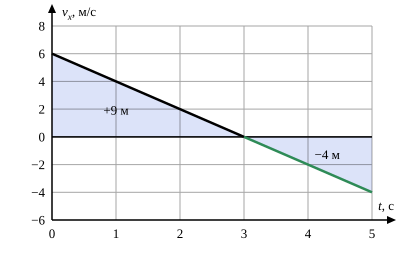

В уроке 1.5 уравнение $x = x_0 + v_x t$ отвечало на вопрос «где тело в любой момент» при равномерном движении. Теперь сделаем то же для равноускоренного. Получится уравнение, которое на ЕГЭ встречается чаще любой другой формулы кинематики: его дают готовым и просят найти скорость, ускорение или путь.

## Уравнение координаты

В уроке 1.5 мы выяснили, что проекция перемещения — это конец минус начало: $s_x = x - x_0$. В уроке 2.3 нашли проекцию перемещения при равноускоренном движении: $s_x = v_{0x}t + \dfrac{a_x t^2}{2}$. Приравняем:

$$
x = x_0 + v_{0x} t + \frac{a_x t^2}{2}.
$$

- $x_0$ — координата при $t = 0$, м;
- $v_{0x}$ — проекция начальной скорости, м/с;
- $a_x$ — проекция ускорения, $\text{м/с}^2$;
- $x$ — координата в момент $t$, м.

Все проекции — со своими знаками, как в уроке 2.2. При $a_x = 0$ получается старое уравнение $x = x_0 + v_x t$: равномерное движение — частный случай.

Вместе с ним почти всегда нужно уравнение скорости из урока 2.2:

$$
v_x = v_{0x} + a_x t.
$$

## Как читать готовое уравнение

На ЕГЭ уравнение часто дают с числами: «координата меняется по закону $x = 5 + 4t - 2t^2$». Сравним его с общим видом **по коэффициентам**:

| Общий вид | $x_0$ | $+\ v_{0x}\, t$ | $+\ \dfrac{a_x}{2}\, t^2$ |
|---|---|---|---|
| Уравнение | $5$ | $+\ 4\, t$ | $-\ 2\, t^2$ |

- Число без $t$: $x_0 = 5\ \text{м}$.
- Число перед $t$: $v_{0x} = 4\ \text{м/с}$.
- Число перед $t^2$ — это **половина** ускорения: $\dfrac{a_x}{2} = -2$, значит, $a_x = -4\ \text{м/с}^2$.

Самая частая ошибка — забыть удвоить и сказать «ускорение $-2$». Перед $t^2$ стоит не $a_x$, а $\dfrac{a_x}{2}$.

Теперь легко написать уравнение скорости: $v_x = 4 - 4t$. Знаки $v_{0x}$ и $a_x$ разные — тело сначала тормозит. Через $1\ \text{с}$ оно остановится и дальше поедет против оси.

Проверь себя: x = −3 + 6t². Найди x₀, v₀ₓ и aₓ.

$x_0 = -3\ \text{м}$. Слагаемого с $t$ нет, значит, $v_{0x} = 0$ — тело стартует из покоя. Перед $t^2$ стоит $6 = \dfrac{a_x}{2}$, значит, $a_x = 12\ \text{м/с}^2$.

<pp-task id="ks-accel-07"></pp-task>

## Три графика одного движения

Возьмём движение $x = 2 + 6t - t^2$. Здесь $x_0 = 2\ \text{м}$, $v_{0x} = 6\ \text{м/с}$, $a_x = -2\ \text{м/с}^2$, и $v_x = 6 - 2t$. Нарисуем три графика.

**Ускорение $a_x(t)$** — горизонтальная прямая на высоте $-2$: ускорение не меняется. Это самый скучный график, но на ЕГЭ его тоже просят узнать.

**Скорость $v_x(t)$** — наклонная прямая, как в уроке 2.2. Начинается на высоте $6$, наклон $-2$, пересекает ось времени при $t = 3\ \text{с}$.

**Координата $x(t)$** — **парабола**. Это понятно из уравнения: в нём есть $t^2$.

Как графики связаны между собой:

- **Наклон графика $x(t)$ — скорость.** В начале парабола круто идёт вверх: скорость $6\ \text{м/с}$. Чем ближе к $3\ \text{с}$, тем она положе — тело тормозит.
- **Вершина параболы — разворот.** В ней наклон нулевой, $v_x = 0$. Это тот же момент, когда график $v_x(t)$ пересекает ось времени.
- **Ветви параболы смотрят вниз**, если $a_x < 0$, и вверх, если $a_x > 0$.

На ЕГЭ часто дают график и спрашивают, какому уравнению он соответствует. Смотри на три вещи: где график начинается ($x_0$), куда сначала идёт (знак $v_{0x}$) и куда смотрят ветви (знак $a_x$).

## Путь с разворотом

Какой путь пройдёт это тело за $5\ \text{с}$? Соблазн — посчитать $x(5) - x(0)$:

$$
x(5) = 2 + 30 - 25 = 7\ \text{м}, \qquad x(5) - x(0) = 7 - 2 = 5\ \text{м}.
$$

Но это **перемещение**, а не путь. Вспомни урок 1.4: если тело развернулось, путь больше перемещения. Тело сначала уехало от $2$ до $11\ \text{м}$, потом вернулось до $7\ \text{м}$. Каждый метр считается:

$$
l = (11 - 2) + (11 - 7) = 9 + 4 = 13\ \text{м}.
$$

То же видно на графике скорости. До разворота площадь над осью — тело едет по оси. После — площадь под осью, тело едет обратно.

- **Перемещение** — площади **со знаками**: $9 - 4 = 5\ \text{м}$.
- **Путь** — площади **по модулю**: $9 + 4 = 13\ \text{м}$.

План для любой задачи «найди путь»:

1. Найди момент разворота: $v_x = 0$.
2. Если он попадает внутрь промежутка — раздели движение на «до» и «после».
3. Найди перемещение на каждом участке и сложи **модули**.

<pp-task id="ks-accel-14"></pp-task>

## То же в векторах

Уравнения для скорости и координаты — это проекции векторных формул:

$$
\vec v = \vec v_0 + \vec a t, \qquad \vec r = \vec r_0 + \vec v_0 t + \frac{\vec a t^2}{2}.
$$

Здесь $\vec r$ — радиус-вектор, стрелка из начала координат в точку, где тело. Пока скорость и ускорение смотрят вдоль одной прямой, хватает одной оси. Но они не обязаны: камень, брошенный горизонтально, летит вперёд, а ускорение у него вниз. Тогда берут две оси, $x$ и $y$, и пишут одно уравнение для каждой. Так решают задачи о броске в следующей теме.

## Частые ловушки

- **Забыли удвоить**, читая ускорение из уравнения: перед $t^2$ стоит $\dfrac{a_x}{2}$.
- **Путают путь и перемещение** при развороте. Найди момент $v_x = 0$ и посчитай участки отдельно.
- **Путают графики.** Парабола — это $x(t)$, наклонная прямая — $v_x(t)$, горизонтальная — $a_x(t)$.
- **Читают скорость как высоту графика $x(t)$.** Скорость — это наклон, а не высота.
- **Не учли знаки.** Тело стартует против оси или ускорение против оси — в уравнении минус.

## Коротко

- $x = x_0 + v_{0x}t + \dfrac{a_x t^2}{2}$ и $v_x = v_{0x} + a_x t$.
- В готовом уравнении коэффициент при $t^2$ — это $\dfrac{a_x}{2}$.
- Графики: $a_x(t)$ — горизонтальная прямая, $v_x(t)$ — наклонная, $x(t)$ — парабола.
- Вершина параболы — разворот, $v_x = 0$.
- Перемещение — площади под $v_x(t)$ со знаками, путь — по модулю.
- В векторах: $\vec r = \vec r_0 + \vec v_0 t + \dfrac{\vec a t^2}{2}$ — две проекции, если движение не по прямой.

Это последний урок темы. Дальше — «Свободное падение и движение тела, брошенного под углом»: те же формулы, только ускорение всегда $g$ и направлено вниз.
