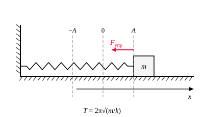

Качели, маятник старых часов, груз на пружине, струна гитары — все они колеблются. Колебания встречаются в задаче 4 и в задачах 5–6, а идеи отсюда потом повторятся в электрическом колебательном контуре.

Что такое колебания, чем они характеризуются и что такое резонанс, рассказывают в 9 классе. Формулы гармонических колебаний и периодов маятников — в 11. Пригодятся темы «Механическая энергия» и «Движение по окружности» (оттуда период, частота и $\omega$).

## Шаг 1. Колебания, период и частота (9 класс)

Подвесь грузик на пружине и оттяни вниз. Отпусти — он начнёт ходить вверх-вниз около положения равновесия. Это **колебания** — движения, которые повторяются через равные промежутки времени.

Основные величины:

- **Амплитуда** $A$ — наибольшее отклонение от положения равновесия, м.
- **Период** $T$ — время одного полного колебания, с.
- **Частота** $\nu$ — число колебаний за секунду, Гц.

Если за время $t$ тело совершило $N$ колебаний, то

$$
T = \frac{t}{N}, \qquad \nu = \frac{N}{t} = \frac{1}{T}.
$$

<pp-task id="ks-osc-01"></pp-task>

## Шаг 2. Путь за период (9 класс)

Одно полное колебание — это не «туда и обратно», а «туда, обратно, в другую сторону и снова в середину». Начнём из положения равновесия: до края — $A$, назад к равновесию — ещё $A$, до другого края — $A$, обратно — $A$. За один период тело проходит путь $4A$.

Перемещение за период при этом равно нулю: тело вернулось туда, откуда начало.

<pp-task id="ks-osc-02"></pp-task>

## Шаг 3. Превращения энергии при колебаниях (9 класс)

Отклони маятник и отпусти. В крайней точке он на миг останавливается: энергия вся потенциальная. Проходя положение равновесия, он движется быстрее всего: энергия вся кинетическая. Дальше всё повторяется — это то же, что качели в теме «Механическая энергия».

Если трения нет, механическая энергия сохраняется. Для маятника, поднимающегося в крайней точке на высоту $h$ над нижней:

$$
m g h = \frac{m v_{\max}^2}{2}, \qquad v_{\max} = \sqrt{2 g h}.
$$

<pp-task id="ks-osc-03"></pp-task>

## Шаг 4. Затухающие, вынужденные колебания и резонанс (9 класс)

В жизни трение есть, и размах качелей постепенно уменьшается — колебания **затухают**. Колебания, которые идут сами после толчка, называют **свободными**. Их частота — **собственная** частота системы.

Чтобы колебания не затухали, систему подталкивают периодической силой. Это **вынужденные** колебания: они идут с частотой внешней силы.

Качаешь ребёнка на качелях. Если толкать невпопад, качели почти не раскачаются. Если толкать в такт их собственным колебаниям, амплитуда будет расти. Это **резонанс** — резкий рост амплитуды вынужденных колебаний, когда частота внешней силы совпадает с собственной частотой системы.

## Шаг 5. Гармонические колебания (11 класс)

Если координата меняется по закону синуса или косинуса, колебания называют **гармоническими**:

$$
x(t) = A \cos(\omega t + \varphi_0).
$$

- $A$ — амплитуда;
- $\omega$ — **циклическая частота**, рад/с: $\omega = 2\pi\nu = \dfrac{2\pi}{T}$ — как угловая скорость при движении по окружности;
- $\omega t + \varphi_0$ — фаза, $\varphi_0$ — начальная фаза.

Из уравнения сразу читаются амплитуда (число перед косинусом) и $\omega$ (число перед $t$). Из $\omega$ находятся период и частота.

<pp-task id="ks-osc-04"></pp-task>

## Шаг 6. Скорость и ускорение при колебаниях (11 класс)

Скорость и ускорение тоже меняются гармонически. Их наибольшие значения:

$$
v_{\max} = A\omega, \qquad a_{\max} = A\omega^2.
$$

Сравни с движением по окружности: $v = \omega R$, $a = \omega^2 R$ — то же самое, только вместо радиуса амплитуда.

В положении равновесия скорость максимальна, а ускорение равно нулю. В крайних точках наоборот: скорость нулевая, ускорение максимально. Ускорение всегда направлено к положению равновесия.

<pp-task id="ks-osc-05"></pp-task>

## Шаг 7. Пружинный маятник (11 класс)

Груз на пружине колеблется с периодом

$$
T = 2\pi \sqrt{\frac{m}{k}}.
$$

- $m$ — масса груза, кг;
- $k$ — жёсткость пружины, Н/м.

Тяжелее груз — колебания медленнее. Жёстче пружина — быстрее. Период **не зависит от амплитуды** и от того, висит маятник вертикально или лежит на гладком столе.

<pp-task id="ks-osc-06"></pp-task>

## Шаг 8. Математический маятник (11 класс)

Маленький тяжёлый груз на лёгкой нерастяжимой нити:

$$
T = 2\pi \sqrt{\frac{l}{g}}.
$$

- $l$ — длина нити, м;
- $g$ — ускорение свободного падения.

Период **не зависит от массы** груза. Формула верна только для малых углов отклонения (до $10$–$15^\circ$).

На Луне, где $g$ меньше, тот же маятник качается медленнее. Удлинили нить в 4 раза — период вырос в 2 раза.

<pp-task id="ks-osc-07"></pp-task>

## Шаг 9. Энергия гармонических колебаний (11 класс)

Вернёмся к энергии из шага 3, теперь для пружинного маятника. В крайней точке энергия — это энергия сжатой пружины, в положении равновесия — кинетическая энергия груза:

$$
\frac{k A^2}{2} = \frac{m v_{\max}^2}{2}.
$$

Кинетическая и потенциальная энергии колеблются с частотой **вдвое большей**, чем координата: за один период энергия дважды становится полностью кинетической (тело дважды проходит положение равновесия).

<pp-task id="ks-osc-08"></pp-task>

## Частые ловушки

- **Путают период и частоту.** Если «за $10\ \text{с}$ — $20$ колебаний», то $T = 0{,}5\ \text{с}$, $\nu = 2\ \text{Гц}$.
- **Путают $\nu$ и $\omega$.** В $x = A\cos\omega t$ число перед $t$ — это $\omega = 2\pi\nu$, а не частота.
- **Думают, что период маятника зависит от массы груза** (математический) или от $g$ (пружинный). Ровно наоборот.
- **Путь за период считают равным $2A$.** Он равен $4A$.
- **Считают частоту энергии равной частоте колебаний.** Она вдвое больше.

## Как это выглядит на ЕГЭ

*Груз на пружине совершает $30$ колебаний за $15\ \text{с}$. Каким станет период, если массу груза увеличить в $4$ раза?*

Сначала период: $T = 15 / 30 = 0{,}5\ \text{с}$.

Период пружинного маятника пропорционален $\sqrt m$. Масса выросла в 4 раза — период вырос в $\sqrt 4 = 2$ раза:

$$
T' = 2 \cdot 0{,}5 = 1\ \text{с}.
$$

## Коротко

- $T = t/N = 1/\nu$, $\omega = 2\pi/T$; путь за период $4A$.
- Резонанс: частота внешней силы равна собственной.
- $x = A\cos(\omega t + \varphi_0)$, $v_{\max} = A\omega$, $a_{\max} = A\omega^2$.
- Пружинный: $T = 2\pi\sqrt{m/k}$. Математический: $T = 2\pi\sqrt{l/g}$.
- Энергия: $kA^2/2 = mv_{\max}^2/2$; энергии колеблются с частотой $2\nu$.
