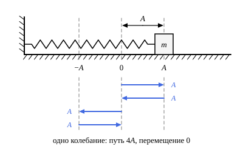

Подвесь грузик на резинке и потяни вниз. Отпусти — и он начнёт ходить вверх-вниз, вверх-вниз, снова и снова. Качели, маятник часов, ветка после того, как с неё вспорхнула птица, — то же самое. У всех этих движений одна общая черта: они **повторяются**. В этом уроке научимся описывать такие движения тремя числами.

## Что такое колебания

Положим брусок на гладкий стол и прикрепим к стене пружиной. Пока его никто не трогает, он стоит там, где пружина не растянута и не сжата. Это **положение равновесия**.

Оттянем брусок вправо и отпустим. Пружина тянет его назад, к равновесию (урок 6.1). Брусок разгоняется, по инерции проскакивает равновесие (урок 5.1), сжимает пружину, останавливается, возвращается… Движение повторяется раз за разом.

**Колебания** — это движение, которое повторяется через равные промежутки времени. Тело при этом ходит туда и обратно около положения равновесия.

Для колебаний нужны две вещи: сила, которая возвращает тело к равновесию (у бруска — пружина, у качелей — сила тяжести), и инерция, из-за которой тело равновесие проскакивает.

## Амплитуда

Брусок отвели от равновесия на $A$ и отпустили. Без трения дальше чем на $A$ он не уйдёт ни в одну сторону: крайние положения — $A$ и $-A$.

**Амплитуда** $A$ — наибольшее отклонение тела от положения равновесия. Измеряется в метрах.

Амплитуда — это расстояние от середины до края, а не от края до края. Если брусок ходит между отметками $10\ \text{см}$ и $16\ \text{см}$, то размах $6\ \text{см}$, а амплитуда — вдвое меньше, $3\ \text{см}$.

## Период и частота

**Период** $T$ — время одного полного колебания, в секундах. **Частота** $\nu$ («ню») — число колебаний за одну секунду. Единица частоты — герц: $1\ \text{Гц}$ — одно колебание в секунду.

Это те же величины, что у вращения по окружности в уроке 4.1, только вместо оборотов — колебания. Если за время $t$ тело совершило $N$ колебаний, то

$$
T = \frac{t}{N}, \qquad \nu = \frac{N}{t} = \frac{1}{T}.
$$

**Пример.** Маятник часов совершает $30$ колебаний за $60\ \text{с}$:

$$
T = \frac{60}{30} = 2\ \text{с}, \qquad \nu = \frac{1}{2} = 0{,}5\ \text{Гц}.
$$

Измерять период удобно именно так — засечь время многих колебаний и поделить. Одно колебание слишком короткое, и ошибка секундомера была бы сравнима с ним самим.

<pp-task id="ks-osc-01"></pp-task>

<pp-task id="ks-osc-09"></pp-task>

## Путь за период

Сколько проходит брусок за одно колебание? Начнём из положения равновесия, как на рисунке:

1. до правого края — $A$;
2. назад к равновесию — ещё $A$;
3. до левого края — $A$;
4. назад к равновесию — $A$.

Одно полное колебание — это не «туда и обратно», а «туда, обратно, в другую сторону и снова в середину». За период тело проходит путь $4A$. Если начать с края, получится то же самое: край — середина — другой край — середина — край, снова четыре отрезка по $A$.

А **перемещение** за период — ноль (урок 1.4): тело вернулось туда, откуда начало. За половину периода тело проходит $2A$ — от края до края.

Проверь себя: амплитуда 5 см, период 2 с. Какой путь пройдёт тело за 3 с?

$3\ \text{с}$ — это полтора периода. За период путь $4A = 20\ \text{см}$, за половину — $2A = 10\ \text{см}$. Всего $30\ \text{см}$.

<pp-task id="ks-osc-02"></pp-task>

## Частые ловушки

- **Путают период и частоту.** «$20$ колебаний за $10\ \text{с}$»: период $T = 10/20 = 0{,}5\ \text{с}$, частота $\nu = 2\ \text{Гц}$. Период — секунды на колебание, частота — колебания в секунду.
- **Путь за период считают равным $2A$.** Он $4A$.
- **Амплитуду считают от края до края.** Это размах, $2A$.
- **Путают путь и перемещение.** За целое число периодов перемещение ноль, а путь — нет.

## Коротко

- Колебания — повторяющееся движение около положения равновесия.
- Амплитуда $A$ — наибольшее отклонение от равновесия.
- $T = \dfrac{t}{N}$, $\nu = \dfrac{N}{t} = \dfrac{1}{T}$.
- За период: путь $4A$, перемещение $0$.

Дальше — урок 13.2: почему качели без толчков останавливаются и как их раскачать.
