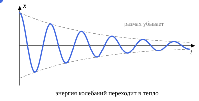
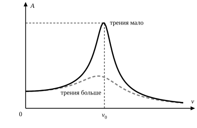

Раскачай качели и отойди. Они качаются всё слабее и через минуту-другую останавливаются. А если подталкивать — можно раскачать их так, что дух захватывает. Только толкать надо не как попало: невпопад качели почти не раскачаются. В этом уроке разберём, куда девается энергия колебаний и почему важен такт.

## Свободные колебания

Брусок на пружине из урока 13.1 оттянули и отпустили. Дальше его никто не трогает — он колеблется сам. Такие колебания называют **свободными**.

У каждой системы — свой «любимый» темп. Короткий маятник качается часто, длинный — медленно; тяжёлый груз на мягкой пружине — неторопливо. Частоту свободных колебаний называют **собственной частотой** системы $\nu_0$. Отчего она зависит, посчитаем в уроках 13.5 и 13.6.

## Затухание

В уроке 12.4 маятник без трения поднимался каждый раз на ту же высоту: механическая энергия сохранялась. В жизни есть сопротивление воздуха и трение в подвесе. Они совершают отрицательную работу, и механическая энергия понемногу переходит в тепло (урок 12.7).

Энергии становится меньше — и тело с каждым разом отходит от равновесия чуть меньше. Колебания **затухают**: амплитуда убывает, пока не станет нулём. Период при этом почти не меняется — на графике максимумы идут через те же промежутки времени, только всё ниже и ниже.

Сколько энергии ушло в тепло, легко найти по крайним точкам: там скорость ноль, и вся механическая энергия — потенциальная.

**Пример.** Шарик массой $0{,}2\ \text{кг}$ сначала поднимался в крайних точках на $5\ \text{см}$, а через минуту — на $2\ \text{см}$. В тепло ушло

$$
Q = m g (h_1 - h_2) = 0{,}2 \cdot 10 \cdot 0{,}03 = 0{,}06\ \text{Дж}.
$$

<pp-task id="ks-osc-10"></pp-task>

## Вынужденные колебания

Чтобы колебания не затухали, систему надо подталкивать — восполнять энергию, которую забирает трение. Если на тело действует внешняя сила, которая периодически меняется, колебания называют **вынужденными**.

Вынужденные колебания идут **с частотой внешней силы**, а не с собственной. Подёргай рукой резинку с грузиком — грузик будет ходить в том темпе, в каком двигается рука: хоть медленно, хоть быстро.

## Резонанс

С какой же частотой толкать качели? Посмотри на график. Пока частота толчков далека от собственной, амплитуда маленькая: толчки то помогают качелям, то мешают. Когда частота толчков приближается к $\nu_0$, каждый толчок приходится вовремя — когда качели и так движутся в его сторону. Каждый толчок добавляет энергию, и амплитуда растёт.

**Резонанс** — резкий рост амплитуды вынужденных колебаний, когда частота внешней силы совпадает с собственной частотой системы:

$$
\nu = \nu_0.
$$

Высота пика зависит от трения: чем трение меньше, тем выше и острее пик. Без трения амплитуда при резонансе росла бы, пока что-нибудь не сломается.

Резонанс бывает полезен: так раскачивают качели, так звучат струна и корпус гитары. Бывает и вреден: если такт шагов или порывов ветра совпадёт с собственной частотой моста, мост может раскачаться опасно сильно. Поэтому солдатам по мосту не велят идти в ногу, а машины и станки ставят так, чтобы их собственная частота была далеко от частоты работающего мотора.

Проверь себя: маятник совершает 15 колебаний за 30 с. С каким периодом нужно его подталкивать, чтобы раскачать?

Собственный период $T_0 = 30/15 = 2\ \text{с}$. Толкать нужно в такт — с тем же периодом $2\ \text{с}$: тогда частота толчков равна собственной частоте, $0{,}5\ \text{Гц}$. Можно толкать и через раз, раз в $4\ \text{с}$, — каждый толчок всё равно придётся вовремя, только раскачка пойдёт медленнее.

<pp-task id="ks-osc-11"></pp-task>

## Частые ловушки

- **Думают, что при затухании растёт период.** Убывает амплитуда, период почти тот же.
- **Считают, что вынужденные колебания идут с собственной частотой.** С частотой внешней силы.
- **Путают резонанс с любым сильным раскачиванием.** Резонанс — именно совпадение частоты силы с собственной частотой.
- **Ищут энергию, ушедшую в тепло, по одной высоте.** Нужна разность: $Q = mg(h_1 - h_2)$.

## Коротко

- Свободные колебания идут сами, с собственной частотой $\nu_0$.
- Из-за трения энергия уходит в тепло, амплитуда убывает — колебания затухают.
- Вынужденные колебания идут с частотой внешней силы.
- Резонанс: при $\nu = \nu_0$ амплитуда резко растёт; чем меньше трение, тем выше пик.

Дальше — урок 13.3, 11 класс: уравнение колебаний и как оно связано с движением по окружности.
