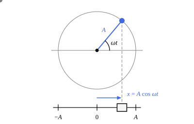
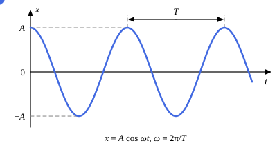

Посмотри на вращающееся колесо сбоку, так, чтобы диск превратился в чёрточку. Точка на ободе не бегает по кругу — она ходит туда-обратно вдоль чёрточки, совсем как груз на пружине. Это не просто похоже: движение получается **точно таким же**. В этом уроке воспользуемся этим, чтобы записать колебания формулой.

## Тень точки на окружности

Пусть точка равномерно движется по окружности радиусом $A$ с угловой скоростью $\omega$ (урок 4.4). В момент $t = 0$ она справа, на горизонтальном радиусе. За время $t$ радиус повернётся на угол

$$
\varphi = \omega t.
$$

Посветим на окружность сверху. Тень точки упадёт на горизонтальную прямую. Где она? Расстояние от середины до тени — это катет прямоугольного треугольника с гипотенузой $A$ и углом $\omega t$ при центре:

$$
x = A \cos \omega t.
$$

Тень ходит от $A$ до $-A$ и обратно. В середине, где точка на окружности движется поперёк прямой, тень проносится быстрее всего, у краёв — замирает и поворачивает. За один оборот точки тень совершает одно колебание. Значит, период колебаний — это период обращения, и

$$
\omega = \frac{2\pi}{T} = 2\pi\nu.
$$

В уроке 13.5 увидим: груз на пружине движется в точности как эта тень.

## Гармонические колебания

Колебания, при которых координата меняется по закону косинуса (или синуса), называют **гармоническими**. В общем виде

$$
x = A \cos(\omega t + \varphi_0).
$$

- $A$ — амплитуда, м;
- $\omega$ — **циклическая частота**, рад/с. Это угловая скорость той самой точки на окружности;
- $\omega t + \varphi_0$ — **фаза**, угол в радианах; $\varphi_0$ — начальная фаза: где была точка на окружности при $t = 0$.

Если груз отпустили из крайнего положения и в этот момент включили секундомер, $\varphi_0 = 0$ и $x = A\cos\omega t$. Если секундомер включили, когда груз проходил положение равновесия, получится синус: $x = A\sin\omega t$. Амплитуда и период от выбора начала отсчёта не зависят.

## Читаем уравнение

Из уравнения сразу видны амплитуда — число перед косинусом — и циклическая частота — число перед $t$. Из $\omega$ находятся частота и период.

**Пример.** $x = 0{,}1\cos(10\pi t)$, все величины в СИ. Амплитуда $A = 0{,}1\ \text{м}$, циклическая частота $\omega = 10\pi\ \text{рад/с}$. Тогда

$$
\nu = \frac{\omega}{2\pi} = \frac{10\pi}{2\pi} = 5\ \text{Гц}, \qquad T = \frac{1}{\nu} = 0{,}2\ \text{с}.
$$

Число перед $t$ — это не частота! Частота в $2\pi$ раз меньше, как в уроке 4.4.

<pp-task id="ks-osc-04"></pp-task>

## Читаем график

График гармонических колебаний — косинусоида. По нему:

- **амплитуда** — высота горба над осью времени (не от горба до впадины!);
- **период** — время между двумя соседними горбами. Или между двумя соседними впадинами. А между горбом и соседней впадиной — только половина периода.

Если график начинается с нуля и сначала идёт вверх — это синус. Ничего страшного: амплитуду и период читают точно так же.

Проверь себя: на графике горбы при t = 0,5 с и t = 2,5 с, а между ними один провал. Высота горбов 4 см. Найди амплитуду, период и циклическую частоту.

Амплитуда $4\ \text{см}$. Горбы соседние — период $T = 2{,}5 - 0{,}5 = 2\ \text{с}$. Циклическая частота $\omega = 2\pi/T = \pi \approx 3{,}14\ \text{рад/с}$.

<pp-task id="ks-osc-12"></pp-task>

## Попробуй сам

В модели груз лежит на гладком столе, а над ним по окружности радиусом $A$ бежит точка. Пунктир соединяет точку с грузом: груз всё время ровно под ней — он её тень. Ниже рисуется график $x(t)$ за $4\ \text{с}$. Зелёная стрелка над грузом — скорость, синяя под полом — ускорение. Нажми «Пуск».

<pp-spring m="0.9" k="40" a="6">Модель: груз на пружине на гладком столе и точка на окружности над ним. Груз всё время находится точно под точкой, его координата x = A cos ωt. Ниже рисуется график координаты от времени и полосы энергии.</pp-spring>

Посмотри, что выходит:

- точка на окружности делает оборот — груз делает одно колебание, а график — один горб;
- поменяй амплитуду и запусти снова: прежний график остаётся пунктиром, горбы стали выше или ниже, но **стоят на тех же местах** — период от амплитуды не зависит;
- а теперь увеличь массу или уменьши жёсткость — горбы раздвинутся. Почему, разберём в уроке 13.5.

## Частые ловушки

- **Путают $\nu$ и $\omega$.** В $x = A\cos\omega t$ число перед $t$ — это $\omega = 2\pi\nu$, а не частота.
- **Теряют $\pi$.** В $x = 0{,}05\cos(4\pi t)$ циклическая частота $4\pi \approx 12{,}6\ \text{рад/с}$, а не $4$.
- **Амплитуду по графику берут от горба до впадины.** Это $2A$.
- **Период по графику берут от горба до впадины.** Это $T/2$.

## Коротко

- Тень точки на окружности колеблется: $x = A\cos\omega t$.
- Гармонические колебания: $x = A\cos(\omega t + \varphi_0)$.
- $\omega = \dfrac{2\pi}{T} = 2\pi\nu$ — циклическая частота, рад/с.
- По графику: $A$ — высота горба, $T$ — между соседними горбами.

Дальше — урок 13.4: где груз движется быстрее всего и где у него наибольшее ускорение.
