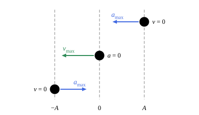

Качели проносятся через нижнюю точку быстрее всего, а в верхних на миг замирают. Значит, скорость при колебаниях всё время меняется — есть ускорение. Где оно больше: там, где скорость велика, или там, где она ноль? Интуиция часто подводит. Ответ даст точка на окружности из урока 13.3.

## Скорость

Точка бежит по окружности радиусом $A$ с постоянной по модулю скоростью $v = \omega A$ (урок 4.4). Скорость направлена по касательной. Тень на горизонтальной прямой повторяет только горизонтальное движение точки — её скорость равна горизонтальной части скорости точки.

- Когда точка проходит верх или низ окружности, её скорость горизонтальна целиком. Тень в этот момент в середине, в положении равновесия, и движется быстрее всего:

$$
v_{\max} = A\omega.
$$

- Когда точка у правого или левого края окружности, её скорость вертикальна. Горизонтальной части нет — тень в крайней точке стоит: $v = 0$.

Формулой: $v = -A\omega\sin\omega t$. Минус значит, что сразу после старта из $x = A$ тело движется к середине, против оси $x$.

## Ускорение

У точки на окружности есть центростремительное ускорение $a = \omega^2 A$ — оно направлено к центру (урок 4.4). Ускорение тени — его горизонтальная часть.

- В крайнем положении точка на горизонтальном радиусе, и центростремительное ускорение горизонтально целиком. Ускорение тени наибольшее:

$$
a_{\max} = A\omega^2.
$$

- В середине точка наверху или внизу, её ускорение вертикально — у тени ускорения нет: $a = 0$.

Получается та же картина, что у скорости, только наоборот.

| | крайнее положение | положение равновесия |
|---|---|---|
| скорость | $0$ | $v_{\max} = A\omega$ |
| ускорение | $a_{\max} = A\omega^2$ | $0$ |

Ускорение всегда направлено **к положению равновесия**. Проследи по горизонтальной части центростремительного ускорения: точка справа от центра — ускорение тени влево, слева — вправо. И чем дальше тень от середины, тем ускорение больше. Это записывается одной строчкой:

$$
a = -\omega^2 x.
$$

Минус — «к середине», а величина пропорциональна отклонению. Запомни эту формулу: в уроке 13.5 именно она объяснит, почему груз на пружине колеблется гармонически.

Сравни с движением по окружности: $v = \omega R$, $a = \omega^2 R$. Для колебаний — те же формулы, только вместо радиуса амплитуда.

**Пример.** $x = 0{,}05\cos 4t$, всё в СИ. $A = 0{,}05\ \text{м}$, $\omega = 4\ \text{рад/с}$:

$$
v_{\max} = 0{,}05 \cdot 4 = 0{,}2\ \text{м/с}, \qquad a_{\max} = 0{,}05 \cdot 4^2 = 0{,}8\ \text{м/с}^2.
$$

<pp-task id="ks-osc-05"></pp-task>

## Почему у края ускорение наибольшее

Кажется странным: тело стоит, а ускорение наибольшее. Но ускорение — не скорость, а то, как быстро скорость **меняется** (урок 2.1). В крайней точке скорость только что была направлена в одну сторону, а через мгновение направлена в другую — она меняется быстрее всего. А в середине скорость наибольшая, но в этот момент она перестаёт расти и начинает убывать — на миг не меняется.

Так же, как мяч в верхней точке броска вверх (урок 3.3): скорость ноль, а ускорение $g$.

В модели урока 13.3 это хорошо видно: зелёная стрелка скорости длиннее всего, когда груз проходит середину, и исчезает у краёв. Синяя стрелка ускорения — наоборот.

Проверь себя: амплитуду колебаний увеличили вдвое, а период оставили тем же. Как изменятся наибольшие скорость и ускорение?

Период тот же — значит, и $\omega = 2\pi/T$ та же. $v_{\max} = A\omega$ и $a_{\max} = A\omega^2$ пропорциональны амплитуде — обе вырастут вдвое.

<pp-task id="ks-osc-13"></pp-task>

## Частые ловушки

- **Думают, что в крайней точке ускорение ноль, раз скорость ноль.** Наоборот, там оно наибольшее.
- **Путают формулы.** $v_{\max} = A\omega$, $a_{\max} = A\omega^2$ — у ускорения $\omega$ в квадрате.
- **Подставляют частоту вместо $\omega$.** Если дана $\nu$, сначала $\omega = 2\pi\nu$.
- **Не переводят амплитуду в метры.**

## Коротко

- В положении равновесия: $v_{\max} = A\omega$, $a = 0$.
- В крайних точках: $v = 0$, $a_{\max} = A\omega^2$.
- $a = -\omega^2 x$: ускорение всегда к положению равновесия и пропорционально отклонению.

Дальше — урок 13.5: почему груз на пружине колеблется гармонически и от чего зависит его период.
