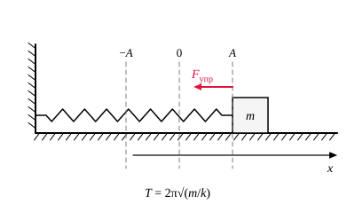

В уроке 13.3 мы получили гармонические колебания из точки на окружности — красиво, но при чём тут груз на пружине? Окружности рядом с ним нет. В этом уроке докажем, что груз всё равно движется в точности как тень, и узнаем, с каким периодом.

## Ускорение груза на пружине

Брусок массой $m$ на гладком столе прикреплён к пружине жёсткостью $k$. Отведём его от положения равновесия на $x$. По закону Гука (урок 6.1) пружина тянет его назад с силой

$$
F_x = -k x.
$$

Минус — сила направлена к равновесию: брусок справа — сила влево, слева — вправо. Сила тяжести и реакция стола вертикальны и друг друга уравновешивают.

По второму закону Ньютона (урок 5.4):

$$
a = \frac{F_x}{m} = -\frac{k}{m}\,x.
$$

## Сравним с тенью

В уроке 13.4 у тени точки на окружности было

$$
a = -\omega^2 x.
$$

Формулы одинаковые! Ускорение пропорционально отклонению и направлено к середине. А раз в каждой точке ускорение такое же, как у тени, то и движение такое же: груз колеблется гармонически, $x = A\cos\omega t$, с циклической частотой

$$
\omega^2 = \frac{k}{m}, \qquad \omega = \sqrt{\frac{k}{m}}.
$$

Период $T = 2\pi/\omega$:

$$
T = 2\pi \sqrt{\frac{m}{k}}.
$$

- $m$ — масса груза, кг;
- $k$ — жёсткость пружины, Н/м.

Это общий признак: **если ускорение пропорционально отклонению и направлено к равновесию, колебания гармонические**, а $\omega^2$ — число, на которое умножено $x$.

**Пример.** Груз $0{,}1\ \text{кг}$ на пружине жёсткостью $40\ \text{Н/м}$:

$$
T = 2 \cdot 3{,}14 \cdot \sqrt{\frac{0{,}1}{40}} = 6{,}28 \cdot 0{,}05 \approx 0{,}31\ \text{с}.
$$

Около трёх колебаний в секунду.

<pp-task id="ks-osc-06"></pp-task>

## Что влияет на период, а что нет

- **Масса.** Тяжёлый груз труднее разогнать — колебания медленнее. Масса больше в $4$ раза — период больше в $\sqrt 4 = 2$ раза.
- **Жёсткость.** Жёсткая пружина возвращает груз сильнее — колебания быстрее. Жёсткость больше в $4$ раза — период меньше в $2$ раза.
- **Амплитуда — не влияет.** Оттянешь дальше — сила больше, груз разгонится сильнее и пройдёт длинный путь за то же время.
- **Висит пружина или лежит — не влияет.** У вертикальной пружины сила тяжести только сдвигает положение равновесия вниз (пружина там уже растянута на $mg/k$). Вокруг нового положения равновесия груз колеблется с тем же периодом $2\pi\sqrt{m/k}$.
- **$g$ не входит.** На Луне пружинный маятник качается так же, как на Земле.

## Соединение пружин

Если груз висит не на одной пружине, а на нескольких, в формулу подставляют общую жёсткость (урок 6.7):

- две одинаковые пружины **параллельно** — жёсткость вдвое больше, $2k$; период меньше в $\sqrt 2$ раз;
- две одинаковые пружины **последовательно** — жёсткость вдвое меньше, $k/2$; период больше в $\sqrt 2$ раз.

Половина пружины вдвое жёстче целой — значит, если пружину разрезать пополам и подвесить груз на половинку, период уменьшится в $\sqrt 2 \approx 1{,}4$ раза.

Проверь себя: массу груза увеличили в 2 раза, а пружину заменили двумя такими же, соединёнными параллельно. Как изменился период?

Масса $2m$, жёсткость $2k$. Отношение $m/k$ не изменилось — период тот же.

<pp-task id="ks-osc-14"></pp-task>

## Попробуй сам

Модель из урока 13.3. Запусти, потом увеличь массу в $4$ раза — с $0{,}2$ до $0{,}8\ \text{кг}$ — и запусти снова. Прежний график останется пунктиром: горбы нового стоят вдвое реже. Потом поменяй амплитуду: период не изменится.

<pp-spring m="0.2" k="80" a="5">Модель: груз на пружине на гладком столе. Массу, жёсткость и амплитуду можно менять; график координаты от времени показывает, что период T = 2π√(m/k) растёт с массой, падает с жёсткостью и не зависит от амплитуды.</pp-spring>

## Частые ловушки

- **Перевернули дробь.** $T = 2\pi\sqrt{m/k}$: масса сверху. Тяжелее — медленнее.
- **Забыли корень.** Масса вчетверо больше — период вдвое, а не вчетверо больше.
- **Решили, что период зависит от амплитуды или от $g$.** Нет.
- **Массу в граммах.** В формулу — килограммы.

## Коротко

- Груз на пружине: $a = -\dfrac{k}{m}x$ — колебания гармонические.
- $\omega = \sqrt{\dfrac{k}{m}}$, $T = 2\pi\sqrt{\dfrac{m}{k}}$.
- Период не зависит от амплитуды и от $g$.
- Соединение пружин меняет $k$: параллельно жёстче, последовательно мягче.

Дальше — урок 13.6: маятник на нити и почему его период не зависит от массы.
