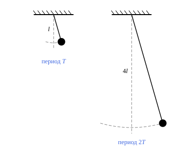

Галилей, по легенде, засёк по собственному пульсу, как качается люстра в соборе. Люстра раскачивалась то сильнее, то слабее, а время одного качания оставалось тем же. В часах с маятником на этом держится весь ход. В этом уроке выясним, от чего период такого маятника зависит — и от чего нет.

## Что такое математический маятник

**Математический маятник** — маленький тяжёлый груз на лёгкой нерастяжимой нити. «Маленький» — размер груза намного меньше длины нити, «лёгкой» — массой нити можно пренебречь. Шарик на длинной нитке — хороший математический маятник, качели — уже не совсем.

## Что возвращает груз

Отклоним груз на небольшой угол $\alpha$. На него действуют сила тяжести $mg$ вниз и натяжение нити вдоль нити. Разложим силу тяжести: часть вдоль нити уравновешивается натяжением, а часть **вдоль дуги**, $mg\sin\alpha$, тянет груз обратно к нижней точке — как скатывающая сила на наклонной плоскости в уроке 6.5.

Пусть $x$ — отклонение груза по дуге от нижней точки, $l$ — длина нити. При малых углах $\sin\alpha \approx \alpha = x/l$ (угол в радианах — дуга, делённая на радиус, урок 4.4). Тогда по второму закону Ньютона

$$
m a = -m g \frac{x}{l}, \qquad a = -\frac{g}{l}\,x.
$$

Снова ускорение пропорционально отклонению и направлено к равновесию — колебания гармонические (урок 13.5). Число перед $x$ — это $\omega^2$:

$$
\omega = \sqrt{\frac{g}{l}}, \qquad T = 2\pi \sqrt{\frac{l}{g}}.
$$

- $l$ — длина нити, м (от точки подвеса до центра груза);
- $g$ — ускорение свободного падения, м/с².

Формула верна только для **малых углов** — до $10$–$15^\circ$. При больших углах $\sin\alpha$ уже заметно меньше $\alpha$, и период немного растёт.

**Пример.** Какой длины маятник качается с периодом $2\ \text{с}$ — по секунде в каждую сторону? Из формулы $l = \dfrac{g T^2}{4\pi^2}$. С $g = 10\ \text{м/с}^2$ и $\pi^2 \approx 10$:

$$
l = \frac{10 \cdot 2^2}{4 \cdot 10} = 1\ \text{м}.
$$

Метровый маятник отбивает секунды — так и устроены старинные напольные часы.

## Масса не нужна

В формулу масса не вошла: она сократилась, как при свободном падении (урок 3.1). Тяжёлый груз сильнее тянет вниз, но его и труднее разогнать — ровно во столько же раз. Шарик из свинца и шарик из дерева на одинаковых нитях качаются в такт.

От амплитуды период тоже не зависит — пока углы малые. Это и заметил Галилей.

<pp-task id="ks-osc-07"></pp-task>

## Длина нити и $g$

Длина под корнем: нить вчетверо длиннее — период вдвое больше. Чтобы часы шли быстрее, груз маятника поднимают выше — укорачивают маятник.

$g$ стоит в знаменателе. На Луне $g$ примерно в $6$ раз меньше (урок 7.2): маятник там качается в $\sqrt 6 \approx 2{,}4$ раза медленнее. Маятниковые часы, привезённые на Луну, стали бы отставать. А пружинный маятник на Луне качается так же, как на Земле: в его период $g$ не входит.

Проверь себя: длину нити маятника увеличили в 9 раз, а массу груза уменьшили вдвое. Как изменился период?

Масса не влияет. $T \propto \sqrt l$: длина в $9$ раз больше — период в $\sqrt 9 = 3$ раза больше.

<pp-task id="ks-osc-15"></pp-task>

## Два маятника рядом

| | пружинный | математический |
|---|---|---|
| период | $2\pi\sqrt{m/k}$ | $2\pi\sqrt{l/g}$ |
| зависит от массы | да | нет |
| зависит от $g$ | нет | да |
| зависит от амплитуды | нет | нет (при малых углах) |

Это частый вопрос ЕГЭ: «как изменится период, если…». Сначала выясни, какой маятник, потом смотри, что из изменённого стоит в его формуле.

## Частые ловушки

- **Подставили массу.** Период математического маятника от неё не зависит.
- **Перевернули дробь.** $T = 2\pi\sqrt{l/g}$: длина сверху. Длиннее — медленнее.
- **Забыли корень.** Длина в $4$ раза больше — период в $2$ раза больше.
- **Решили, что на Луне период меньше.** $g$ меньше — период больше.

## Коротко

- Математический маятник: $T = 2\pi\sqrt{\dfrac{l}{g}}$, только для малых углов.
- Период не зависит от массы и (при малых углах) от амплитуды.
- Длиннее нить или меньше $g$ — медленнее колебания.

Дальше — урок 13.7: энергия колебаний и почему она меняется вдвое чаще, чем координата.
