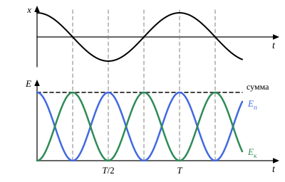

Закон сохранения энергии мы уже применяли к маятнику и к пружине (уроки 12.4 и 12.5) — для одного движения туда. Колебания — это то же движение, только повторённое много раз. В этом уроке посмотрим, как энергия переливается за целое колебание, и получим из неё скорость в любой точке.

## Маятник

Отклони маятник и отпусти. В крайней точке он на миг останавливается — вся энергия потенциальная. Проходя нижнюю точку, он движется быстрее всего — вся энергия кинетическая. Без трения (урок 12.4):

$$
m g h = \frac{m v_{\max}^2}{2}, \qquad v_{\max} = \sqrt{2 g h}.
$$

Здесь $h$ — на сколько крайняя точка выше нижней, а не длина нити и не амплитуда.

<pp-task id="ks-osc-03"></pp-task>

## Груз на пружине

У пружины потенциальная энергия $kx^2/2$, где $x$ — деформация (урок 12.5). У горизонтального пружинного маятника деформация — это и есть отклонение от равновесия.

- В крайней точке $x = A$, скорость ноль: энергия $\dfrac{kA^2}{2}$ вся у пружины.
- В положении равновесия пружина не деформирована, скорость наибольшая: энергия $\dfrac{m v_{\max}^2}{2}$ вся у груза.
- В любой другой точке — и та и другая.

Трения нет — сумма сохраняется:

$$
\frac{k x^2}{2} + \frac{m v^2}{2} = \frac{k A^2}{2} = \frac{m v_{\max}^2}{2}.
$$

Из крайних частей равенства:

$$
v_{\max} = A\sqrt{\frac{k}{m}} = A\omega.
$$

Та же формула, что в уроке 13.4 из окружности, — теперь из энергии. Два разных пути дают один ответ, это хорошая проверка.

**Пример.** Груз $0{,}4\ \text{кг}$ на пружине $160\ \text{Н/м}$, амплитуда $5\ \text{см}$:

$$
E = \frac{160 \cdot 0{,}05^2}{2} = 0{,}2\ \text{Дж},
$$

$$
v_{\max} = 0{,}05 \cdot \sqrt{\frac{160}{0{,}4}} = 0{,}05 \cdot 20 = 1\ \text{м/с}.
$$

Проверка: $\dfrac{0{,}4 \cdot 1^2}{2} = 0{,}2\ \text{Дж}$ — сходится.

<pp-task id="ks-osc-08"></pp-task>

## Энергия в любой точке

Из того же равенства находится скорость или кинетическая энергия в любой точке:

$$
\frac{m v^2}{2} = \frac{k\,(A^2 - x^2)}{2}.
$$

Обрати внимание: $A^2 - x^2$, а не $(A - x)^2$. Энергии складываются, а не отклонения.

Где кинетическая энергия равна потенциальной? Каждая — половина всей: $\dfrac{kx^2}{2} = \dfrac{1}{2} \cdot \dfrac{kA^2}{2}$, откуда $x = \dfrac{A}{\sqrt 2} \approx 0{,}71A$. Не на середине пути до края, а заметно дальше.

Проверь себя: груз проходит точку x = A/2. Какую долю всей энергии составляет кинетическая?

Потенциальная $\dfrac{k(A/2)^2}{2} = \dfrac{1}{4} \cdot \dfrac{kA^2}{2}$ — четверть. Кинетическая — остальное, $\dfrac{3}{4}$ всей энергии.

<pp-task id="ks-osc-16"></pp-task>

## Энергия меняется вдвое чаще

За одно колебание груз **дважды** проходит положение равновесия — в одну сторону и в другую — и дважды бывает в крайних точках, справа и слева. Значит, кинетическая энергия за период дважды становится наибольшей и дважды нулём. Потенциальная — тоже.

Энергия не различает «справа» и «слева»: и $x^2$, и $v^2$ одинаковы на $A$ и на $-A$. Поэтому энергия повторяется через половину периода:

$$
T_{E} = \frac{T}{2}, \qquad \nu_{E} = 2\nu.
$$

Это частый вопрос ЕГЭ: «с какой частотой меняется кинетическая энергия груза, если он колеблется с частотой $3\ \text{Гц}$?» — с частотой $6\ \text{Гц}$.

## Попробуй сам

Следи за полосами энергии: синяя — у пружины, зелёная — у груза, нижняя — их сумма. За одно колебание каждая полоса дважды становится полной и дважды исчезает, а сумма всё время одной длины. Поменяй амплитуду: энергия меняется как $A^2$ — амплитуда вдвое больше, энергия вчетверо.

<pp-spring m="0.5" k="20" a="8">Модель: груз на пружине на гладком столе. Полосы показывают энергию пружины kx²/2 и кинетическую энергию груза mv²/2: они перетекают друг в друга дважды за период, а их сумма kA²/2 не меняется.</pp-spring>

## Частые ловушки

- **Считают частоту энергии равной частоте колебаний.** Она вдвое больше.
- **Пишут $k(A - x)^2/2$.** Правильно $k(A^2 - x^2)/2$.
- **В $mgh$ подставляют длину нити или амплитуду.** Нужна разность высот.
- **Сантиметры.** Амплитуду и деформацию — в метрах.

## Коротко

- Без трения энергия колебаний сохраняется.
- Маятник: $mgh = \dfrac{mv_{\max}^2}{2}$.
- Пружина: $\dfrac{kx^2}{2} + \dfrac{mv^2}{2} = \dfrac{kA^2}{2}$; $v_{\max} = A\omega$.
- Энергии меняются с периодом $T/2$, частотой $2\nu$.

Это последний урок темы. Дальше — тема «Механические волны и звук»: что будет, если колебания побегут от точки к точке.
