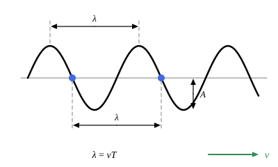

Брось камень в пруд — по воде побегут круги. Крикни в горах — услышишь эхо. Это волны. На ЕГЭ они встречаются в задаче 4 и в задаче 5.

Волны и звук проходят в 9 классе — почти всё, что нужно, оттуда. В конце добавим две вещи из 11 класса, на которых ловят на ЕГЭ: переход волны в другую среду и разность фаз. Пригодится предыдущая тема «Механические колебания»: период, частота и амплитуда.

## Шаг 1. Что такое волна (9 класс)

Посмотри на круги на воде. Поплавок качается вверх-вниз, но не уплывает вместе с волной. Значит, вода не течёт к берегу — бежит само **колебание**.

**Механическая волна** — распространение колебаний в упругой среде. Волна переносит энергию, но не переносит вещество.

Каждая частица среды просто колеблется на своём месте — с тем же периодом и той же частотой, что и источник волны. Поэтому период волны можно узнать по любому поплавку.

<pp-task id="ks-waves-01"></pp-task>

## Шаг 2. Поперечные и продольные волны (9 класс)

Волны бывают двух видов:

- **Поперечные** — частицы колеблются поперёк направления распространения волны (волна на верёвке). Возникают в твёрдых телах и на поверхности жидкости.
- **Продольные** — частицы колеблются вдоль направления распространения, образуя сгущения и разрежения (звук в воздухе, волна вдоль длинной растянутой пружины). Возникают в газах, жидкостях и твёрдых телах.

Механическая волна не может распространяться в вакууме: ей нужна среда.

## Шаг 3. Длина волны (9 класс)

**Длина волны** $\lambda$ — расстояние, на которое волна распространяется за один период. Это расстояние между двумя ближайшими гребнями (или между ближайшими точками, которые колеблются одинаково).

Волна бежит с постоянной скоростью $v$, поэтому за период $T$ она проходит

$$
\lambda = v T.
$$

- $v$ — скорость волны, м/с;
- $T$ — период, с;
- $\lambda$ — длина волны, м.

<pp-task id="ks-waves-02"></pp-task>

## Шаг 4. Длина волны и частота (9 класс)

Частота $\nu = 1/T$, поэтому ту же формулу пишут и так:

$$
\lambda = \frac{v}{\nu}, \qquad v = \lambda \nu.
$$

При одной и той же скорости чем выше частота, тем короче волна.

<pp-task id="ks-waves-03"></pp-task>

## Шаг 5. Звук (9 класс)

Звук — продольная механическая волна, которую слышит человек: частоты примерно от $20\ \text{Гц}$ до $20\ \text{кГц}$. Ниже — инфразвук, выше — ультразвук.

Скорость звука в воздухе около $340\ \text{м/с}$, в воде около $1500\ \text{м/с}$, в стали ещё больше.

- **Громкость** связана с амплитудой колебаний.
- **Высота тона** — с частотой. Чем выше частота, тем выше звук.

Свет приходит почти мгновенно, а звук — с задержкой. Поэтому сначала видишь молнию, а потом слышишь гром: по задержке можно найти расстояние до грозы, $s = vt$.

<pp-task id="ks-waves-04"></pp-task>

## Шаг 6. Эхо (9 класс)

**Эхо** — звук, отражённый от препятствия. Если эхо пришло через время $t$, звук за это время прошёл до препятствия **и обратно**. Расстояние до препятствия:

$$
s = \frac{v t}{2}.
$$

Так работают эхолоты на кораблях и летучие мыши: посылают ультразвук и ловят отражение.

<pp-task id="ks-waves-05"></pp-task>

## Шаг 7. Переход волны в другую среду (11 класс)

Частота волны задаётся **источником** и не меняется, когда волна переходит из одной среды в другую. Частицы новой среды раскачиваются соседями в том же ритме. А скорость и длина волны меняются: $\lambda = v/\nu$, и при той же частоте длина волны пропорциональна скорости.

Звук из воздуха переходит в воду — скорость растёт примерно в $4{,}4$ раза, и во столько же раз растёт длина волны.

<pp-task id="ks-waves-06"></pp-task>

## Шаг 8. Разность фаз точек волны (11 класс)

Точки волны колеблются с одной частотой, но с запаздыванием: колебание доходит до дальней точки позже. Сравним две точки на луче волны:

- расстояние между ними $\lambda$ (или $2\lambda$, $3\lambda$…) — колеблются **одинаково** (в фазе);
- расстояние $\lambda/2$ (или $3\lambda/2$…) — колеблются **в противофазе**: одна вверху, когда другая внизу.

В общем виде разность фаз $\Delta\varphi = 2\pi \dfrac{\Delta x}{\lambda}$: на одну длину волны приходится полный оборот $2\pi$.

<pp-task id="ks-waves-07"></pp-task>

## Частые ловушки

- **Думают, что частота меняется при переходе в другую среду.** Меняются скорость и длина волны, частота остаётся.
- **В задачах на эхо забывают делить на два.**
- **Считают, что звук распространяется в вакууме.** Не распространяется: нет среды.
- **Путают длину волны с амплитудой.** Длина — вдоль направления волны, амплитуда — размах колебаний.
- **Думают, что частицы среды бегут вместе с волной.** Они только колеблются на месте.

## Как это выглядит на ЕГЭ

*Звук частотой $680\ \text{Гц}$ переходит из воздуха в воду. Скорость звука в воздухе $340\ \text{м/с}$, в воде $1480\ \text{м/с}$. Найди длину волны в воде.*

Частота при переходе не меняется: в воде она тоже $680\ \text{Гц}$. Тогда

$$
\lambda = \frac{v}{\nu} = \frac{1480}{680} \approx 2{,}18\ \text{м}.
$$

В воздухе длина волны была $340/680 = 0{,}5\ \text{м}$. В воде волна стала длиннее, потому что выросла скорость.

## Коротко

- Волна переносит энергию, но не вещество.
- Поперечные — в твёрдых телах и на поверхности жидкости; продольные — в любой среде.
- $\lambda = vT = v/\nu$.
- Эхо: $s = vt/2$.
- При переходе в другую среду частота не меняется.
- Точки на расстоянии $\lambda$ — в фазе, на $\lambda/2$ — в противофазе.
- Звук: продольная волна, $20\ \text{Гц}$ – $20\ \text{кГц}$, в воздухе около $340\ \text{м/с}$.
