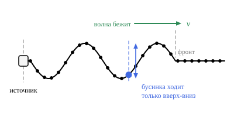

Брось камешек в пруд. По воде побегут круги и доберутся до поплавка. Поплавок закачается вверх-вниз — но к берегу не поплывёт. Волна до берега дойдёт, а поплавок останется где был. Что же тогда бежит по воде? В этом уроке разберёмся.

## Бежит колебание, а не вода

Привяжи длинную верёвку к столбу, натяни и резко дёрни свободный конец вверх-вниз. По верёвке побежит горб. Посмотри на какую-нибудь точку верёвки — например, на узелок. Горб добегает до узелка, узелок поднимается и опускается, а горб бежит дальше. Узелок вдоль верёвки никуда не уехал.

Так устроена любая волна. Рука качает первую бусинку. Бусинка тянет за собой соседку, та — следующую, и так дальше. Каждая следующая начинает колебаться чуть позже предыдущей. Колебание передаётся от бусинки к бусинке и бежит по верёвке, а сами бусинки остаются на своих местах.

**Механическая волна** — это колебания, которые распространяются в упругой среде: в верёвке, в воде, в воздухе, в стали. Граница, до которой волна успела добежать, называется **фронтом**. Впереди фронта среда ещё в покое.

## Что переносит волна

Бусинка начала двигаться — значит, получила энергию. Её принесла волна от руки. Волна **переносит энергию, но не переносит вещество**. Поэтому морские волны разбивают волнорезы, а мяч, упавший в море далеко от берега, волны к берегу не пригонят: он качается на месте. К берегу его гонит ветер или течение.

## Период волны — период источника

Каждая бусинка повторяет движение руки, только с опозданием. Значит, все бусинки колеблются с тем же периодом и той же частотой, что и источник (урок 13.1). Поэтому **период волны** можно узнать по любой точке среды — хоть по поплавку.

**Пример.** Поплавок за $20\ \text{с}$ поднялся и опустился $8$ раз. Период волны

$$
T = \frac{t}{N} = \frac{20}{8} = 2{,}5\ \text{с}.
$$

<pp-task id="ks-waves-01"></pp-task>

Сколько проходит сам поплавок? Он колеблется, как груз на пружине: за одно колебание путь $4A$ (урок 13.1). Сколько при этом проходит волна, поплавку всё равно.

<pp-task id="ks-waves-08"></pp-task>

## Поперечные и продольные волны

В верёвке бусинки колеблются вверх-вниз, а волна бежит вдоль верёвки — поперёк их движения. Такую волну называют **поперечной**.

Возьми теперь длинную мягкую пружину и толкни её конец вдоль оси, туда-обратно. Витки будут то сближаться, то расходиться, и эти сгущения побегут вдоль пружины.

Здесь каждый виток колеблется вдоль того же направления, по которому бежит волна. Такую волну называют **продольной**. В ней чередуются **сгущения** и **разрежения**.

- **Поперечная волна** — частицы колеблются поперёк направления, в котором бежит волна. Бывает в твёрдых телах и на поверхности жидкости.
- **Продольная волна** — частицы колеблются вдоль направления волны. Бывает в газах, жидкостях и твёрдых телах.

Почему поперечных волн в воздухе нет? Чтобы соседний слой потащить вбок, нужна упругость на сдвиг. У твёрдого тела она есть, у газа и жидкости — нет. А сжатию сопротивляется любая среда, поэтому продольная волна бежит везде.

И главное: волне нужна **среда**. Колебанию нечего передавать в пустоте, поэтому в вакууме механических волн нет.

Проверь себя: по шнуру бежит волна. Почему бусинка на шнуре, пока по ней проходит волна, не уезжает вдоль шнура?

Волна — это передача колебания от одной бусинки к соседней. Каждая бусинка только колеблется около своего места — вверх-вниз, поперёк шнура, — и после того как волна прошла, остаётся там, где была. Вдоль шнура переносится энергия, а не бусинки.

## Попробуй сам

Модель — верёвка из бусинок длиной $6\ \text{м}$. Левый конец колеблется, по верёвке бежит волна. Две бусинки отмечены синим, пунктир показывает, где каждая может оказаться. Нажми «Пуск».

<pp-wave nu="1" v="1.5">Модель: верёвка из бусинок. Левый конец колеблется, и по верёвке бежит волна. Отмеченные бусинки только колеблются на своих местах.</pp-wave>

Посмотри, что выходит:

- пока фронт не добежал до бусинки, она стоит; потом начинает колебаться — и всё время остаётся на своём пунктире;
- переключи волну на продольную: теперь бусинки — слои, они ходят влево-вправо, а по верёвке бегут сгущения.

## Частые ловушки

- **Думают, что частицы среды бегут вместе с волной.** Они колеблются на месте; бежит колебание.
- **Путь частицы считают по скорости волны.** Частица за период проходит $4A$, как любое колеблющееся тело.
- **Считают, что в воздухе бывают поперечные волны.** В газах и жидкостях внутри — только продольные.
- **Думают, что механическая волна идёт в вакууме.** Не идёт: нет среды.

## Коротко

- Механическая волна — колебания, распространяющиеся в упругой среде.
- Волна переносит энергию, но не вещество.
- Каждая точка среды колеблется с периодом и частотой источника.
- Поперечная — колебания поперёк направления волны; продольная — вдоль, со сгущениями и разрежениями.

Дальше — урок 14.2: какое расстояние волна проходит за один период.
