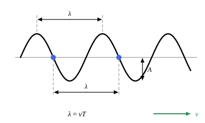
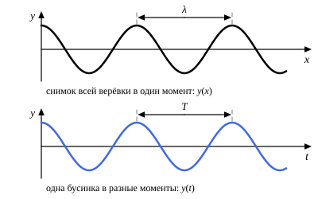

Посмотри на волны, бегущие по озеру. Гребни идут друг за другом через равные расстояния, будто их кто-то отмерил. Это расстояние — главная мера волны. В этом уроке узнаем, откуда оно берётся и как его не перепутать с другими величинами.

## Сколько волна пробегает за период

Вернёмся к верёвке из урока 14.1. Рука начала колебания и за один период $T$ сделала одно полное колебание: вверх, вниз и обратно в середину. За это время фронт волны убежал от руки на какое-то расстояние. На верёвке от руки до фронта уложился ровно один «горб и впадина».

Волна бежит равномерно, с постоянной скоростью $v$ — как машина в уроке 1.2. Значит, за период она проходит

$$
\lambda = v T.
$$

- $v$ — скорость волны, м/с;
- $T$ — период, с;
- $\lambda$ («лямбда») — **длина волны**, м.

**Длина волны** — расстояние, на которое волна распространяется за один период.

**Пример.** Волна бежит по шнуру со скоростью $0{,}8\ \text{м/с}$, период колебаний $1{,}5\ \text{с}$:

$$
\lambda = 0{,}8 \cdot 1{,}5 = 1{,}2\ \text{м}.
$$

## Где на картинке длина волны

Пока рука делала второе колебание, первый горб убежал ещё на $\lambda$, а за ним вырос второй. Поэтому на снимке волны гребни стоят через $\lambda$ друг от друга.

Длину волны можно мерить не только от гребня до гребня. Возьми любую точку и найди ближайшую к ней, которая находится в таком же положении и движется так же — например, обе идут вниз через середину. Между ними тоже $\lambda$. Точки на расстоянии $\lambda$ колеблются одинаково: волна приносит им одно и то же колебание с опозданием ровно на период.

**Амплитуда** $A$ — высота гребня над средним положением, как в уроке 13.1. Длина волны — вдоль направления волны, амплитуда — поперёк. Это разные расстояния.

<pp-task id="ks-waves-02"></pp-task>

## Сколько промежутков между гребнями

Если на снимке пять гребней, то между первым и пятым — не пять длин волны, а четыре: промежутков всегда на один меньше, чем гребней. Так же, как между первым и пятым столбом забора четыре пролёта.

Проверь себя: между первым и четвёртым гребнями волны 7,5 м. Найди длину волны.

От первого гребня до четвёртого — три промежутка: $\lambda = 7{,}5/3 = 2{,}5\ \text{м}$.

Когда гребни проходят мимо неподвижной точки — лодки, столба, — между двумя соседними проходит один период.

<pp-task id="ks-waves-09"></pp-task>

## Две похожие картинки

Это главная ловушка темы. Посмотри на два графика: они похожи как две капли воды. Но смысл у них разный.

- **График волны** $y(x)$ — снимок всей верёвки в один момент. По горизонтали — **координата** точки. Расстояние между соседними горбами — длина волны $\lambda$, в метрах.
- **График колебаний** $y(t)$ — одна точка в разные моменты, как $x(t)$ в уроке 13.3. По горизонтали — **время**. Расстояние между соседними горбами — период $T$, в секундах.

Прежде чем что-то читать с графика, посмотри на подпись оси. Если по оси $x$ или «м» — это волна, и между горбами $\lambda$. Если $t$ или «с» — это колебания одной точки, и между горбами $T$. Амплитуда на обоих — высота горба.

## Частые ловушки

- **Считают гребни, а не промежутки.** Между первым и $n$-м гребнем $n - 1$ длин волны.
- **Путают длину волны с амплитудой.** $\lambda$ — вдоль волны, $A$ — поперёк.
- **Читают период с графика $y(x)$ или длину волны с графика $y(t)$.** Смотри на ось.
- **Делят вместо умножения.** $\lambda = vT$: путь равен скорости, умноженной на время.

## Коротко

- $\lambda = vT$ — путь волны за период.
- $\lambda$ — между соседними гребнями или любыми ближайшими точками, которые колеблются одинаково.
- График $y(x)$ — снимок волны, между горбами $\lambda$; график $y(t)$ — одна точка, между горбами $T$.

Дальше — урок 14.3: как длина волны связана с частотой и что от чего зависит.
