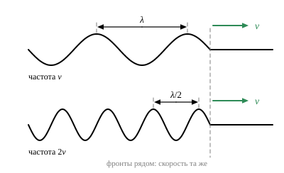

Покачай конец верёвки медленно — по ней побегут длинные пологие волны. Покачай быстро — волны станут короткими и частыми. А бегут они при этом с одной и той же скоростью. В этом уроке разберёмся, что от чего зависит.

## Формула через частоту

Частота и период связаны: $\nu = 1/T$ (урок 13.1). Подставим $T = 1/\nu$ в $\lambda = vT$ из урока 14.2:

$$
\lambda = \frac{v}{\nu}, \qquad v = \lambda \nu.
$$

Вторую формулу удобно читать так: за одну секунду источник выпускает $\nu$ волн, каждая длиной $\lambda$. Все они за секунду убегают от источника — значит, волна проходит $\lambda\nu$ метров в секунду.

**Пример.** Волна частотой $4\ \text{Гц}$ бежит по шнуру со скоростью $6\ \text{м/с}$:

$$
\lambda = \frac{v}{\nu} = \frac{6}{4} = 1{,}5\ \text{м}.
$$

Какую формулу брать — $\lambda = vT$ или $\lambda = v/\nu$, — смотри по условию: дан период или частота.

<pp-task id="ks-waves-03"></pp-task>

<pp-task id="ks-waves-10"></pp-task>

## Кто что задаёт

В формуле $\lambda = v/\nu$ три величины, но решают за себя только две.

- **Частоту задаёт источник.** Каждая точка среды колеблется в том ритме, в каком её раскачивают соседи, а самых первых — источник (урок 14.1). Рука качает верёвку раз в секунду — и вся верёвка колеблется раз в секунду.
- **Скорость задаёт среда.** Насколько быстро колебание передаётся от точки к точке, зависит от того, из чего среда и как натянута: тугая верёвка передаёт колебание быстрее, звук в воде бежит быстрее, чем в воздухе.
- **Длина волны получается из них:** $\lambda = v/\nu$.

Поэтому, если в той же среде качать источник чаще, скорость не изменится, а волны станут короче. Частота вдвое больше — длина волны вдвое меньше. За одно и то же время фронты обеих волн убегают одинаково далеко, но у частого источника на этом пути укладывается вдвое больше горбов.

Проверь себя: частоту источника увеличили в 3 раза, а среда та же. Как изменились скорость волны и длина волны?

Скорость задаёт среда — она не изменилась. Длина волны $\lambda = v/\nu$ уменьшилась в $3$ раза.

## Попробуй сам

Поменяй частоту источника и запусти снова. Затем поменяй скорость волны. Отмеченные бусинки стоят на расстоянии $\lambda$ друг от друга: следи, как скобка между ними растёт и сжимается.

<pp-wave nu="1.25" v="1.5">Модель: верёвка из бусинок. Ползунки — частота источника и скорость волны; длина волны λ = v/ν показана скобкой между двумя отмеченными бусинками.</pp-wave>

Посмотри, что выходит:

- частота больше — волны короче, но фронт бежит так же быстро;
- скорость больше — при той же частоте волны длиннее;
- в любом случае за один период фронт сдвигается ровно на одну скобку $\lambda$.

## Частые ловушки

- **Умножают скорость на частоту, чтобы найти $\lambda$.** $\lambda = v/\nu$; произведение $\lambda\nu$ — это скорость.
- **Думают, что от частоты зависит скорость волны.** В одной среде скорость та же; меняется длина волны.
- **Путают период и частоту в условии.** «Период» — подставляй в $\lambda = vT$, «частота» — в $\lambda = v/\nu$.

## Коротко

- $\lambda = \dfrac{v}{\nu}$, $v = \lambda\nu$.
- Частоту задаёт источник, скорость — среда, длина волны — следствие.
- В одной среде: частота выше — волна короче.

Дальше — урок 14.4: звук — волна, которую мы слышим.
