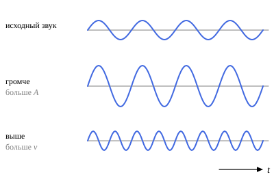

Тронь струну гитары — и услышишь звук. Приложи палец к струне — звук пропадёт вместе с колебаниями. Звук всегда начинается с того, что что-то колеблется. В этом уроке проследим, как колебание струны добирается до уха.

## Звук — продольная волна

Струна, мембрана динамика, голосовые связки колеблются и толкают соседний воздух. Слой воздуха то сжимается, то разрежается и передаёт толчки следующему слою. По воздуху бегут сгущения и разрежения — продольная волна, как в пружине из урока 14.1. Добежав до уха, она раскачивает барабанную перепонку, и мы слышим звук.

**Звук** — продольная механическая волна, которую слышит человек.

Голая струна звучит тихо: она тонкая и толкает мало воздуха. У гитары струна раскачивает деревянный корпус. Корпус подобран так, что откликается на частоты струн — это резонанс из урока 13.2. Большая дека толкает много воздуха, и звук становится громким.

## Звуку нужна среда

Звук — механическая волна, поэтому в пустоте не распространяется. Если поставить звонящий будильник под стеклянный колокол и откачивать воздух, звонок становится всё тише, хотя молоточек по-прежнему бьёт по чашке. На Луне, где нет воздуха, космонавты говорят друг с другом по радио — даже стоя рядом.

Зато звук прекрасно идёт через воду и твёрдые тела. Чем плотнее «связаны» частицы, тем быстрее колебание передаётся от одной к другой:

| Среда | Скорость звука |
|---|---|
| воздух | около $340\ \text{м/с}$ |
| вода | около $1500\ \text{м/с}$ |
| сталь | около $5000\ \text{м/с}$ |

Если приложить ухо к рельсу, услышишь приближающийся поезд раньше, чем через воздух.

## Какой звук мы слышим

Человек слышит звук с частотой примерно от $20\ \text{Гц}$ до $20\ \text{кГц}$ — от $20$ до $20\,000$ колебаний в секунду.

- Ниже $20\ \text{Гц}$ — **инфразвук**. Его создают землетрясения и шторм; человек его не слышит.
- Выше $20\ \text{кГц}$ — **ультразвук**. Его слышат собаки и летучие мыши, им пользуются эхолоты и УЗИ.

Длина звуковой волны находится по той же формуле $\lambda = v/\nu$ (урок 14.3). Чем ниже звук, тем длиннее его волна.

<pp-task id="ks-waves-11"></pp-task>

## Громкость и высота

Звуки отличаются двумя главными свойствами.

- **Громкость** связана с **амплитудой**. Сильнее ударил по струне — она колеблется с большим размахом, и звук громче.
- **Высота тона** связана с **частотой**. Чем чаще колебания, тем выше звук. Комар машет крыльями сотни раз в секунду и пищит, шмель — реже и гудит.

Не путай: «высокий» звук — это частота, а не громкость. Тихий писк может быть высоким, громкий рёв — низким.

Проверь себя: камертон ударили сильнее. Что изменилось: громкость или высота звука?

Громкость: камертон колеблется с большей амплитудой. Частота — собственная частота камертона — та же, поэтому высота тона не изменилась.

## Гром отстаёт от молнии

Свет от молнии доходит до нас почти мгновенно: он бежит почти в миллион раз быстрее звука. А звук грома идёт к нам с постоянной скоростью — равномерное движение из урока 1.2:

$$
s = v t,
$$

где $t$ — сколько прошло между вспышкой и громом.

**Пример.** Гром прогремел через $5\ \text{с}$ после вспышки:

$$
s = 340 \cdot 5 = 1700\ \text{м}.
$$

Гроза примерно в $1{,}7\ \text{км}$. Звук здесь идёт в одну сторону — от молнии к нам, — и делить на два не нужно.

<pp-task id="ks-waves-04"></pp-task>

## Частые ловушки

- **Думают, что звук идёт в вакууме.** Не идёт — нужна среда.
- **Путают громкость и высоту.** Громкость — амплитуда, высота — частота.
- **Считают, что в воде звук медленнее, чем в воздухе.** Наоборот: около $1500\ \text{м/с}$ против $340$.
- **В задаче про гром делят на два.** Звук идёт в одну сторону; на два делят только эхо.

## Коротко

- Звук — продольная механическая волна; в вакууме его нет.
- Слышимый звук: от $20\ \text{Гц}$ до $20\ \text{кГц}$; ниже — инфразвук, выше — ультразвук.
- Скорость звука: воздух $\approx 340\ \text{м/с}$, вода $\approx 1500\ \text{м/с}$, сталь $\approx 5000\ \text{м/с}$.
- Громкость — амплитуда, высота тона — частота.
- Гром: $s = vt$.

Дальше — урок 14.5: эхо и как по нему мерить расстояние.
