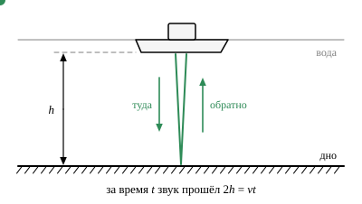

Крикни в горах или в пустом спортзале — через мгновение голос вернётся к тебе. Звук долетел до стены, отразился и пришёл обратно. По этой задержке можно узнать, далеко ли стена, даже не подходя к ней.

## Звук туда и обратно

**Эхо** — звук, отражённый от препятствия: скалы, стены, леса, дна моря.

Пусть до скалы расстояние $s$. Звук от крика бежит к скале — это $s$, — отражается и бежит назад — ещё $s$. Эхо приходит, когда звук прошёл **удвоенное** расстояние. За время $t$ от крика до эха

$$
2s = v t, \qquad s = \frac{v t}{2}.
$$

Это та же формула $s = vt$ из урока 1.2, только путь звука — туда и обратно.

**Пример.** Эхо от стены дома пришло через $0{,}5\ \text{с}$. Скорость звука в воздухе $340\ \text{м/с}$:

$$
s = \frac{340 \cdot 0{,}5}{2} = 85\ \text{м}.
$$

Сравни с грозой из урока 14.4: там звук шёл в одну сторону, и мы не делили на два. Перед тем как считать, спроси себя: звук пришёл прямо от источника или вернулся?

<pp-task id="ks-waves-05"></pp-task>

## Эхолот

Корабль измеряет глубину без всякой верёвки с грузом. **Эхолот** на днище посылает вниз короткий звуковой сигнал, обычно ультразвуковой, и ловит отражение от дна. Прибор сам делит путь пополам:

$$
h = \frac{v t}{2}.
$$

Только скорость здесь — скорость звука **в воде**, около $1500\ \text{м/с}$, а не в воздухе. Так же рыбаки ищут косяки рыбы, а подводные лодки — препятствия.

Проверь себя: эхолот поймал отражение через 2 с. Глубина больше или меньше километра?

Туда и обратно звук прошёл $1500 \cdot 2 = 3000\ \text{м}$, до дна — половину, $1500\ \text{м}$. Больше километра.

<pp-task id="ks-waves-12"></pp-task>

## Эхолокация в природе

Летучие мыши охотятся в полной темноте. Они издают короткие ультразвуковые писки и слушают эхо: по задержке узнают, далеко ли мошка, а по тому, с какой стороны пришло эхо, — где она. Дельфины делают то же в воде. Ультразвук для этого удобен: волна короткая и отражается даже от мелких предметов. Если волна много длиннее мошки, она огибает её почти без отражения.

## Частые ловушки

- **Не делят на два.** Эхо — путь туда и обратно, $2s = vt$. Это главная ловушка задач на эхо.
- **Делят на два там, где не надо.** Гром, выстрел, звук от удара издалека идут в одну сторону.
- **В воде берут скорость звука в воздухе.** Эхолот работает в воде: около $1500\ \text{м/с}$.

## Коротко

- Эхо — отражённый звук.
- До препятствия: $s = \dfrac{vt}{2}$, где $t$ — время от сигнала до эха.
- Эхолот: глубина $h = \dfrac{vt}{2}$, скорость звука в воде.

Дальше — урок 14.6, 11 класс: что происходит с волной, когда она переходит в другую среду.
