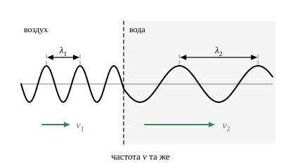

Нырни в бассейн, а друг пусть хлопнет в ладоши у бортика. Хлопок ты услышишь и под водой — звук перешёл из воздуха в воду. Но вода — другая среда, и звук в ней бежит в четыре с лишним раза быстрее. Что при этом происходит с волной? Одно меняется, другое — нет.

## Что не меняется

Вспомни урок 14.3: частоту задаёт источник, скорость — среда.

На границе воздуха и воды слой воды раскачивается соседним слоем воздуха. Сколько раз в секунду его толкнули, столько раз он и колеблется. Он раскачивает следующий слой воды в том же ритме — и так дальше. Частота передаётся через границу без изменений.

При переходе волны из одной среды в другую **частота не меняется**. Период тоже.

Если бы частота менялась, на границе частицы по одну сторону делали бы, скажем, $1000$ колебаний в секунду, а по другую — другое число, и граница бы разорвалась.

## Что меняется

Скорость задаёт среда — значит, в новой среде она другая. А длина волны $\lambda = v/\nu$ при той же частоте меняется вместе со скоростью:

$$
\frac{\lambda_2}{\lambda_1} = \frac{v_2/\nu}{v_1/\nu} = \frac{v_2}{v_1}.
$$

Во сколько раз выросла скорость, во столько же раз выросла и длина волны.

Звук из воздуха в воду: скорость растёт примерно с $340$ до $1500\ \text{м/с}$, в $4{,}4$ раза, — и во столько же раз растёт длина волны. Гребни в воде расходятся шире: за тот же период волна убегает дальше. Из воды в воздух — наоборот, волна укорачивается.

## Решаем по шагам

План всегда один:

1. найти частоту по данным для первой среды — она же будет во второй;
2. найти длину волны во второй среде: $\lambda_2 = v_2/\nu$.

Или сразу через отношение: $\lambda_2 = \lambda_1 \cdot v_2/v_1$.

**Пример.** Звук частотой $680\ \text{Гц}$ переходит из воздуха в воду. Скорость звука в воздухе $340\ \text{м/с}$, в воде $1480\ \text{м/с}$. В воздухе длина волны

$$
\lambda_1 = \frac{340}{680} = 0{,}5\ \text{м}.
$$

Частота в воде та же, $680\ \text{Гц}$:

$$
\lambda_2 = \frac{1480}{680} \approx 2{,}18\ \text{м}.
$$

Волна стала длиннее, потому что выросла скорость.

<pp-task id="ks-waves-06"></pp-task>

Проверь себя: звук переходит из воды в воздух. Как меняются частота, скорость и длина волны?

Частота не меняется. Скорость уменьшается — в воздухе звук медленнее. Длина волны уменьшается во столько же раз, во сколько скорость.

<pp-task id="ks-waves-13"></pp-task>

## Частые ловушки

- **Думают, что при переходе меняется частота.** Частота и период остаются, меняются скорость и длина волны.
- **Думают, что длина волны остаётся.** Она меняется вместе со скоростью: $\lambda_2/\lambda_1 = v_2/v_1$.
- **Переворачивают отношение.** Где скорость больше, там и волна длиннее — проверь ответ этим.

## Коротко

- При переходе в другую среду частота (и период) не меняется: её задаёт источник.
- Скорость и длина волны меняются: $\dfrac{\lambda_2}{\lambda_1} = \dfrac{v_2}{v_1}$.
- Звук из воздуха в воду: $v$ и $\lambda$ растут примерно в $4{,}4$ раза.

Дальше — урок 14.7: как колеблются разные точки одной волны относительно друг друга.
