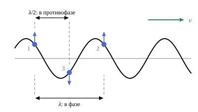

Посмотри на волну на верёвке: все бусинки колеблются с одной частотой, но не в ногу. Одна наверху, соседка ещё поднимается, а дальняя уже внизу. Насколько одна точка отстаёт от другой? В уроке 13.3 мы описывали это фазой. Теперь применим её к волне.

## Опоздание на Δx/v

Возьмём две точки волны на расстоянии $\Delta x$ друг от друга. Колебание доходит до дальней точки позже — на столько, сколько волна бежит от ближней до дальней:

$$
\Delta t = \frac{\Delta x}{v}.
$$

Дальняя точка делает то же, что ближняя, но с опозданием $\Delta t$.

В уроке 13.3 колебания записывались как $x = A\cos(\omega t + \varphi_0)$, а фаза — это угол $\omega t + \varphi_0$, в радианах (урок 4.4). Опоздание на время $\Delta t$ — это отставание по фазе на $\omega\Delta t$. Подставим $\omega = 2\pi\nu$ и $v = \lambda\nu$:

$$
\Delta\varphi = \omega\,\Delta t = 2\pi\nu \cdot \frac{\Delta x}{\lambda\nu},
$$

$$
\Delta\varphi = 2\pi \frac{\Delta x}{\lambda}.
$$

На одну длину волны приходится полный оборот фазы — $2\pi$, как один оборот точки по окружности в уроке 13.3. На половину длины волны — $\pi$, на четверть — $\pi/2$.

**Пример.** Длина волны $1{,}2\ \text{м}$, точки на расстоянии $0{,}3\ \text{м}$:

$$
\Delta\varphi = 2\pi \cdot \frac{0{,}3}{1{,}2} = \frac{\pi}{2}.
$$

Дальняя точка отстаёт на четверть периода: когда ближняя наверху, дальняя только проходит середину.

## В фазе и в противофазе

Два особых случая встречаются в задачах чаще всего.

- Расстояние $\lambda$, $2\lambda$, $3\lambda$… — разность фаз $2\pi$, $4\pi$… — целое число оборотов. Точки колеблются **одинаково**: вместе наверху, вместе внизу. Говорят, **в фазе**. Это мы уже видели в уроке 14.2.
- Расстояние $\lambda/2$, $3\lambda/2$… — разность фаз $\pi$, $3\pi$… Точки колеблются **в противофазе**: одна наверху, когда другая внизу; одна поднимается, когда другая опускается.

Ближайшие точки в противофазе — на расстоянии $\lambda/2$, а не $\lambda$.

<pp-task id="ks-waves-07"></pp-task>

Проверь себя: длина волны 1,2 м. На какую часть периода и на какой угол отстаёт точка, которая дальше на 0,9 м?

$0{,}9/1{,}2 = 3/4$ длины волны. Точка отстаёт на три четверти периода, по фазе на $2\pi \cdot \dfrac{3}{4} = \dfrac{3\pi}{2}$.

Обратная задача: по разности фаз найти расстояние. Из той же формулы

$$
\Delta x = \lambda \cdot \frac{\Delta\varphi}{2\pi}.
$$

Какую часть оборота $2\pi$ составляет $\Delta\varphi$, такую часть длины волны и составляет $\Delta x$.

<pp-task id="ks-waves-14"></pp-task>

## Попробуй сам

В модели отмечены две бусинки на расстоянии $\lambda/2$. Нажми «Пуск» и следи за ними: когда одна наверху, другая внизу. Потом переключи отметку на $\lambda$ — бусинки начнут двигаться как одна.

<pp-wave nu="1.25" v="1.75" mark="half">Модель: верёвка из бусинок. Две бусинки отмечены на расстоянии λ/2 — они колеблются в противофазе; переключатель ставит их на расстояние λ — тогда в фазе.</pp-wave>

Посмотри, что выходит:

- дальняя бусинка начинает двигаться позже — на столько, сколько фронт бежит между ними;
- на $\lambda/2$ бусинки всегда движутся в противоположные стороны, на $\lambda$ — одинаково, при любой частоте и скорости;
- переключи волну на продольную: там то же самое — слои на $\lambda/2$ то сходятся, то расходятся.

## Частые ловушки

- **Берут для противофазы $\lambda$.** На $\lambda$ — в фазе; противофаза — $\lambda/2$.
- **Забывают $2\pi$.** $\Delta\varphi = 2\pi\Delta x/\lambda$: на одну длину волны $2\pi$, а не $\pi$ и не $1$.
- **Путают разность фаз с расстоянием.** Фаза в радианах, расстояние в метрах; связывает их $\lambda$.

## Коротко

- Дальняя точка опаздывает на $\Delta t = \Delta x/v$.
- $\Delta\varphi = 2\pi\dfrac{\Delta x}{\lambda}$: на $\lambda$ приходится $2\pi$.
- На $\lambda$, $2\lambda$… — в фазе; на $\lambda/2$, $3\lambda/2$… — в противофазе.

Это последний урок темы. Дальше — тема «Основы МКТ — молекулы и количество вещества»: из чего состоят тела и как молекулы движутся.
