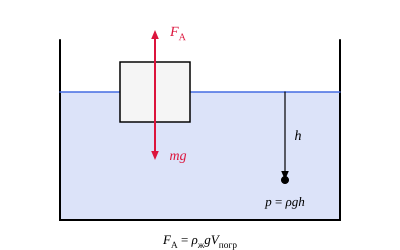

Почему уши закладывает на дне бассейна? Почему железный корабль плавает, а железный гвоздь тонет? Это гидростатика. Она встречается в задаче 4, в задачах 5–6 и в задаче 26.

Почти всю гидростатику проходят в 7 классе: давление, закон Паскаля, закон Архимеда, плавание тел. В конце соберём это вместе с законами Ньютона — так, как оно встречается на ЕГЭ. Пригодятся сила тяжести и вес из темы «Силы в механике».

## Шаг 1. Давление (7 класс)

Стоять на снегу в ботинках — проваливаешься. На лыжах — нет. Твой вес тот же, а площадь опоры разная. Важна не сила сама по себе, а сила **на единицу площади** — **давление**:

$$
p = \frac{F}{S}.
$$

- $F$ — сила, действующая перпендикулярно поверхности, Н;
- $S$ — площадь, $\text{м}^2$;
- $p$ — давление, Па ($1\ \text{Па} = 1\ \text{Н/м}^2$).

Паскаль — маленькая единица, поэтому часто пишут килопаскали: $1\ \text{кПа} = 1000\ \text{Па}$. Площадь обязательно переводи в квадратные метры: $1\ \text{см}^2 = 10^{-4}\ \text{м}^2$.

<pp-task id="ks-hydro-01"></pp-task>

## Шаг 2. Давление жидкости на глубине (7 класс)

Ныряешь глубже — давление на уши растёт. Его создаёт вес столба воды над тобой. Столб высотой $h$ и площадью $S$ весит $\rho S h g$; делим на площадь:

$$
p = \rho g h.
$$

- $\rho$ — плотность жидкости, $\text{кг/м}^3$ (вода — $1000$);
- $h$ — глубина, отсчитанная **от свободной поверхности** вниз, м.

Давление жидкости на дно зависит только от высоты столба и плотности, а не от формы сосуда. В узкой бутылке и в широкой кастрюле на одной глубине давление одинаковое.

<pp-task id="ks-hydro-02"></pp-task>

## Шаг 3. Закон Паскаля и гидравлический пресс (7 класс)

Надави на поршень шприца с водой, проткнутого в нескольких местах, — струйки брызнут во все стороны одинаково. Это **закон Паскаля**: давление, которое создают на жидкость (или газ), передаётся во все точки одинаково.

На этом работает **гидравлический пресс**: два цилиндра с поршнями соединены трубкой с жидкостью. Давление под поршнями одинаковое:

$$
\frac{F_1}{S_1} = \frac{F_2}{S_2}.
$$

Маленькой силой на маленьком поршне получаешь большую силу на большом — во столько раз, во сколько большой поршень больше по площади. Так работают домкраты и тормоза автомобиля.

<pp-task id="ks-hydro-03"></pp-task>

## Шаг 4. Сообщающиеся сосуды (7 класс)

Чайник и его носик, лейка, шлюз на реке — это **сообщающиеся сосуды**: они соединены внизу. Однородная жидкость в них устанавливается на одном уровне, какой бы формы они ни были.

Если жидкости разные (например, вода и масло в U-образной трубке), уровни разные. На уровне границы раздела давления с двух сторон равны:

$$
\rho_1 g h_1 = \rho_2 g h_2 \quad\Rightarrow\quad \rho_1 h_1 = \rho_2 h_2.
$$

Высоты $h_1$ и $h_2$ отсчитывают от уровня границы раздела вверх. Лёгкая жидкость стоит выше.

<pp-task id="ks-hydro-04"></pp-task>

## Шаг 5. Атмосферное давление (7 класс)

Мы живём на дне воздушного «океана». Воздух тоже давит — это **атмосферное давление**. Около поверхности Земли оно примерно $10^5\ \text{Па} = 100\ \text{кПа}$. Это примерно как давление столба воды высотой $10\ \text{м}$ или ртути высотой $760\ \text{мм}$.

Если над жидкостью воздух, то полное давление на глубине $h$ складывается из атмосферного и давления самой жидкости:

$$
p = p_{\text{атм}} + \rho g h.
$$

Смотри, что спрашивают: «давление воды» — это только $\rho g h$, «полное давление» или «давление на глубине» в открытом водоёме — с атмосферным.

<pp-task id="ks-hydro-05"></pp-task>

## Шаг 6. Закон Архимеда (7 класс)

Попробуй утопить надувной мяч в воде — он выталкивается. На любое тело в жидкости или газе действует **выталкивающая (архимедова) сила**:

$$
F_{\text{А}} = \rho_{\text{ж}} g V_{\text{погр}}.
$$

- $\rho_{\text{ж}}$ — плотность **жидкости**, а не тела;
- $V_{\text{погр}}$ — объём погружённой части тела, $\text{м}^3$.

Откуда она берётся? Это следствие шага 2: снизу на тело давит более глубокая вода, чем сверху. Разница давлений и даёт силу вверх.

<pp-task id="ks-hydro-06"></pp-task>

## Шаг 7. Плавание тел (7 класс)

Сравни силу тяжести и архимедову силу при полном погружении. Получается простое правило:

- $\rho_{\text{тела}} > \rho_{\text{ж}}$ — тонет;
- $\rho_{\text{тела}} < \rho_{\text{ж}}$ — всплывает и плавает, частично погрузившись;
- $\rho_{\text{тела}} = \rho_{\text{ж}}$ — находится в равновесии на любой глубине.

Если тело плавает, архимедова сила равна силе тяжести: $\rho_{\text{ж}} V_{\text{погр}} = \rho_{\text{т}} V$. Отсюда доля погружённого объёма:

$$
\frac{V_{\text{погр}}}{V} = \frac{\rho_{\text{т}}}{\rho_{\text{ж}}}.
$$

Лёд плотностью $900\ \text{кг/м}^3$ в воде погружён на $90\,\%$.

Корабль из железа плавает, потому что внутри него воздух, и **средняя** плотность корабля меньше плотности воды.

<pp-task id="ks-hydro-07"></pp-task>

## Шаг 8. Тело в жидкости: все силы сразу (10 класс)

На ЕГЭ тело в жидкости редко бывает одно. Его держит нить, тянет динамометр, оно лежит на дне. Решаем так же, как в теме «Законы Ньютона»: рисуем **все** силы и записываем их сумму.

Груз на нити полностью погружён в воду и покоится. Вверх действуют натяжение нити $T$ и архимедова сила, вниз — сила тяжести:

$$
T + F_{\text{А}} = m g \quad\Rightarrow\quad T = m g - \rho_{\text{ж}} g V.
$$

Поэтому динамометр в воде показывает меньше, чем в воздухе, — ровно на $F_{\text{А}}$. Говорят, что тело «теряет в весе», хотя сила тяжести осталась прежней.

Если тело лежит на дне, вместо нити его держит реакция дна: $N = mg - F_{\text{А}}$.

<pp-task id="ks-hydro-08"></pp-task>

## Частые ловушки

- **В закон Архимеда подставляют плотность тела.** Нужна плотность жидкости.
- **Берут весь объём тела**, когда оно погружено частично.
- **Считают глубину от дна.** $h$ — от поверхности жидкости вниз.
- **Забывают перевести см² и см³ в м² и м³.** $1\ \text{см}^2 = 10^{-4}\ \text{м}^2$, $1\ \text{см}^3 = 10^{-6}\ \text{м}^3$.
- **Думают, что плавающее тело в более плотной жидкости испытывает большую силу Архимеда.** Пока тело плавает, $F_{\text{А}} = mg$ в любой жидкости. Меняется только глубина погружения.

## Как это выглядит на ЕГЭ

*Деревянный брусок объёмом $500\ \text{см}^3$ плавает в воде, погрузившись на $60\,\%$ своего объёма. Найди массу бруска. Плотность воды $1000\ \text{кг/м}^3$.*

Переводим объём: $500\ \text{см}^3 = 5 \cdot 10^{-4}\ \text{м}^3$. Погружённая часть: $0{,}6 \cdot 5 \cdot 10^{-4} = 3 \cdot 10^{-4}\ \text{м}^3$.

Брусок плавает — архимедова сила равна силе тяжести:

$$
m g = \rho_{\text{в}} g V_{\text{погр}},
$$

$$
m = 1000 \cdot 3 \cdot 10^{-4} = 0{,}3\ \text{кг}.
$$

## Коротко

- $p = F/S$; в жидкости $p = \rho g h$ (+ атмосферное, если нужно полное давление).
- Закон Паскаля: давление передаётся во все стороны одинаково; пресс $F_1/S_1 = F_2/S_2$.
- Сообщающиеся сосуды с разными жидкостями: $\rho_1 h_1 = \rho_2 h_2$ от границы раздела.
- $F_{\text{А}} = \rho_{\text{ж}} g V_{\text{погр}}$.
- Плавает: $F_{\text{А}} = mg$, $V_{\text{погр}}/V = \rho_{\text{т}}/\rho_{\text{ж}}$.
- Тело на нити в жидкости: $T = mg - F_{\text{А}}$.
