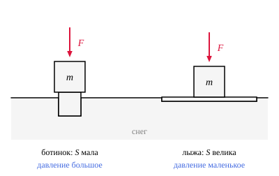

Пройди по глубокому снегу в ботинках — проваливаешься по колено. Встань на лыжи — почти не проваливаешься. Ты весишь столько же, на снег давит та же сила. Что изменилось? Площадь, на которую эта сила приходится. В этом уроке разберёмся, как это измерить.

## Сила и площадь

Посмотри на рисунок. Сила $F$ одна и та же. Под ботинком она распределяется на маленькую площадь, и каждому кусочку снега достаётся большая доля силы. Под лыжей та же сила распределяется на большую площадь, и каждому кусочку достаётся мало. Снег продавливается, когда на каждый его кусочек давят сильно.

Так же устроены и другие вещи вокруг:

- острый нож режет, а тупой — нет: у острого лезвия крошечная площадь;
- кнопку легко вдавить пальцем: вся сила пальца приходится на острие;
- у трактора широкие гусеницы, а у рюкзака широкие лямки — чтобы уменьшить давление.

## Что такое давление

**Давление** — сила, которая приходится на единицу площади поверхности:

$$
p = \frac{F}{S}.
$$

- $F$ — сила, которая давит **перпендикулярно** поверхности, Н;
- $S$ — площадь, на которую она давит, $\text{м}^2$;
- $p$ — давление, в **паскалях**: $1\ \text{Па} = 1\ \text{Н/м}^2$.

Паскаль — это очень мало: так давит лист бумаги, лежащий на столе. Поэтому часто пишут килопаскали: $1\ \text{кПа} = 1000\ \text{Па}$.

Чем меньше площадь, тем больше давление при той же силе. Чем больше сила, тем больше давление при той же площади.

Если тело просто стоит на горизонтальной опоре, оно давит на неё своим весом. В уроке 6.2 мы выяснили, что тогда вес $P = mg$. Значит, $F = mg$.

## Площадь — в квадратных метрах

Это главное место, где ошибаются. Площадь часто дают в квадратных сантиметрах. В квадратном метре $100 \times 100 = 10\,000$ квадратных сантиметров. Поэтому

$$
1\ \text{см}^2 = 10^{-4}\ \text{м}^2.
$$

Не $10^{-2}$, как для длины, а $10^{-4}$: сантиметр в квадрате.

**Пример.** Девочка массой $42\ \text{кг}$ стоит на снегу. Площадь подошв её ботинок $240\ \text{см}^2$, площадь двух лыж $0{,}3\ \text{м}^2$. Сравним давления.

Сила давления — вес девочки: $F = mg = 42 \cdot 10 = 420\ \text{Н}$.

В ботинках: $S = 240 \cdot 10^{-4} = 0{,}024\ \text{м}^2$,

$$
p = \frac{420}{0{,}024} = 17\,500\ \text{Па} = 17{,}5\ \text{кПа}.
$$

На лыжах:

$$
p = \frac{420}{0{,}3} = 1400\ \text{Па} = 1{,}4\ \text{кПа}.
$$

На лыжах давление в $12{,}5$ раза меньше — во столько раз, во сколько больше площадь.

Проверь себя: сколько квадратных метров в 50 см²? А в 50 мм²?

$50\ \text{см}^2 = 50 \cdot 10^{-4} = 0{,}005\ \text{м}^2$. В квадратном метре $1000 \times 1000 = 10^6$ квадратных миллиметров, поэтому $50\ \text{мм}^2 = 50 \cdot 10^{-6} = 5 \cdot 10^{-5}\ \text{м}^2$.

<pp-task id="ks-hydro-01"></pp-task>

## Обратная задача

Формулу $p = F/S$ можно повернуть: $F = pS$. Если известны давление и площадь, найдём силу. А если сила — это вес, то по ней найдём и массу: $m = F/g$.

Проверь себя: человек стоит на одной ноге, а потом на двух. Как меняется его давление на пол?

На одной ноге площадь опоры вдвое меньше, а сила (вес) та же. Давление вдвое больше.

<pp-task id="ks-hydro-09"></pp-task>

## Частые ловушки

- **Площадь в см² подставили в формулу без перевода.** $1\ \text{см}^2 = 10^{-4}\ \text{м}^2$, а не $10^{-2}$.
- **Подставили массу вместо силы.** В формулу входит сила в ньютонах: $F = mg$.
- **Ответ в паскалях, а спрашивали в килопаскалях.** Посмотри, в чём просят ответ.
- **Площадь одной опоры вместо всех.** Человек стоит на двух ногах, стол — на четырёх ножках: площади складываются.

## Коротко

- Давление — сила на единицу площади: $p = F/S$, в паскалях.
- При той же силе давление тем больше, чем меньше площадь.
- Тело на горизонтальной опоре давит своим весом: $F = mg$.
- $1\ \text{см}^2 = 10^{-4}\ \text{м}^2$, $1\ \text{кПа} = 1000\ \text{Па}$.

Дальше — урок 9.2: на дне бассейна давит не ботинок, а вода. Откуда берётся её давление?
