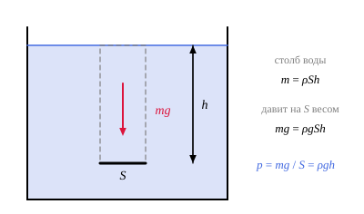
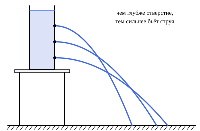

Нырни на дно бассейна — уши закладывает, их что-то сдавливает. Это давит вода. Чем глубже, тем сильнее. Проделай в пластиковой бутылке с водой три дырочки одна над другой: из нижней струя бьёт сильнее всех. В этом уроке выясним, откуда берётся давление жидкости и как его посчитать.

## Столб жидкости давит своим весом

Жидкость притягивается к Земле, как любое тело. Каждый её слой лежит на нижних и давит на них своим весом. Чем глубже, тем больше воды сверху — и тем больше давление.

Посчитаем. Возьмём на глубине $h$ маленькую площадку $S$. Над ней — столб воды высотой $h$ и площадью основания $S$.

1. Объём столба $V = Sh$, масса $m = \rho V = \rho S h$, где $\rho$ — плотность жидкости.
2. Столб давит на площадку своим весом: $mg = \rho g S h$.
3. Делим силу на площадь (урок 9.1):

$$
p = \frac{\rho g S h}{S} = \rho g h.
$$

- $\rho$ — плотность **жидкости**, $\text{кг/м}^3$ (у воды $1000$);
- $h$ — глубина, отсчитанная **от свободной поверхности вниз**, м;
- $g = 10\ \text{Н/кг}$.

Площадь сократилась: давление зависит только от плотности жидкости и глубины.

Это и видно по струям: чем ниже дырочка, тем больше глубина, тем сильнее вода выталкивается наружу. Заметь ещё одно: вода бьёт **вбок**, из стенки. На одной и той же глубине жидкость давит во все стороны одинаково — вниз, вверх и вбок. Это пригодится в уроке 9.5.

**Пример.** Какое давление создаёт вода на глубине $12\ \text{м}$?

$$
p = \rho g h = 1000 \cdot 10 \cdot 12 = 120\,000\ \text{Па} = 120\ \text{кПа}.
$$

Проверь себя: какое давление создаёт вода на глубине 50 см?

Сначала глубину в метры: $0{,}5\ \text{м}$. Тогда $p = 1000 \cdot 10 \cdot 0{,}5 = 5000\ \text{Па} = 5\ \text{кПа}$.

## Форма сосуда не важна

Налей воду до одного уровня в узкий стакан и в широкую кастрюлю. На дне кастрюли воды намного больше. Но давление на дно одинаковое: в формулу $p = \rho g h$ входит только глубина. В кастрюле больше воды, но она давит и на бо́льшую площадь.

Поэтому ныряльщику в узком колодце и в море на одной глубине давит на уши одинаково.

<pp-task id="ks-hydro-02"></pp-task>

## Атмосферное давление

Мы живём на дне воздушного океана. Над нами слой воздуха высотой в сотни километров. Воздух лёгкий, но его много, и он тоже давит своим весом. Это **атмосферное давление**. У поверхности Земли оно около

$$
p_{\text{атм}} \approx 10^5\ \text{Па} = 100\ \text{кПа}.
$$

Почему мы его не чувствуем? Воздух давит со всех сторон, и изнутри наше тело давит наружу так же. А если выкачать воздух из пластиковой бутылки, атмосфера сомнёт её.

Сколько это? Столб воды, который давит так же, найдём из $\rho g h = 10^5$:

$$
h = \frac{10^5}{1000 \cdot 10} = 10\ \text{м}.
$$

Атмосфера давит как десятиметровый слой воды. Ртуть в $13{,}6$ раза плотнее воды, поэтому столб ртути нужен в $13{,}6$ раза ниже — около $760\ \text{мм}$. Так атмосферное давление измерил Торричелли, поэтому его до сих пор называют в «миллиметрах ртутного столба».

## Полное давление на глубине

Над водой в озере — воздух. Он давит на поверхность, и это давление жидкость передаёт вниз (почему — урок 9.3). Поэтому полное давление на глубине $h$ складывается:

$$
p = p_{\text{атм}} + \rho g h.
$$

**Пример.** Полное давление на глубине $12\ \text{м}$ в озере: $100 + 120 = 220\ \text{кПа}$. Вода сама даёт $120\ \text{кПа}$, атмосфера — ещё $100$.

Смотри, что спрашивают в задаче. «Давление воды» или «давление столба жидкости» — только $\rho g h$. «Полное давление» или «давление на глубине» в открытом водоёме — вместе с атмосферным. Если сказано «атмосферное давление не учитывай», его не прибавляют.

<pp-task id="ks-hydro-05"></pp-task>

## Частые ловушки

- **Глубину считают от дна.** $h$ — от поверхности жидкости вниз до точки.
- **Глубину подставили в сантиметрах.** В формулу — метры.
- **Плотность тела вместо плотности жидкости.** Давление создаёт жидкость.
- **Забыли атмосферное давление, когда просят полное.** Или прибавили его, когда просят только давление воды.
- **«В широком сосуде давление больше».** На одной глубине — одинаковое, форма не важна.

## Коротко

- Жидкость давит своим весом: $p = \rho g h$, глубина $h$ — от поверхности.
- На одной глубине жидкость давит во все стороны одинаково; форма сосуда не важна.
- Атмосферное давление около $100\ \text{кПа}$ — как $10\ \text{м}$ воды или $760\ \text{мм}$ ртути.
- Полное давление в открытом водоёме: $p = p_{\text{атм}} + \rho g h$.

Дальше — урок 9.3: почему давление воздуха на поверхность доходит до дна? И как маленькой силой поднять автомобиль?
