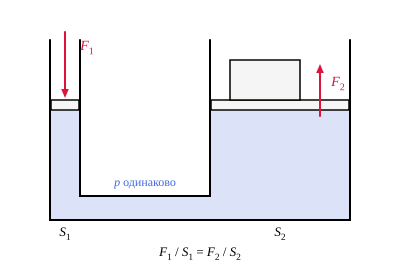

Надуй воздушный шарик и сожми его ладонью с одной стороны. Он раздуется не только там, где ты давишь, а во все стороны. Набери воду в шприц, проткни в нём несколько дырочек и надави на поршень — струйки брызнут во все стороны одинаково. Давишь в одну сторону, а давление расходится во все. В этом уроке разберёмся, почему, и узнаем, как это помогает поднимать автомобиль одной рукой.

## Закон Паскаля

Частицы жидкости и газа подвижны. Надави на них с одной стороны — они толкают соседей со всех сторон, те — своих соседей, и так по всему объёму. Твёрдое тело так не умеет: надави на кирпич сверху — он давит только вниз.

**Закон Паскаля:** давление, которое создают на жидкость или газ, передаётся в каждую точку жидкости или газа без изменения.

Поэтому в уроке 9.2 атмосферное давление на поверхность озера доходит до дна: вода передаёт его вниз, и на глубине давления складываются.

Жидкости почти не сжимаются. Надави на поршень шприца, зажав выход пальцем, — вода не поддастся. Поэтому жидкость передаёт давление сразу, как жёсткий стержень, но во все стороны.

Проверь себя: в бутылке с водой давление на дне 3 кПа. Сверху в горлышко вставили пробку и надавили на неё, создав дополнительное давление 2 кПа. Каким стало давление на дне?

Дополнительное давление передаётся во все точки без изменения, в том числе на дно: $3 + 2 = 5\ \text{кПа}$.

## Гидравлический пресс

Возьмём два цилиндра разной ширины, соединим их трубкой и нальём жидкость. Сверху поставим поршни.

Надавим на малый поршень площадью $S_1$ силой $F_1$. Под ним появится давление $p = F_1/S_1$. По закону Паскаля такое же давление будет под большим поршнем. А там площадь $S_2$ больше, поэтому сила

$$
F_2 = p S_2 = F_1 \frac{S_2}{S_1}.
$$

Обычно записывают так: давления под поршнями равны,

$$
\frac{F_1}{S_1} = \frac{F_2}{S_2}.
$$

**Выигрыш в силе** — во столько раз, во сколько большой поршень больше по площади. Так работают домкраты, гидравлические прессы, тормоза автомобиля, ковш экскаватора.

**Пример.** Площадь малого поршня $4\ \text{см}^2$, большого — $100\ \text{см}^2$. На малый давят силой $80\ \text{Н}$. Большой поршень в $100/4 = 25$ раз больше, поэтому

$$
F_2 = 80 \cdot 25 = 2000\ \text{Н}.
$$

Площади здесь можно не переводить в квадратные метры: в формулу входит только их отношение, а оно в любых единицах одно и то же.

<pp-task id="ks-hydro-03"></pp-task>

## За выигрыш в силе платим путём

В уроке 8.3 мы видели золотое правило механики: выиграл в силе — проиграл в пути. Пресс тоже ему подчиняется.

Жидкость не сжимается. Сколько её ушло из-под малого поршня, столько пришло под большой: $S_1 h_1 = S_2 h_2$, где $h_1$ и $h_2$ — на сколько сдвинулись поршни. Большой поршень в $25$ раз шире — значит, поднимется в $25$ раз меньше.

В примере выше: если малый поршень опустился на $40\ \text{см}$, большой поднимется на $40/25 = 1{,}6\ \text{см}$. Поэтому домкратом качают много раз, чтобы чуть-чуть поднять машину.

Проверь себя: у пресса большой поршень в 25 раз больше малого по площади. Малый опустили на 10 см. На сколько поднялся большой?

В $25$ раз меньше: $10/25 = 0{,}4\ \text{см} = 4\ \text{мм}$.

<pp-task id="ks-hydro-10"></pp-task>

## Частые ловушки

- **Делят на отношение площадей вместо умножения.** На большом поршне сила больше: $F_2 = F_1 \cdot S_2/S_1$.
- **«Силы под поршнями равны».** Равны давления, а не силы.
- **Перепутали площадь и диаметр.** Если даны диаметры, площади относятся как квадраты диаметров: вдвое шире — вчетверо больше площадь.
- **Подставили массу груза вместо силы.** Поршень держит вес груза $mg$.

## Коротко

- Закон Паскаля: давление на жидкость или газ передаётся во все точки без изменения.
- Гидравлический пресс: $F_1/S_1 = F_2/S_2$ — давления под поршнями равны.
- Выигрыш в силе — во столько раз, во сколько больше площадь; во столько же раз проигрываем в пути.

Дальше — урок 9.4: почему вода в носике чайника стоит на том же уровне, что и в самом чайнике?
