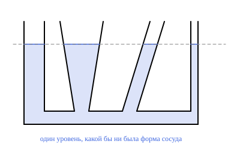
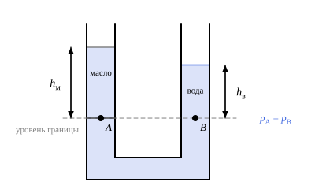

Налей воду в чайник. Посмотри сбоку: в носике она поднялась ровно до того же уровня, что и в самом чайнике. Не выше и не ниже, хотя носик узкий и кривой, а чайник широкий. Строители так проверяют, ровно ли стоит стена: берут длинную прозрачную трубку с водой и смотрят на уровни на её концах. В этом уроке поймём, почему уровни одинаковые и когда они бывают разными.

## Одна жидкость — один уровень

**Сообщающиеся сосуды** — сосуды, которые соединены между собой снизу. Чайник и носик, лейка и её трубка, шлюз на реке.

Почему уровни равны? Посмотри на воду в соединительной трубке внизу. Она покоится. Значит, слева и справа на неё давят одинаково — иначе она потекла бы туда, где давление меньше. Давление на глубине — это $\rho g h$ (урок 9.2). Жидкость одна и та же, плотность одна. Раз давления равны, то и высоты столбов над трубкой равны.

Форма сосудов не важна: давление зависит только от глубины, а не от того, широкий сосуд или узкий, прямой или наклонный.

Если долить воды в один сосуд, уровень там на мгновение станет выше. Давление внизу с этой стороны станет больше, и вода перетечёт в другие сосуды, пока уровни снова не сравняются.

Проверь себя: у чайника носик ниже, чем край крышки. Можно ли налить чайник доверху?

Нет. Как только вода в чайнике дойдёт до уровня края носика, в носике она будет на том же уровне — и начнёт выливаться. Чайник наполнится только до высоты носика.

## Разные жидкости

Нальём в U-образную трубку воду, а потом в левое колено — масло. Масло легче воды и в ней не тонет, оно останется сверху в левом колене. Уровни теперь разные: масло стоит выше воды в правом колене.

Как найти уровни? Проведём горизонталь через **границу раздела** масла и воды. Ниже неё в обоих коленах только вода, и она покоится. Значит, на уровне границы давления в коленах равны: $p_A = p_B$.

- В точке $A$ давит столб масла: $\rho_{\text{м}} g h_{\text{м}}$.
- В точке $B$ давит столб воды: $\rho_{\text{в}} g h_{\text{в}}$.

Приравниваем и сокращаем $g$:

$$
\rho_{\text{м}} h_{\text{м}} = \rho_{\text{в}} h_{\text{в}}.
$$

Высоты отсчитываются **от уровня границы раздела вверх**, а не от дна. Чем легче жидкость, тем выше её столб.

**Пример.** В U-образной трубке ртуть плотностью $13\,600\ \text{кг/м}^3$. В левое колено налили воду, столб воды над границей $68\ \text{см}$. На какую высоту над этой границей поднимется ртуть в правом колене?

$$
h_{\text{рт}} = \frac{\rho_{\text{в}} h_{\text{в}}}{\rho_{\text{рт}}} = \frac{1000 \cdot 68}{13\,600} = 5\ \text{см}.
$$

Ртуть в $13{,}6$ раза тяжелее воды, и её столб во столько же раз ниже. Сантиметры здесь можно не переводить: обе высоты в одних единицах.

<pp-task id="ks-hydro-04"></pp-task>

Иногда спрашивают не высоту над границей, а насколько один уровень выше другого. Тогда найди обе высоты от границы и вычти.

<pp-task id="ks-hydro-11"></pp-task>

## Частые ловушки

- **Высоты от дна.** Отсчитывай от уровня границы раздела жидкостей.
- **Перепутали плотности местами.** Проверь здравым смыслом: лёгкая жидкость должна стоять выше.
- **Ответили высотой над границей, а спрашивали разницу уровней.** Это разные вопросы.
- **«В узком колене вода выше».** Одна жидкость в сообщающихся сосудах всегда стоит на одном уровне.

## Коротко

- Сообщающиеся сосуды соединены снизу; однородная жидкость в них стоит на одном уровне при любой форме.
- Разные жидкости: на уровне границы раздела давления равны, $\rho_1 h_1 = \rho_2 h_2$.
- Высоты — от границы раздела вверх; лёгкая жидкость стоит выше.

Дальше — урок 9.5: давление снизу больше, чем сверху. Что это значит для тела, погружённого в воду?
