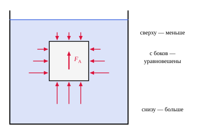

Попробуй утопить в воде надувной мяч — он рвётся наверх, и чем глубже его толкаешь, тем сильнее. Товарища, которого на берегу едва оторвёшь от земли, в воде поднимаешь легко. Камень, подвешенный к динамометру, в воде весит меньше, чем в воздухе. Вода выталкивает всё, что в неё погружают. В этом уроке поймём, откуда берётся эта сила и как её посчитать.

## Откуда выталкивающая сила

Опустим в воду кубик и посмотрим, как вода давит на каждую его грань. Давление растёт с глубиной (урок 9.2) и действует во все стороны.

- **С боков.** На левую и правую грани на одной глубине давят одинаково, навстречу друг другу. Эти силы уравновешены.
- **Сверху.** Верхняя грань выше — давление там меньше, сила толкает кубик вниз.
- **Снизу.** Нижняя грань глубже — давление больше, сила толкает кубик вверх.

Снизу давят сильнее, чем сверху. Разность этих сил и есть **выталкивающая**, или **архимедова**, сила $F_{\text{А}}$. Она направлена вверх.

**Пример.** Кубик с ребром $10\ \text{см}$ погружён в воду, верхняя грань на глубине $10\ \text{см}$. Площадь грани $S = 0{,}01\ \text{м}^2$.

- Сверху: глубина $0{,}1\ \text{м}$, давление $1000 \cdot 10 \cdot 0{,}1 = 1000\ \text{Па}$, сила $1000 \cdot 0{,}01 = 10\ \text{Н}$ вниз.
- Снизу: глубина $0{,}2\ \text{м}$, давление $2000\ \text{Па}$, сила $20\ \text{Н}$ вверх.
- Выталкивающая сила: $20 - 10 = 10\ \text{Н}$ вверх.

## Закон Архимеда

Посчитаем то же в общем виде. Пусть высота кубика $a$, площадь грани $S$. Снизу давление больше на $\rho_{\text{ж}} g a$ — на столько глубже нижняя грань. Значит,

$$
F_{\text{А}} = \rho_{\text{ж}} g a S = \rho_{\text{ж}} g V,
$$

потому что $aS = V$ — объём кубика. В примере: $1000 \cdot 10 \cdot 0{,}001 = 10\ \text{Н}$, сошлось.

Это верно для тела любой формы. **Закон Архимеда:** на тело, погружённое в жидкость или газ, действует выталкивающая сила, направленная вверх:

$$
F_{\text{А}} = \rho_{\text{ж}} g V_{\text{погр}}.
$$

- $\rho_{\text{ж}}$ — плотность **жидкости**, а не тела;
- $V_{\text{погр}}$ — объём **погружённой части** тела, $\text{м}^3$.

Заметь: $\rho_{\text{ж}} V_{\text{погр}}$ — масса жидкости в объёме погружённой части, а $\rho_{\text{ж}} g V_{\text{погр}}$ — её вес. Поэтому закон часто говорят так: **выталкивающая сила равна весу жидкости, вытесненной телом.**

## От чего она зависит и от чего нет

Из формулы видно:

- **зависит** от плотности жидкости: в солёной воде выталкивает сильнее, чем в пресной;
- **зависит** от погружённого объёма: чем больше тела под водой, тем больше сила;
- **не зависит** от плотности и массы тела: стальной и алюминиевый бруски одного объёма выталкиваются одинаково;
- **не зависит** от глубины, когда тело уже целиком под водой: давление и сверху, и снизу растёт одинаково, а разность остаётся той же.

Попробуй сам. Опускай динамометр, и брусок будет уходить в жидкость. Пока он погружается, архимедова сила растёт, а динамометр показывает всё меньше. Когда брусок целиком под водой, всё перестаёт меняться, как глубоко его ни опускай. Весы под сосудом пока не трогай: о них урок 9.7.

<pp-archimedes body="al" rho="1000" s="0">Модель: брусок объёмом 500 см³ на динамометре опускают в сосуд с жидкостью. Пока брусок погружается, архимедова сила ρж·g·Vпогр растёт, а показание динамометра падает. Когда брусок целиком в жидкости, они больше не меняются.</pp-archimedes>

Поменяй плотность жидкости — архимедова сила изменится. А теперь поставь плотность $800$ (керосин) и сравни алюминиевый брусок с ледяным. Опусти каждый целиком: архимедова сила одна и та же, ведь объём у них одинаковый. Динамометр показывает разное, потому что разная сила тяжести. А в воде лёд ведёт себя иначе — почему, узнаешь в уроке 9.6.

Проверь себя: камень объёмом 600 см³ лежит на дне озера. Какая архимедова сила на него действует? Плотность воды 1000 кг/м³.

$V = 600 \cdot 10^{-6} = 6 \cdot 10^{-4}\ \text{м}^3$, $F_{\text{А}} = 1000 \cdot 10 \cdot 6 \cdot 10^{-4} = 6\ \text{Н}$. Что камень лежит на дне, не важно: он весь в воде.

<pp-task id="ks-hydro-06"></pp-task>

## Тело погружено не целиком

Если в воде только часть тела, выталкивает только эта часть. Под водой половина объёма — архимедова сила вдвое меньше, чем при полном погружении. В формулу подставляй объём **погружённой части**.

Закон Архимеда работает и в газах. Воздушный шар выталкивает воздух — поэтому шар с горячим воздухом или гелием поднимается. Но плотность воздуха в $800$ раз меньше, чем воды, и для обычных предметов эта сила незаметна.

<pp-task id="ks-hydro-12"></pp-task>

## Частые ловушки

- **Подставили плотность тела.** В закон Архимеда входит плотность жидкости.
- **Взяли весь объём тела**, когда оно погружено частично.
- **Не перевели объём.** $1\ \text{см}^3 = 10^{-6}\ \text{м}^3$, $1\ \text{л} = 10^{-3}\ \text{м}^3$.
- **«Глубже — сильнее выталкивает».** Пока тело целиком под водой, глубина не важна.
- **«Тяжёлое тело выталкивается сильнее».** Масса тела в формулу не входит.

## Коротко

- Снизу жидкость давит на тело сильнее, чем сверху: получается выталкивающая сила вверх.
- Закон Архимеда: $F_{\text{А}} = \rho_{\text{ж}} g V_{\text{погр}}$ — вес вытесненной жидкости.
- Зависит от плотности жидкости и погружённого объёма; не зависит от материала тела и от глубины.

Дальше — урок 9.6: почему одни тела тонут, а другие плавают?
